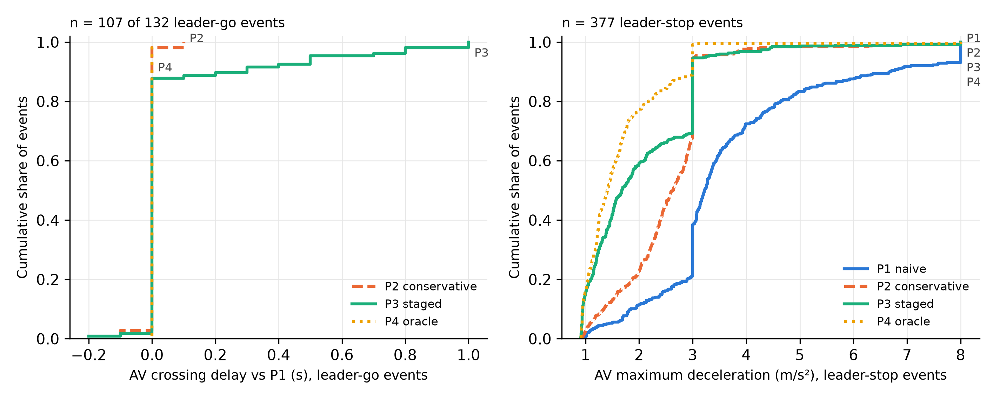

# FINDINGS — 확인한 것 vs 추측 (2026-10-11)

표기: **[확인]** 파일·코드 실행으로 직접 검증 / **[추측]** 근거는 있으나 미검증 / **[외부]** 문서·서브에이전트 조사 결과를 인용, 일부만 재확인.

## SinD (공개 샘플, SOTIF-AVLab/SinD @ `data/raw/sind/SOURCE_COMMIT`)

| 항목 | 내용 | 등급 |
|---|---|---|
| 샘플 구성 | 4개 도시 × 1개 녹화: Changchun(Pudong), Chongqing(NR), Tianjin, Xi'an(Shanglin). 각 15–26분 | 확인 |
| 궤적 | `Veh_smoothed_tracks.csv`, 10 Hz(100.1 ms), x/y [m], vx/vy, a_lon, heading, length/width. heading ≈ atan2(vy,vx) (중앙값 차 < 0.2°) | 확인 |
| 신호 코드 | **0 = 적, 1 = 녹, 3 = 황** (`Format.md` 81행 + 모든 파일에서 전이 1→3→0) | 확인 |
| 황색 길이 | ≈ 3.0 s (모든 교차로, Xi'an 포함 — 아래 fps 문제 보정 후). **단, 창춘 light_1(N·S)은 기록상 2.0–4.2 s로 흩어짐** (아래 "외부 시험" 절, 2026-10-12) | 확인 |
| 신호 CSV 형식 | 변화가 있을 때만 한 줄인 이벤트표 | 확인 |
| **시간 정렬** | 신호 CSV의 `timestamp(ms)`가 궤적 `timestamp_ms`와 같은 시계. RawFrameID 기준 정렬은 녹화별로 0/30/65/90 s 어긋남 | 확인 (적신호 통과율 검정: cc 1.5%, cqNR 3.8%, tj 4.3%, xasl 7.7% vs RawFrameID 정렬 21/55/4/41%) |
| Xi'an 원본 fps | 59.94 fps (나머지 29.97). 첫 행 timestamp 결측, 중복·역순 행 존재 → 보간·정렬 | 확인 |
| Xi'an 잔여 오프셋 | 최적 +4.5 s(4.0%) vs 0 s(7.7%) — 수 초 어긋남 가능 | 추측 |
| 정지선 | 4개 지도 모두 `type=stop_line` way 4개. UTM(원점 0,0) 투영 후 궤적과 일치 | 확인 (그림 `results/sind/map_*.png`) |
| 신호→접근로 매핑 | 4곳 모두 N/S → light_1, E/W → light_2. 공식 JSON과 cc, xasl, tj 일치; cqNR은 이름 체계가 달라 비교 불가 | 확인 (cqNR 제외) |
| 이벤트 수 | cc 69 (stop 36 / go 33), xasl 1, cqNR 0, tj 0 | 확인 |
| 이벤트가 적은 이유 | 필터를 풀어도 황색 시 상류에서 움직이는 자동차가 cqNR 3, tj 3, xasl 5대뿐 → 교통량·상류 시야 부족 | 확인 |
| LOIO 가능성 | 샘플로는 불가 (사용 가능한 교차로 1곳) | 확인 |
| 창춘 결과 | MLP/LR이 규칙보다 유의하게 높음 (macro-F1 +0.12~0.18, 주기 bootstrap 95% CI > 0). LSTM은 τ=0/0.5에서 유의하지 않음 | 확인 (n=69, 1곳이라 일반화 불가) |
| 규칙이 지는 이유 | 규칙의 stop recall 0.56 — `d/v < t_r`인데도 멈추는 운전자가 많음 | 확인(수치) / 원인 해석은 추측 |

## NGSIM

| 항목 | 내용 | 등급 |
|---|---|---|
| Lankershim (data.transportation.gov) | 지원 데이터 ZIP(`Lankershim-Boulevard-LosAngeles-CA.zip`, 80,179,421 B)이 서버에서 잘려 zip으로 열리지 않음. 2026-10-11 재다운로드해도 같은 크기 · 같은 상태 | 확인 (`BadZipFile`, `unzip -l`: central directory 없음) |
| Lankershim (대체 출처) | **Wayback Machine 사본**: 옛 NGSIM 커뮤니티 사이트의 `Lankershim-Main-Data.zip` (`https://web.archive.org/web/20150324165048id_/http://ngsim-community.org/Lankershim-Main-Data.zip`, 2015-03-24 캡처, 2026-10-11 받음). 375,226,084 B, sha256 `d615aae8…7240c`. 공식 배포처(data.transportation.gov)가 아니라 보관 사본이다 | 확인 (`unzip -t`: 122개 항목 모두 OK, "No errors detected") |
| Lankershim 신호 형식 | 위 ZIP의 `signal-timing/real-time-split-monitor-reports/RSM*-061605.txt`(교차로 10곳): LADOT ATSAC 주기별 리포트. 주기마다 한 줄(시작 시각 1 s 단위, 주기 길이, 위상별 녹색 split 초). 황색 · 적색 시작 시각과 프레임 번호는 없음 | 확인 (파일 내용) |
| Lankershim 신호-궤적 동기화 | `metadata.htm`: 0830-0845 궤적 시작 = RSM 8:27:34, 0845-0900 = 8:44:34 | 외부 (같은 ZIP의 문서) |
| Lankershim split 정의 | RSM split = **녹색 시간만** (황색·전적색 제외). 근거: 주기 = 서비스된 위상들의 split 합 + 위상당 약 5 s. 예: RSM086 00:03:12, 링 A 0+84+9+12 = 105, 3개 위상 × 5 s = 120 = 주기. int086 φ4 황색 3.9 + 전적색 1.1 = 5.0 s, int089 φ2/φ6 황색 3.5 + 전적색 1.0 s (timing sheet p.2) | 확인 (RSM 수치 + 시트) |
| Lankershim 위상→접근로 | timing sheet p.1: Lankershim 직진 = **φ2/φ6**. 087·089·090은 φ2 = 남향·φ6 = 북향, 088은 φ2 = 북향·φ6 = 남향. 086은 φ3 = 남향(+좌회전), φ4 = 북향. 089 시트 'F-Lag Phs .2.4.6.8' → 링 순서 φ1→φ2, φ5→φ6 (좌회전 선행). 091 시트는 안 읽음(φ2 = 남향 가정) | 확인 (091은 추측) |
| Lankershim int_id ↔ RSM | 신호 위치도와 적신호 통과율로 **int2 = RSM089 (Main St)** 확정. 남→북 순서상 int1 = 088 (Universal Hollywood Dr), int3 = 090 (James Stewart/Valley Heart), int4 = 091 | int2 확인 (적신호 통과율 북향 2.6% / 남향 1.5%), 나머지 추측 |
| Lankershim 황색 시작 계산 | 모형: RSM 행 시각 = 주기 시작, φ1/φ5 선행. 황색 = 시작 + (선행 좌회전 녹색 + 정리시간) + φ2/6 녹색. RSM 시각 → 궤적 프레임은 metadata의 동기(frame 0 = RSM 8:27:34 / 8:44:34, 궤적 시계와 약 26 s 차이) 사용. **int2(089)만 맞는다**: 오프셋 0에서 적신호 통과율 2.6% / 1.5%. int1(088) 30–68%, int3(090) 22–23%, int4(091) 15–92%로, ±60 s 오프셋 스캔으로도 9–45%까지만 내려감 → 위상 순서(088 OLA, 090 LAG 등)나 행 시각의 의미가 교차로마다 다른 것으로 보임 | 확인 (수치) / 원인은 추측 |
| Lankershim 신호 시각 불확실성 (int2) | 적신호 통과율 최소 1.4%(k = +4.6 s). 최소 + 1%p 이내 범위는 **k = −3.6 ~ +5.0 s**. 녹색 출발(선두 9대만 사용 가능): 계산된 녹색 대비 출발 중앙값 4.07 s (IQR 3.3–4.8) → 반응 0.5–2 s 가정 시 k = −3.6 ~ −2.1 s. 정리하면 **수 초(약 ±4 s) 불확실**하고, 녹색 출발 기준으로는 계산된 신호가 2–3.5 s 이르다. RSM 자체도 1 s 단위 | 확인 (수치) / 해석은 추측 (선두 9대, 정체로 출발이 늦을 수 있음) |
| Lankershim 이벤트 수 (int2만, 기존 파이프라인) | 정지선은 정지 차량 q95로 추정 (CAD .dwg는 읽을 도구가 없어 안 씀). k = 0: **123건 (정지 108 / 통과 15; 북향 94, 남향 29)**. k = −3.6 s: 102건 (89/13), k = +5.0 s: 113건 (101/12). 모델 비교는 안 함 | 확인 |
| Lankershim int2 규칙 vs LR·MLP (`scripts/lankershim_eval.py`) | 오프셋 3개 × τ 3개 = 9개 조건. 분할은 반복 층화 5-fold(황색 주기 단위 그룹, `StratifiedGroupKFold`, seed 20개)이고 LSTM은 제외. macro-F1(seed 평균): 규칙 0.70–0.86, LR 0.66–0.83, MLP 0.62–0.77. **9개 조건 모두 규칙이 1위**다. LR과 MLP는 k = −3.6 / 0 s에서 LR > MLP, k = +5.0 s에서 MLP > LR로 바뀐다. 주기 bootstrap(2000회, seed 평균 차이)에서 모델이 규칙보다 유의하게 나은 조건은 0개다. 유의하게 나쁜 조건(95% CI < 0)은 LR 4개(k=0 τ0·τ0.5, k=+5 τ0.5·τ1), MLP 3개(k=−3.6 τ0.5, k=0 τ0.5·τ1)다. 결과: `results/ngsim_lankershim/eval/` | 확인 (수치) |
| Lankershim int2 평가의 한계 | 교차로 1곳, 21개 주기, 통과 12–15건(전체의 11–12%). macro-F1은 통과 클래스 F1에 크게 좌우되므로 통과 1–2건만 바뀌어도 값이 움직인다. 일반화(LOIO)는 평가하지 않았다. 신호 오프셋이 ±4 s 불확실해 라벨 자체가 바뀐다(102–123건). 규칙이 1위라는 것은 '이 교차로·이 데이터에서 학습 모델의 이득이 보이지 않는다'까지만 말해 준다. 이유 해석 — 정체로 대부분 정지하는 상황이라 등속 규칙이 잘 맞고, 학습 모델은 class weight 때문에 통과를 과대 예측한다(LR stop recall 0.79–0.90 < 규칙 0.85–0.96) — 은 [추측] | 확인 (규모) / 해석 추측 |
| Peachtree 신호 | 접근로별 signal-change 로그: 주기마다 BG/BY/BR(녹/황/적 시작) 프레임 번호. 황색 3.6 s(10th), 3.2 s(나머지) | 확인 |
| Peachtree 궤적 | 10 Hz, ft·ft/s. `local_y` = 차량 **앞범퍼 중심** 종방향 위치 (북쪽 증가). direction 2=NB, 4=SB; movement 1=직진 | 확인 (`local_y` 정의는 Lankershim 메타데이터 PDF, Peachtree도 같은 형식으로 가정 — 추측) |
| 두 시간대 구분 | `global_time - 100·frame_id` 값 2개 → 12:45–13:00 / 16:00–16:15 | 확인 (값 2개) |
| 시간대 ↔ 신호 파일 짝 | 1163018600 → 1245-0100, 1163030300 → 0400-0415 | 확인 (반대로 짝지으면 적신호 통과율 43% vs 11.5%) |
| **신호-궤적 프레임 정렬** | "신호 프레임 = 궤적 frame_id + k" 가정. k = 0에서 적신호 통과율 11.5%(전체)/4.3%(5 m/s 이상), 최소는 k ≈ −1.0~−2.0 s (2.9%) | 추측 — 문서 없음. 데이터로 ±1.5 s 범위까지만 좁혀짐 |
| 녹색 출발로 정렬 재검토 (`scripts/ngsim_green_start.py`) | 적신호에 정지선 0–8 m 앞에 서 있던 차로별 선두 차량 107대의 출발 시점(정지 위치에서 0.25 m 벗어난 순간) − 로그상 녹색: 중앙값 1.66 s, IQR 0.85–3.10 s, 범위 −1.7–5.9 s. 주기별 최초 출발만 봐도 IQR 0.83–2.85 s. k = R − 지연이라 반응시간 R(0.5–2 s 가정)에 따라 k = −1.2~+0.3 s → **기존 ±1.5 s보다 좁혀지지 않음**. 시간대별 중앙값은 0400-0415 2.35 s, 1245-0100 1.04 s로 1.3 s 차이. 시간대별 적신호 통과율 최소점은 −1.5~−2.0 s / −1.0 s | 확인 (수치) |
| **한계: 시간대별 어긋남** | 위 결과는 두 시간대의 신호 로그 시계가 서로 다르게 어긋나 있을 가능성을 시사한다(1245-0100은 k = −1.0 s면 R ≈ 0 s로 비현실적, 일부 선두 차량이 로그상 녹색보다 먼저 출발). 반응시간을 독립적으로 알 수 없어 이 데이터로는 가를 수 없음 → k = 0 본 실험 + k = −1.5 s 민감도 분석 유지 | 추측 |
| 정지선 | 데이터에 없음 → 적신호 중 정지한 직진 차량 앞범퍼 위치의 q95로 추정. int_id 경계보다 2–4 m 하류. 14th SB는 정지 차량 0 → 경계+평균오프셋으로 대체 | 추측 (CAD `.dwg`로 검증 필요) |
| 속도/가속도 | 원본 v_acc는 ±12.27 ft/s²에서 잘림 → Savitzky-Golay(1.1 s, 3차)로 위치에서 재계산 | 확인 (잘림은 서브에이전트 조사, 재계산은 코드) |
| 이벤트 수 (k=0) | 203 (stop 71 / go 132; go 중 적색 시작 후 통과 36). 10th 63, 11th 43, 12th 83, 14th 14. 82%가 선행차 있음 | 확인 |
| 결과 (k=0, LOIO) | macro-F1: 규칙 0.82–0.83, LR 0.82–0.86, MLP 0.81–0.86, LSTM 0.80–0.83. **규칙 대비 모든 차이의 95% CI가 0을 포함** | 확인 |
| 결과 (k=−1.5 s) | 이벤트 196 (stop 108 / go 88). 규칙 0.86–0.87이 최고, MLP는 τ=0.5에서 규칙보다 유의하게 낮음 | 확인 |
| **결론의 민감도** | 신호 정렬 ±1.5 s가 라벨 분포와 모델 순위를 바꾼다 → NGSIM 결과는 "LSTM이 규칙보다 낫다는 증거 없음" 이상으로 해석 불가 | 확인 |

## 데이터 후보 (외부 검증용, 2026-10-11 점검)

원자료는 `data/raw/{waterloo,fluid}/`(gitignore)에 있고, 출처는 각 폴더의 `SOURCE.txt`(주소, 받은 날짜, 크기, sha256)에 적었다. 두 압축 모두 `unzip -t`에서 오류가 없었다.
코드: `src/dzp/waterloo.py`, `src/dzp/fluid.py`(둘 다 SinD `Recording` 형식으로 변환), `scripts/waterloo_check.py`, `scripts/fluid_visibility.py`, `scripts/fluid_check.py`. 이벤트 등 파생 결과는 `data/raw/{waterloo,fluid}/results/`(gitignore)에만 둔다.

| 항목 | A. Waterloo Multi-Agent: Intersection (캐나다) | B. FLUID, Xuancheng (중국, Sci. Data 2026) | 등급 |
|---|---|---|---|
| 이용 조건 | **[확인 안 됨]**: 데이터셋 페이지에 라이선스·이용 조건 문구가 없음('licen', 'copyright', 'permission', 'non-commercial' 검색 0건) | **CC BY 4.0** (figshare 메타데이터) | 확인 |
| 크기 | DB zip 610,803,071 B(받음, 풀면 SQLite 14개·4.76 GB), 영상 zip 4,673,980,140 B(안 받음) | 전체 17.7 GB. 받은 것: `derived_data.zip` 1개(30,932,517 B, md5가 figshare와 일치) = **TI 교차로**(영상 3개, 약 79분). 나머지 derived_data 2개(215.6 / 96.5 MB, FI·FIDRT로 추정)와 영상 3개(3.6–7.3 GB)는 안 받음 | 확인 |
| 궤적 | 드론 1시간(파일 14개, 각 200–291 s), 29.97 fps, UTM 17T [m], SPEED는 km/h(변위 속도 대비 3.59배), ANGLE은 heading [rad]. **TRACK_LENGTH는 14개 파일 모두 NULL** → 차종별 명목 길이(승용 4.5, 중형 8, 대형·버스 12 m) 사용 [가정]. 3프레임마다 뽑아 0.1001 s 간격으로 맞춤 | 드론, 10 FPS, `time` = frame/10 s(영상 시계), 지역 tmerc [m], 속도·yaw 제공(yaw = atan2(vy, vx)) | 확인 |
| 황색 표시 | `TRAFFIC_LIGHTS` 이벤트표, 이동류별(L_<출발>_<도착>) **G / Y / R**. 황색은 대부분 4.0 s(직진 신호 148회 중 134회; 3.0 s 8회, 5.17–7.0 s 6회) | `signal` CSV, 방향·회전별 **G / y / r**, begin/end. 황색 **3 s**(332회 모두) | 확인 |
| 시간 해상도 | 영상 프레임 단위(예: 32.866167 s) | **1 s 단위**(README "accurate to the second", begin/end 모두 정수) | 확인 |
| 궤적과 같은 시계 | 둘 다 "파일 녹화 시작 후 초"(문서) | 둘 다 영상 시각(README) | 확인 (문서) |
| 위상↔접근로 | 신호 열 이름 자체가 이동류(출발→도착)라 매핑이 필요 없음. 자동 추정(`infer_light_map`)은 14개 중 9개 파일에서 문서와 달랐음(N/S와 W/E 신호가 94% 같은 값이라 구분이 안 됨) → 문서 매핑 사용 | `direction`의 의미(출발 방향 vs 진행 방향)는 문서로 불분명. 적신호 통과율 행렬로 정함: W·E 진입 직진 → E_s(= W_s = W_l, 시간 동일), N 진입 → N_l(= N_s) | 확인 (B는 데이터로 결정) |
| 정지선 | `stop_line` 유형 없음 → 접근로별 교차로 진입 경계(`entry_boundary` l_<출발>_*) 사용. 정지한 차량 앞범퍼의 2% 분위가 경계 앞 −0.7~+1.4 m(파일별 중앙값 0.4 m) → 정지선과 맞음 [추측: 이름상 '진입 경계', 정지선 표기는 없음] | 지도(TI.osm)에 `type=stop_line` 3개. README의 tmerc로 투영하면 정지 차량 중심이 선 앞 1.6–2.3 m(차 길이 절반) → 일치 | A 추측 / B 확인 |
| 보이는 상류 길이 | 정지선 앞 99% 분위: N·S **약 9 m**, W·E 약 32–34 m | 99% 분위: W 39 m, N 34 m, E 23 m | 확인 |
| 적신호 통과율 (직진) | 오프셋 0에서 **2.0%**(파일별 0–4.3%). 최소 1.6%(−0.7 s). 최소 + 1%p 범위 −3.0~+0.4 s | 오프셋 0에서 영상 1: 5.2%, 영상 2: 4.0%, **영상 3: 15.2%**. 영상 1·2는 −1.5 s / −3.0 s에서 3.0%, 범위 −2.0~−0.5 / −4.0~−0.5 s. 영상 1·2의 적신호 통과는 대부분 적색 끝 1–3 s(녹색 직전 출발) → 신호 기록이 약 1–2 s 늦다 [추측]. 영상 3은 적색 전체에 퍼져 있고 어떤 오프셋에서도 13.8% 아래로 안 내려감 → 영상 3의 신호 기록 오류 가능성 [추측] | 확인 (수치) |
| 황색 이벤트 (기존 파이프라인) | 14개 파일 합계 **7건 (정지 4 / 통과 3)**, 그중 직진은 1건(통과). 후보 35 중 이력 2 s 부족 27, 우회전 2 | TI 3개 영상, 오프셋 0: **22건 (정지 13 / 통과 9)**, 그중 E–W 직진 17건(통과 6). 오프셋 −1.5 s: 13건 (5 / 8). 후보 54 중 이력 부족 22, 우회전 10 | 확인 |
| 판단 | **확정(2026-10-11): 딜레마존 데이터로 쓰지 않음.** 정지선 앞 가시 거리가 9–33 m라 황색 시점 접근 차량의 2 s 이력과 도달 시간 2.5–5.5 s 구간을 담지 못함. 신호 시계는 정확하지만 더 진행하지 않음 | TI는 이벤트가 너무 적음(약 79분에 22건). FI·FIDRT 결과는 아래 표 | 해석 추측 |

### FLUID 전체 3개 교차로 (TI · FI · FIDRT)

받은 파일: `derived_data` 3개(TI 64179079, FI 64179085, FIDRT 64179082). 모두 figshare MD5와 일치하고 `unzip -t`에서 오류가 없었다. 영상 zip은 안 받았다. 출처는 `data/raw/fluid/SOURCE.txt`에 있다.

**1단계 — 가시 거리와 도달 시간 구간** (`scripts/fluid_visibility.py`, 직진 통과 30건 이상인 접근로)
- 가시 거리 = 정지선 쪽으로 움직이는 직진 차량 앞범퍼의 정지선 앞 거리, 99% 분위.
- 접근 속도 = 보이는 구간에서 한 번도 2 m/s 아래로 내려가지 않은 직진 차량의 정지선 통과 속도 평균.
- 기준: 가시 거리 ≥ 5.5 s × 접근 속도. 즉 도달 시간 2.5–5.5 s 구간 전체가 화면에 들어와야 한다.

| 교차로 | 접근로 | 직진 통과 | 가시 거리 (m) | 접근 속도 (m/s) | 2.5–5.5 s 구간 (m) | 보이는 비율 | 기준 |
|---|---|---|---|---|---|---|---|
| TI | W | 421 | 38.6 | 13.96 | 34.9–76.8 | 0.09 | 미달 |
| TI | E | 428 | 33.6 | 14.14 | 35.4–77.8 | 0.00 | 미달 |
| FI | **W** | 725 | **57.1** | 7.01 | 17.5–38.5 | **1.00** | **통과** |
| FI | **E** | 744 | **47.4** | 6.68 | 16.7–36.7 | **1.00** | **통과** |
| FI | N | 831 | 20.7 | 9.75 | 24.4–53.6 | 0.00 | 미달 |
| FI | S | 638 | 21.0 | 10.93 | 27.3–60.1 | 0.00 | 미달 |
| FIDRT | **E** | 163 | **57.0** | 9.74 | 24.4–53.6 | **1.00** | **통과** |
| FIDRT | W | 181 | 43.0 | 9.10 | 22.8–50.1 | 0.74 | 미달 (부분) |
| FIDRT | S | 286 | 15.9 | 12.97 | 32.4–71.4 | 0.00 | 미달 |
| FIDRT | N | 395 | 14.3 | 12.31 | 30.8–67.7 | 0.00 | 미달 |

등급: 수치는 확인. 접근 속도 정의(정지하지 않은 차량의 통과 속도)는 선택한 정의이고, FI의 7 m/s(약 25 km/h)는 저속 도심 접근이다.

**2단계 — 영상별 신호 검증과 제외** (`scripts/fluid_check.py`, 기준 통과 접근로의 직진 차량만)
- 신호군 선택: 접근로별로 적신호 통과율이 가장 낮은 신호군. FI W·E → `light_E_s`(E_s = E_l = W_s = W_l, 8개 영상 모두 100% 같은 시간). FIDRT E → `light_E_s`. README의 `direction` 의미가 불분명해 데이터로 정했다.
- **제외 기준: 오프셋 0에서 직진 차량의 적신호 정지선 통과율 > 8% → "신호 기록 의심"으로 영상 제외.**

| 교차로 | 영상 | 직진 통과 | 적신호 통과율 | 판정 |
|---|---|---|---|---|
| FI | 20250120_video | 269 | 3.7% | 사용 |
| FI | 20250121_video-1 | 285 | 3.2% | 사용 |
| FI | 20250121_video-2 | 127 | 0.8% | 사용 |
| FI | 20250121_video-3 | 148 | 4.1% | 사용 |
| FI | 20250525_video-1 | 170 | 1.2% | 사용 |
| FI | 20250525_video-2 | 231 | 3.5% | 사용 |
| FI | 20250530_video-1 | 84 | 3.6% | 사용 |
| FI | 20250530_video-2 | 154 | 1.3% | 사용 |
| FIDRT | 20250120_video | 88 | 9.1% | **제외 (신호 기록 의심)** |
| FIDRT | 20250525_video | 17 | 11.8% | **제외 (신호 기록 의심)** |
| FIDRT | 20250526_video | 65 | 9.2% | **제외 (신호 기록 의심)** |
| TI | 20250529_video-3 | 282 | 15.2% | (참고: 1단계 미달이라 대상 아님. 같은 기준이면 제외) |

- **제외된 영상: FIDRT 3개 전부** → FIDRT는 남는 영상이 없다.
- 8%라는 문턱은 SinD·Peachtree의 정상 범위(1.5–4.3%, Xi'an 7.7%) 위로 잡은 경험적 값이다. FIDRT 9–12%가 신호 기록 오류인지, 그 교차로의 실제 적신호 위반(또는 정지선 위치 오차)인지는 가르지 못했다 [추측].

**3단계 — 황색 이벤트 (FI만, W·E 접근로, 기존 파이프라인, 정지선 = 지도 `stop_line`)**
- 대상: 우회전을 제외한 모든 차량. "직진"은 진출 방향이 진입의 반대인 차량이다.

| 교차로 | 영상 | 이벤트 | 정지 | 통과 | 직진만: 이벤트 | 정지 | 통과 |
|---|---|---|---|---|---|---|---|
| FI | 20250120_video | 48 | 24 | 24 | 32 | 14 | 18 |
| FI | 20250121_video-1 | 53 | 35 | 18 | 34 | 23 | 11 |
| FI | 20250121_video-2 | 26 | 20 | 6 | 14 | 10 | 4 |
| FI | 20250121_video-3 | 29 | 22 | 7 | 17 | 13 | 4 |
| FI | 20250525_video-1 | 16 | 10 | 6 | 11 | 6 | 5 |
| FI | 20250525_video-2 | 40 | 18 | 22 | 26 | 11 | 15 |
| FI | 20250530_video-1 | 14 | 12 | 2 | 9 | 8 | 1 |
| FI | 20250530_video-2 | 14 | 5 | 9 | 8 | 2 | 6 |
| **FI 합계** | 8개 영상 | **240** | **146** | **94** | **151** | **87** | **64** |

- 접근로별: E 166건(통과 61), W 74건(통과 33). 황색은 모두 3 s.
- 한계:
  - 신호가 1 s 단위다.
  - 교차로 1곳의 동서 접근로뿐이다.
  - 접근 속도가 약 7 m/s로 낮아 고전적 딜레마존(50–60 km/h)과 성격이 다르다 [추측: SinD 창춘과 비슷한 저속 상황].
  - 좌회전 차량도 같은 신호군(시간 동일)으로 판정했다.
  - 오프셋은 0만 썼다. FI의 영상별 최적 오프셋은 확인하지 않았다.
- 원자료와 이벤트 결과: `data/raw/fluid/results/`(gitignore).

## FLUID FI 벤치마크 — 평가 파이프라인 시험 (2026-10-11)

목적: SinD 전체 데이터가 오면 데이터만 바꿔 끼울 수 있는 평가 파이프라인을 끝까지 한 번 돌려 본다. 하이퍼파라미터 튜닝은 하지 않았다.
- 코드: `scripts/run_benchmark.py`(데이터 경로·fold 방식·신호 오프셋·신호군 매핑·접근로·규칙 B 감속도 문턱·딜레마존 구간이 모두 인자), `src/dzp/{features,bench_models,bench_eval}.py`. SinD 샘플에서도 같은 스크립트가 끝까지 도는 것을 확인했다(직진 56건, `--dataset sind`).
- 결과(집계표·그림): `results/fluid_fi/`(`metrics.csv`, `leadtime.csv`, `offsets.csv`, `counts.json`, `fig1–4`). 이벤트·특징·시퀀스 파일은 `data/raw/fluid/results/benchmark_fi/`(gitignore).

**설정** [확인]
- 데이터: FI W·E 접근로, 8개 영상, 오프셋 0. 이벤트 240건 중 **직진 151건(정지 87 / 통과 64)**, 74개 황색 주기. 좌·우회전 89건은 `events_turning.csv`로 따로 두고 평가에서 뺐다.
- 딜레마존 구간: 황색 시작 시 d/v ∈ [2.5, 5.5] s → 52건(통과 13).
- 특징: d, v, a, t_r, d/v, v²/2d, 앞차(유무·간격·상대속도), 차로(정지선 위 위치를 3.5 m로 나눈 추정값). 모델 입력은 지시대로 LR·MLP = (d, v, a), 시퀀스 모델 = 황색 전 2 s(20스텝)의 (x, y, v, a). x, y는 정지선 기준 접근로 좌표다.
- 모델 6개는 모두 같은 fold를 쓴다: 규칙 A d/v < t_r(t_r은 신호에서 계산, 황색 시작 시 3.0 s), 규칙 B v²/2d > 3.0 m/s², LR, MLP, LSTM(시드 3개 앙상블), Transformer(1층, 시드 3개).
- 평가 방식은 두 가지다.
  - 영상 단위 leave-one-video-out (8 fold)
  - 반복 층화 5-fold (황색 주기 단위 그룹, 5회 반복, 사건별 확률은 반복 평균)
- CI는 황색 주기 단위 cluster bootstrap 1,000회로 구했다.
- 규칙은 확률이 없어 Brier = 오분류율이고, AUROC에는 규칙의 여유값(t_r − d/v, v²/2d − b)을 점수로 썼다. 따라서 Brier에서 규칙이 불리한 것은 지표의 성질이다.

**주요 결과 (leave-one-video-out, 황색 시작 시점)** — 괄호 안은 95% CI, Δ는 규칙 A 대비 차이

| 모델 | macro-F1 전체 | Δ macro-F1 | AUROC 전체 | Brier 전체 | macro-F1 딜레마존(52) | Δ (딜레마존) |
|---|---|---|---|---|---|---|
| 규칙 A d/v < t_r | 0.806 (0.74–0.87) | — | 0.900 | 0.192 | 0.621 (0.46–0.75) | — |
| 규칙 B v²/2d > 3.0 | 0.699 (0.63–0.77) | **−0.106 (−0.20 – −0.01)** | 0.885 | 0.252 | 0.429 | **−0.187 (−0.34 – −0.03)** |
| LR (d, v, a) | **0.864 (0.80–0.91)** | **+0.058 (+0.01 – +0.11)** | **0.928** (Δ +0.028, CI +0.003 – +0.056) | 0.105 | 0.637 | +0.016 (−0.06 – +0.09) |
| MLP (d, v, a) | 0.775 | −0.031 (−0.10 – +0.03) | 0.895 | 0.169 | 0.493 | −0.126 (−0.31 – +0.06) |
| LSTM (x, y, v, a) | 0.822 | +0.018 (−0.04 – +0.08) | 0.873 | 0.131 | 0.612 | −0.008 (−0.13 – +0.10) |
| Transformer | 0.824 | +0.020 (−0.03 – +0.07) | 0.901 | 0.134 | 0.575 | −0.045 (−0.12 – +0.02) |

- 반복 층화 5-fold도 같은 결론이다. LR만 규칙 A보다 macro-F1(+0.052, CI +0.006 – +0.102)과 AUROC(+0.035)가 유의하게 높고, 규칙 B는 유의하게 낮다. 딜레마존 구간에서는 규칙 A를 유의하게 넘는 모델이 없다. [확인]
- **리드 타임** (leave-one-video-out, macro-F1, 시점 −2 / −1 / 0 / +0.5 / +1 s):

| 모델 | −2 s | −1 s | 0 s | +0.5 s | +1 s |
|---|---|---|---|---|---|
| 규칙 A | 0.75 | 0.79 | 0.81 | 0.81 | 0.85 |
| 규칙 B | 0.37 | 0.46 | 0.70 | 0.82 | 0.86 |
| LR | 0.74 | 0.77 | 0.86 | 0.87 | 0.93 |
| MLP | 0.71 | 0.78 | 0.78 | 0.84 | 0.88 |
| LSTM | 0.81 | 0.82 | 0.82 | 0.86 | 0.88 |
| Transformer | 0.75 | 0.78 | 0.82 | 0.86 | 0.93 |

  - 규칙 A는 그 시점의 d, v와 그 시점의 t_r(−2 s면 녹색 잔여 2 s + 황색 3 s = 5 s)로 다시 계산했다.
  - −2 s에서 LSTM이 가장 높지만 CI가 다른 모델과 겹친다(0.74–0.86 vs 규칙 A 0.68–0.81).
  - −2 s에서는 151건 중 42건, −1 s에서는 24건이 2 s 이력을 다 갖지 못해 첫 관측값으로 채웠다. 이 차이가 시퀀스 모델에 유리하거나 불리하게 작용했는지는 확인하지 않았다 [추측].
  - 규칙 B가 황색 전 시점에 무너지는 것은, 멀리 있는 차량은 필요 감속도가 작아 모두 "정지"로 판정되기 때문이다 [추측, 정의상 자연스러움].
- **신호 오프셋 민감도** (leave-one-video-out, 황색 시작 시점; 신호 기록이 1 s 단위라 −1 / 0 / +1 s):
  - 이벤트가 162 / 151 / 136건(통과 89 / 64 / 38)으로 바뀐다. 오프셋에 따라 라벨 분포가 크게 움직인다.
  - macro-F1 순위 (원래 6개 모델 기준):
    - 규칙 A는 세 경우 모두 4위다.
    - LR(d, v, a)은 1 / 1 / 3위, Transformer는 2 / 2 / 2위, MLP는 5 / 5 / 1위다.
    - **"LR·Transformer > 규칙 A > 규칙 B" 관계는 세 오프셋에서 모두 유지된다.** 학습 모델끼리의 순위는 바뀐다.
  - AUROC 순위: LR(d, v, a)이 세 경우 모두 1위다.
  - **(보충) 오프셋별 규칙 A 대비 macro-F1 차이의 95% CI** (`offsets.csv`의 `diff_*` 열):
    - LR(d, v, a): −1 s +0.029 (−0.019 – +0.080), 0 s +0.058 (+0.013 – +0.106), +1 s +0.059 (+0.005 – +0.118). **−1 s에서는 유의하지 않다.**
    - Transformer·LSTM·MLP: 세 오프셋 모두 유의하지 않다. MLP +1 s는 +0.081 (−0.002 – +0.167).
    - 규칙 B: −1 s와 0 s에서 유의하게 낮고(−0.146, −0.106), +1 s에서는 유의하지 않다(−0.025).
    - 즉 "LR > 규칙 A"는 오프셋 0 / +1 s에서만 유의하다. 신호 시각이 1 s 늦게 기록됐다면(−1 s가 맞다면) 그 이득은 유의하지 않다. [확인]

**해석과 한계**
- 이 결과는 **교차로 1곳(FI)의 동서 접근로, 저속 도심(접근 속도 약 7 m/s), 151건**에서 나온 것이다.
  - 처음 보는 교차로에 대한 일반화는 평가하지 않았다. 영상 단위 fold는 같은 교차로 안에서 시간대만 바꾼 것이다.
  - 신호는 1 s 단위라 t_r에 ±0.5 s 오차가 있다.
- 단순한 LR(d, v, a)이 규칙 A보다 조금 낫다(+0.06). 아래 ablation에서 a를 빼면 이득이 사라지므로, (d, v) 경계 자체의 차이보다는 가속도 정보 덕분이다. 처음에는 경계 차이 때문이라고 추측했는데 이 추측은 기각됐다. 그림 `fig2_dv_plane.png`에서는 d = 3v 선 아래(규칙 A가 통과로 판정하는 쪽)에도 정지 차량이 일부 있다.
- **(보충) 가속도 ablation — LR(d, v)** (`metrics.csv`의 `logreg_dv` 행):
  - leave-one-video-out: macro-F1 0.812, 규칙 A 대비 +0.006 (−0.016 – +0.030). AUROC +0.006 (−0.008 – +0.020).
  - 반복 층화 5-fold: −0.000 (−0.020 – +0.020).
  - 오프셋 −1 / +1 s에서도 유의하지 않다(−0.012, −0.002).
  - → **a를 빼면 규칙 A 대비 이득이 사라진다. LR의 이득(+0.058)은 가속도에서 온다** [확인: 수치]. 황색 시작 시점에 이미 감속 중인 차량(예측 가능한 정지)을 a가 구분해 준다는 해석은 [추측]이다. 운전자가 녹색 잔여시간이나 앞차를 보고 먼저 감속했을 수 있다.
- 시퀀스 모델(LSTM·Transformer)은 황색 시작 시점에 순간값 모델보다 낫지 않다. 151건에 시드 3개, 튜닝 없이 돌린 결과라 시퀀스 모델의 가치는 이 데이터로 판단할 수 없다 [추측].
- 딜레마존 구간(52건, 통과 13)은 CI가 넓어 어떤 모델도 규칙 A와 구분되지 않는다. 연구 질문의 핵심 구간이라 SinD 전체 데이터에서 표본을 늘려야 한다.
- 규칙 B(문턱 3.0 m/s²)는 일관되게 가장 나쁘다. 저속 도심에서는 3 m/s²가 너무 높은 문턱일 수 있다 [추측]. 문턱은 인자 `--decel`로 바꿀 수 있지만 튜닝하지 않았다.

## 선두/추종 — 같은 차로의 앞차·뒷차 (FLUID FI, 2026-10-11)

문제 설정을 "주변 차량"에서 "같은 차로의 앞차·뒷차"로 좁혔다. 데이터, 평가 방식(영상 단위 8-fold, 황색 주기 단위 bootstrap 1,000회), 모델은 위 벤치마크와 같다.
- 코드:
  - `src/dzp/features.py`의 `ldr_*` 열.
  - `scripts/run_benchmark.py --split leader|follower|all`: SinD에도 같은 인자로 쓸 수 있다.
  - `scripts/leader_follower.py`: 역할 표, 앞차 특징, 위험 쌍.
- 결과: `results/fluid_fi/leader_follower/`
  - `roles.csv`, `lead_features.csv`, `risk_pairs.csv`, `risk_recall.csv`, `all_trained_by_role.csv`, `fig_risk_recall.png`
  - `leader/`, `follower/`: 분리 평가의 `metrics.csv`, `leadtime.csv`, `offsets.csv`, 그림
- **앞차 정의** [확인: 코드]:
  - 황색 시작 시점에 같은 차로 띠(횡방향 ±1.75 m) 안에서 정지선 쪽으로 가장 가까운 자동차를 앞차로 본다.
  - 그 차가 이미 정지선을 넘었거나 80 m 안에 없으면 이 차량은 **선두**(`ldr_id = −1`)이고, 그렇지 않으면 **추종**이다.
  - `ldr_gap`은 앞차 뒷범퍼에서 이 차량 앞범퍼까지의 거리, `ldr_dv`는 v − v_앞차, `ldr_a`는 앞차의 가속도다.
  - `ldr_label`은 앞차 자신의 정지/통과 결과다. 앞차 궤적에 같은 라벨 규칙(`label_event`)을 적용했다.
  - 앞차가 그 자체로 이벤트인 55건에서는 이 결과가 이벤트 라벨과 55/55 일치했다.
  - 차로는 지도에 없어 3.5 m 띠로 추정했다. 따라서 옆 차로 차량이 섞이거나 같은 차로 차량이 빠졌을 수 있다 [추측].

**1. 선두/추종 분포** [확인]

| 역할 | 건수 | 정지 | 통과 | 통과율 |
|---|---|---|---|---|
| 선두 | 88 | 33 | 55 | 0.63 |
| 추종 | 63 | 54 | 9 | 0.14 |

- 추종 63건의 앞차 정보(중앙값): 간격 7.6 m, 상대속도 +0.4 m/s, 앞차 가속도 −0.2 m/s².
- 추종 통과 9건 중 6건이 한 영상(20250120)에 몰려 있다. 4개 영상은 추종 통과가 0건이다.

**2. 분리 평가** (영상 8-fold, macro-F1, Δ는 규칙 A 대비 차이와 95% CI)

| 모델 | 선두(88, 통과 55) | Δ 선두 | 추종(63, 통과 9) | Δ 추종 |
|---|---|---|---|---|
| 규칙 A | 0.700 | — | 0.700 | — |
| 규칙 B | 0.668 | −0.029 (−0.17 – +0.12) | 0.462 | −0.210 (−0.43 – +0.01) |
| LR (d, v, a) | **0.881** | **+0.185 (+0.08 – +0.29)** | 0.497 | **−0.184 (−0.37 – −0.01)** |
| LR (d, v) | 0.763 | +0.063 (−0.04 – +0.16) | 0.497 | **−0.184** |
| MLP | 0.779 | +0.081 (−0.03 – +0.19) | 0.525 | −0.155 |
| LSTM | 0.856 | **+0.159 (+0.06 – +0.27)** | 0.548 | −0.132 |
| Transformer | 0.856 | **+0.158 (+0.05 – +0.26)** | 0.615 | −0.070 |

- 위 표는 각 부분집합 안에서만 학습한 결과다 [확인].
- 학습 표본 크기의 영향을 떼어 보려고, 151건 전체로 학습하고 역할별로 채점한 결과도 냈다(`all_trained_by_role.csv`) [확인].
  - 선두: LR(d, v, a) +0.155 (+0.05 – +0.25), 유의. LR(d, v) +0.022 (−0.02 – +0.08), 유의하지 않음.
  - 추종: LR(d, v, a) −0.018, LR(d, v) 0.000. 규칙 A와 사실상 같다.
- **핵심 질문의 답:** 선두 차량에서도 LR(d, v, a)의 이득이 유지되고(+0.19), a를 빼면 유의하지 않게 된다.
  - 두 학습 방식에서 모두 같다. 따라서 **"가속도 효과는 앞차 때문이 아니다"** [확인: 수치].
  - 오히려 전체 151건에서 본 LR의 이득은 선두 차량에서 나온다. 추종 차량에서는 어떤 모델도 규칙 A를 넘지 못했다.
- 선두 차량의 오프셋 민감도(`leader/offsets.csv`):
  - LR(d, v, a)은 −1 s에서 +0.110 (−0.01 – +0.23, 유의하지 않음), +1 s에서 +0.232 (유의)다.
  - LR(d, v)은 +1 s에서도 +0.118 (+0.00 – +0.23)로 경계선이다.
  - 즉 오프셋 −1 s에서는 선두 차량에서도 이득이 유의하지 않다. 위 벤치마크의 오프셋 결과와 같은 양상이다 [확인].
- 추종 차량만으로 학습한 모델(통과 9건)은 대부분 "모두 정지"에 가깝게 무너진다. 규칙 A(학습 없음)가 가장 낫다.
  - 이것은 표본이 작은 탓이지 추종 차량의 행동이 예측 불가능하다는 뜻은 아니다 [추측].
  - CI가 넓으므로(규칙 A 0.46–0.89) 그대로 보고한다.
- 선두 차량에서 가속도가 왜 유효한지는 확인하지 않았다 [추측]. 앞차가 없는 운전자는 녹색 잔여시간이나 신호 예측만 보고 황색 전에 이미 감속을 시작하므로, a가 결정을 미리 드러내는 것일 수 있다.

**3. 앞차 특징 추가 (추종 63건만, 영상 8-fold)** (`lead_features.csv`)

| 모델 | macro-F1 | Δ 규칙 A | Δ LR(d, v, a) |
|---|---|---|---|
| LR (d, v, a) + (gap, dv, a_lead) | 0.497 | −0.184 (−0.37 – −0.01) | 0.000 (−0.03 – +0.03) |
| MLP (d, v, a) + (gap, dv, a_lead) | 0.508 | −0.167 (−0.44 – +0.14) | +0.017 (−0.14 – +0.16) |
| LR + 앞차 특징 + **앞차 라벨 [앞차 행동을 안다고 가정]** | 0.694 | +0.014 (−0.23 – +0.26) | **+0.197 (+0.07 – +0.33)** |
| MLP + 앞차 특징 + **앞차 라벨 [앞차 행동을 안다고 가정]** | 0.659 | −0.038 (−0.24 – +0.17) | **+0.146 (+0.02 – +0.28)** |

- 간격·상대속도·앞차 가속도는 추종 차량 예측을 개선하지 못했다 [확인].
- 앞차 라벨을 알면 LR(d, v, a)보다 유의하게 좋아진다. 하지만 학습 없는 규칙 A와 같은 수준에 그친다.
- 앞차 라벨은 황색 시작 시점에는 알 수 없는 미래 정보다. 그래서 이 행은 상한 참고용이다.
  - [추측] 실제로는 앞차의 정지선 통과·감속을 수백 ms~1 s 뒤에 관측하게 되므로, 리드 타임을 늦춘 예측과 비슷한 효과가 있을 것이다.

**4. 추돌 위험 관점: 앞차·뒷차 쌍** (추종 63쌍, `risk_pairs.csv`) [확인]

| 앞차 \ 뒷차 | 뒷차 통과 | 뒷차 정지 |
|---|---|---|
| 앞차 통과 | 9 (14%) | 21 (33%) |
| 앞차 정지 | **0 (0%)** | 33 (52%) |

- **(앞차 정지, 뒷차 통과) 조합은 FI에서 0건이다.** 이 조합에서의 재현율은 정의되지 않는다.
  - 같은 차로 띠에서 정지한 앞차를 지나쳐 통과하는 일은 물리적으로 차로 변경 없이는 어렵다. 0건은 자연스럽다 [추측].
  - 이 조합을 위험 빈도로 쓰려면 차로 변경 차량을 따로 다뤄야 한다.
- 참고로 뒷차 통과 9건 전체에 대한 통과 재현율(`risk_recall.csv`, 영상 8-fold):
  - 전체 학습 모델: 규칙 A·LR(d, v, a)·LR(d, v)·Transformer 3/9, MLP·LSTM 1/9, 규칙 B 0/9.
  - 추종 전용 학습: 앞차 라벨 LR 7/9.
  - 즉 추종 차량의 통과는 대부분 놓친다(9건이라 비율은 불안정).
- 실제 추돌 위험과 더 가까운 조합은 (앞차 통과, 뒷차 정지) 21건(33%)일 수 있다 [추측]. 뒷차가 앞차를 따라 통과할 것으로 예측한 AV가 그 뒤에서 위험해지는 경우다. 이번에는 집계만 했다.

**한계**
- 교차로 1곳, 151건이다. 추종 통과는 9건뿐이라 추종 쪽 결론은 모두 CI가 넓다.
- 차로를 추정한 값이라 앞차 판정에 오류가 있을 수 있다.
- SinD에서는 `--split`와 `leader_follower.py`를 같은 인자로 다시 돌리면 된다.

## 선두 차량 모델끼리 비교 — 기준을 LR(d, v, a)로 (FLUID FI, 2026-10-12)

- 코드: `scripts/model_compare.py --split leader`. 결과: `results/fluid_fi/leader_follower/leader/model_compare/vs_logreg_dva.csv`
- 위 분리 평가와 같은 선두 88건(통과 55)·영상 8-fold·주기 단위 쌍대 부트스트랩(1000회)이다. 기준만 규칙 A에서 LR(d, v, a)로 바꿨다. 튜닝은 하지 않았다.

| 모델 | macro-F1 | Δ macro-F1 (95% CI) | AUROC | Δ AUROC (95% CI) |
|---|---|---|---|---|
| LR (d, v, a) | **0.881** | 기준 | **0.934** | 기준 |
| LSTM | 0.856 | −0.026 (−0.104 – +0.053) | 0.925 | −0.010 (−0.058 – +0.045) |
| Transformer | 0.856 | −0.027 (−0.108 – +0.058) | 0.916 | −0.019 (−0.073 – +0.033) |
| MLP (d, v, a) | 0.779 | **−0.104 (−0.194 – −0.019)** | 0.892 | **−0.042 (−0.081 – −0.007)** |
| LR (d, v) | 0.763 | **−0.121 (−0.214 – −0.033)** | 0.878 | **−0.057 (−0.112 – −0.005)** |
| 규칙 A | 0.700 | **−0.185 (−0.289 – −0.075)** | 0.872 | **−0.064 (−0.133 – −0.001)** |
| 규칙 B | 0.668 | **−0.214 (−0.309 – −0.121)** | 0.879 | −0.057 (−0.132 – +0.008) |

- **LSTM·Transformer는 LR(d, v, a)과 구분되지 않는다** (macro-F1·AUROC 모두 CI가 0을 포함) [확인]. 2 s 이력을 쓰는 시퀀스 모델이 황색 시작 순간의 (d, v, a)보다 더 주는 정보는 이 표본에서 보이지 않는다.
- **LR(d, v)은 LR(d, v, a)보다 유의하게 낮다** (−0.121). 규칙 A 대비로 보던 "a를 빼면 이득이 사라진다"를 직접 비교로도 확인했다 [확인].
- **MLP(d, v, a)도 LR(d, v, a)보다 유의하게 낮다** (−0.104). 입력은 같으므로 차이는 모델 쪽이다. 88건에서 튜닝 없는 MLP가 불안정한 탓일 수 있다 [추측].
- 규칙 A의 AUROC 차이는 CI 상한이 −0.001로 경계선이다.

**학습 곡선** (`model_compare.py --curve-only`; `learning_curve.csv`, `learning_curve_draws.csv`, `fig_learning_curve.png`)
- 각 fold에서 학습용 황색 주기의 25/50/75%만 무작위로 남기고(비율마다 10회), 테스트 fold는 그대로 둔다. 100%는 1회(표본 추출 없음).
- 값은 macro-F1 평균이고, 괄호는 10회 추출의 2.5–97.5 백분위다. **부트스트랩 CI가 아니라 학습 표본 추출에 따른 변동 폭이다.**
- 124회 추출 모두 88건 전체가 채점됐다(한 클래스뿐인 학습 fold로 건너뛴 경우 없음) [확인].

| 모델 | 25% | 50% | 75% | 100% |
|---|---|---|---|---|
| LR (d, v, a) | 0.816 (0.760 – 0.864) | 0.851 (0.827 – 0.869) | 0.859 (0.837 – 0.878) | **0.881** |
| Transformer | 0.803 (0.748 – 0.853) | 0.851 (0.788 – 0.888) | 0.835 (0.797 – 0.862) | 0.856 |
| LSTM | 0.722 (0.672 – 0.770) | 0.800 (0.740 – 0.861) | 0.816 (0.768 – 0.866) | 0.856 |
| LR (d, v) | 0.742 (0.689 – 0.809) | 0.770 (0.741 – 0.806) | 0.763 (0.748 – 0.787) | 0.763 |

- 100% 값은 위 비교 표의 macro-F1과 같다(같은 fold·같은 모델) [확인].
- LR(d, v, a)은 모든 비율에서 평균이 가장 높거나 같다. LR(d, v)은 50%부터 평평하다(0.76–0.77) [확인].
- LSTM은 25%에서 가장 크게 떨어지고(0.722) 100%까지 계속 오른다. Transformer는 50% 이후 평평하다 [확인].
- [추측] LSTM 곡선이 아직 오르고 있으므로 표본이 많아지면 차이가 줄 수는 있다. 하지만 88건 범위에서는 시퀀스 모델이 LR(d, v, a)을 넘는 신호가 없다. 이 판단은 SinD 전체 데이터에서 다시 봐야 한다.

## 외부 시험 — FLUID 선두 88건으로 학습, SinD 공개 샘플에 그대로 적용 (2026-10-12)

- 코드: `scripts/external_sind_sample.py`. 결과: `results/fluid_fi/leader_follower/leader/external_sind_sample/`(`screening.csv`, `visibility.csv`, `metrics.csv`, `counts.json`). 이벤트별 행·예측: `data/raw/sind/results/external_sample/`(gitignore).
- 데이터: SinD 샘플 @ `930e4de`, 녹화 4개. 이벤트 추출·선두 판정은 FLUID와 같은 코드(`run_benchmark.extract`, `features.build`)다.
- 선별 기준(논문 Ⅲ.4): (1) 직진(|회전각| < 30°) 정지선 통과 중 적신호 비율 ≤ 8%. 신호군은 이벤트 추출과 같은 `infer_light_map`이다. (2) 접근로별 가시 거리 ≥ 5.5 s × 평균 접근 속도. `fluid_visibility.py`와 같은 정의이고, `fluid_check.py`처럼 직진 통과 30대 이상 조건도 넣었다.
- 모델: FLUID 선두 88건 전체로 한 번 학습했다(LR(d,v,a), LR(d,v), LSTM, Transformer 각 시드 3). 규칙 A의 t_r은 각 이벤트의 SinD 신호 기록(황색 시작 → 적색)이고, 규칙 B는 3.0 m/s²다. 재학습·임계값 조정은 없다(P(go) ≥ 0.5).

**1. 녹화별 선별** [확인]

| 녹화 | 직진 통과 | 적신호 통과율 | 신호 기준 | 가시 거리 통과 접근로 | 직진 이벤트 (정지/통과) | 선두 (정지/통과) | 추종 (정지/통과) | 판정 |
|---|---|---|---|---|---|---|---|---|
| 창춘 cc | 772 | 1.7% | 통과 | N, S (가시 57–58 m ≥ 필요 49–55 m) | 55 (25/30) | 40 (12/28) | 15 (13/2) | **통과**: 선두 29건 (6/23) |
| 충칭 cqNR | 76 | 5.3% | 통과 | 없음 (가시 9–23 m) | 0 | 0 | 0 | 제외 |
| 톈진 tj | 116 | 3.4% | 통과 | 없음 (가시 2–19 m) | 0 | 0 | 0 | 제외 |
| 시안 xasl | 183 | 6.6% | 통과 | 없음 (가시 8–35 m, 필요 45–59 m) | 1 (0/1) | 1 (0/1) | 0 | 제외 |

- 창춘의 W·E 접근로는 가시 21–24 m로 탈락했다. 창춘의 선두 40건 중 통과 접근로(N·S)의 29건만 시험에 쓴다.
- 4개 녹화 모두 신호 기준은 통과하고, 탈락 원인은 모두 가시 거리다. 시안은 8% 문턱에 가깝다(6.6%).
- **창춘 N·S(light_1)의 기록된 황색 길이는 2.0–4.2 s로 흩어져 있다**(19회 중 3.0 s가 9회). E·W(light_2)는 18회 모두 3.0 s다. 앞 SinD 절의 "황색 ≈ 3.0 s"는 이 편차를 가린 요약이었다. 기록 오류인지 실제 가변 황색인지는 모른다 [추측]. 지시대로 기록값을 그대로 썼다(t_r 1.9–4.1 s).

**2–3. 결과** (선두 29건, 통과 23, 황색 주기 16개. 주기 부트스트랩 1000회, Δ는 규칙 A 대비 부트스트랩 평균과 95% CI)
- 30건 미만이라 녹화별 표는 따로 두지 않는다. 합산 = 창춘 n = 29다.

| 모델 | macro-F1 (95% CI) | Δ macro-F1 | AUROC (95% CI) | Δ AUROC |
|---|---|---|---|---|
| 규칙 A | 0.720 (0.467 – 0.876) | — | 0.942 (0.864 – 1.000) | — |
| 규칙 B | 0.604 (0.409 – 0.800) | −0.099 (−0.379 – +0.200) | 0.891 | −0.050 (−0.194 – +0.070) |
| LR (d, v, a) | **0.851** (0.677 – 1.000) | +0.143 (0.000 – +0.350) | 0.957 | +0.014 (−0.047 – +0.083) |
| LR (d, v) | 0.752 (0.550 – 0.902) | +0.040 (−0.095 – +0.213) | 0.884 | −0.056 (−0.148 – 0.000) |
| LSTM | 0.607 (0.392 – 0.762) | −0.115 (−0.323 – 0.000) | 0.696 | **−0.256 (−0.594 – −0.015)** |
| Transformer | 0.832 (0.596 – 0.959) | +0.115 (0.000 – +0.273) | 0.949 | +0.005 (−0.060 – +0.065) |

- **어느 모델도 규칙 A와 macro-F1에서 유의하게 다르지 않다** [확인].
  - LR(d,v,a)·Transformer는 CI 하한이 정확히 0.000이다. 정지가 6건뿐이라 많은 부트스트랩 표본에서 두 모델의 정지 판정이 같기 때문이다.
  - 방향은 FLUID 내부 결과와 같다(LR(d,v,a) > LR(d,v) ≈ 규칙 A).
- **LSTM은 외부 교차로에서 무너졌다.** AUROC 0.696으로 규칙 A보다 유의하게 낮다. FLUID 내부(0.925)와 대조된다 [확인].
  - 원인은 확인하지 않았다 [추측]. 입력의 y(정지선 방향 횡위치)와 x(−d) 범위가 교차로마다 달라 분포가 바뀐 탓일 수 있다. Transformer는 같은 입력에서 버텼다.
- 딜레마존 구간(d/v 2.5–5.5 s)은 4건(통과 2)이라 해석하지 않는다(`metrics.csv`의 `subset=dz`).
- 한계: 외부 표본이 1곳 29건이고 정지는 6건이다. "일반화된다"고 말할 근거는 아니고, 방향이 반대로 나오지 않았다는 정도다. SinD 전체 데이터가 필요하다.

### 후속 확인 1: 시퀀스 입력을 (d, v, a)로 (2026-10-12)

- 코드: `scripts/seq_dva.py`. 결과: `results/fluid_fi/leader_follower/leader/seq_dva/{fluid_loo,sind_external}.csv`(기존 파일은 그대로 둠).
- 기존 입력 (x, y, v, a)의 x는 이미 접근로 좌표의 −d(정지선 기준)였다(`features.build`) [확인]. 따라서 (d, v, a)로 바꾼 실제 차이는 **y(정지선 방향 횡위치)를 뺀 것**이다. x의 부호 반전은 표준화 후 의미가 없다.
- 망 구조·시드 3개·20스텝·학습 설정은 같다. 규칙 A 대비 Δ와 95% CI(주기 부트스트랩 1000회)다.

| 모델 | (a) FLUID 88, 영상 8-fold: macro-F1 / Δ | AUROC / Δ | (b) FLUID → 창춘 29: macro-F1 / Δ | AUROC / Δ |
|---|---|---|---|---|
| 규칙 A | 0.700 | 0.872 | 0.720 | 0.942 |
| LSTM (x,y,v,a) | 0.856 / **+0.159 (+0.058 – +0.265)** | 0.925 / +0.053 (−0.005 – +0.126) | 0.607 / −0.115 (−0.323 – 0.000) | 0.696 / **−0.256 (−0.594 – −0.015)** |
| LSTM (d,v,a) | 0.845 / **+0.147 (+0.058 – +0.237)** | 0.906 / +0.034 (−0.040 – +0.106) | 0.832 / +0.115 (0.000 – +0.273) | 0.928 / −0.021 (−0.167 – +0.078) |
| Transformer (x,y,v,a) | 0.856 / **+0.158 (+0.050 – +0.262)** | 0.916 / +0.045 (−0.026 – +0.124) | 0.832 / +0.115 (0.000 – +0.273) | 0.949 / +0.005 (−0.060 – +0.065) |
| Transformer (d,v,a) | 0.812 / **+0.115 (+0.017 – +0.222)** | 0.879 / +0.008 (−0.088 – +0.099) | 0.895 / +0.184 (0.000 – +0.366) | 0.935 / −0.009 (−0.075 – +0.050) |

- (x,y,v,a) 행은 앞의 결과(`metrics.csv`, `external_sind_sample/metrics.csv`)와 같은 값이 나왔다 [확인].
- **(b) y를 빼자 LSTM의 외부 붕괴가 사라졌다.** AUROC 0.696 → 0.928, macro-F1 0.607 → 0.832이고, 더는 규칙 A보다 유의하게 낮지 않다 [확인: 수치].
  - 두 입력끼리의 쌍대 CI는 계산하지 않았다. 29건·정지 6건이라 이 개선이 우연이 아니라고 단정할 수는 없다.
  - 앞 절의 "y 분포 차이 때문일 수 있다"는 추측과 방향이 맞는다. 다만 원인을 y로 확정하려면 SinD 전체 데이터에서 다시 봐야 한다 [추측].
- (a) FLUID 내부에서는 y를 빼면 LSTM은 거의 같고(−0.011), Transformer는 0.856 → 0.812로 낮아진다. 둘 다 여전히 규칙 A보다 유의하게 높다 [확인].
  - 같은 교차로 안에서는 y가 차로 위치 정보로 약간 쓰였을 수 있다 [추측].
- 결론: 외부 교차로에 적용할 시퀀스 모델은 교차로 형상에 묶인 횡위치 없이 (d, v, a)만 쓰는 쪽이 안전하다 [추측: 외부 표본 1곳·29건 근거].
- 어느 경우에도 시퀀스 모델이 LR(d, v, a)(FLUID 0.881, 창춘 0.851)을 넘는다는 근거는 없다 [확인: 수치, 쌍대 CI는 앞 절 FLUID에서만].

### 후속 확인 2: 창춘 t_r — 기록값 vs 고정 3.0 s (2026-10-12)

- 코드: `scripts/tr_check.py`. 결과: `results/fluid_fi/leader_follower/leader/external_sind_sample/t_r_check.csv`
- **외부 시험의 규칙 A는 이벤트(주기)별 기록값을 썼다** [확인]. t_r = 기록상 적색 시작 − 황색 시작 직후 첫 프레임이다(`features.build`, 창춘 선두 29건에서 1.9–4.1 s). 고정값은 쓰지 않았다.
- 고정 3.0 s는 같은 시작 프레임에서 t_r = 3.0 − (첫 프레임 − 기록 황색 시작)으로 계산했다. 라벨은 기록 신호 그대로다.
- t_r을 입력으로 쓰는 것은 규칙 A뿐이다. 규칙 B(d, v), LR(d,v,a)·LR(d,v), 시퀀스 모델은 t_r을 쓰지 않으므로 구조상 바뀌지 않는다 [확인: 코드].

| 모델 | 기록 t_r: macro-F1 / Δ 규칙 A | 고정 3.0 s: macro-F1 / Δ 규칙 A |
|---|---|---|
| 규칙 A | 0.720 (0.467 – 0.876) | 0.720 (0.467 – 0.876) |
| 규칙 B | 0.604 / −0.099 (−0.379 – +0.200) | 0.604 / −0.099 (−0.379 – +0.200) |
| LR (d, v, a) | 0.851 / +0.143 (0.000 – +0.350) | 0.851 / +0.143 (0.000 – +0.350) |

- **규칙 A의 판정은 29건 중 하나도 바뀌지 않았다.** AUROC(0.942)도 같다 [확인].
- 기록 황색이 3.0 s가 아닌 이벤트는 18건이다. 하지만 모두 도달 시간 d/v가 두 t_r 값의 같은 쪽에 있었다. 경계(|3.0 − d/v|)에 가장 가까운 이벤트도 0.07 s 차이였고, 판정은 바뀌지 않았다.
- 따라서 창춘 황색 기록의 흩어짐(2.0–4.2 s)은 이번 외부 시험 결론에 영향이 없다 [확인]. 다만 SinD 전체 데이터에서 딜레마존 구간 표본이 늘면 영향이 생길 수 있다 [추측].

## 센서 잡음 강건성 — FLUID 선두 88건 (2026-10-12)

- 코드: `scripts/noise_robustness.py`. 결과: `results/fluid_fi/leader_follower/leader/noise/noise_grid.csv`
- 영상 8-fold다. 시험 fold의 황색 시작 시점 입력에 가우시안 잡음을 넣었다. d는 σ 0.5 m 고정이고, v σ {0, 0.1, 0.3, 0.5} m/s × a σ {0, 0.25, 0.5, 1.0} m/s² 전체 격자(16조건)에 무잡음 기준 1행을 더했다.
- 규칙 A도 같은 잡음 입력(d/v 재계산)을 본다. Δ는 같은 잡음에서의 규칙 A 대비다.
- 조건마다 잡음 50회를 반복했다. macro-F1은 50회 평균이고, CI는 주기 부트스트랩 1000회다(각 표본에서 50회를 모두 다시 채점). 표의 Δ는 점추정 차이다.
- clean = 무잡음 학습 모델을 그대로 쓴 경우, noise-aware = 반복마다 학습 fold에도 같은 σ의 잡음을 새로 넣어 다시 학습한 경우다.
- 무잡음 기준: 규칙 A 0.700, LR(d,v,a) 0.881 (+0.182, +0.075 – +0.289), LR(d,v) 0.763 (+0.063, n.s.). 앞 절의 값과 같다 [확인].

LR(d, v, a) macro-F1, Δ 규칙 A (95% CI). d σ = 0.5 m. 규칙 A는 모든 조건에서 0.696–0.707이다.

| v σ \ a σ | 0 | 0.25 | 0.5 | 1.0 | 1.0, noise-aware |
|---|---|---|---|---|---|
| 0 | 0.870, +0.170 (+0.069 – +0.277) | 0.853, +0.152 (+0.048 – +0.259) | 0.838, +0.136 (+0.036 – +0.241) | 0.797, +0.098 (+0.001 – +0.198) | 0.831, +0.133 (+0.041 – +0.229) |
| 0.1 | 0.866, +0.168 (+0.065 – +0.275) | 0.852, +0.154 (+0.049 – +0.261) | 0.842, +0.140 (+0.043 – +0.243) | 0.795, +0.094 (**−0.005** – +0.194) | 0.827, +0.127 (+0.033 – +0.224) |
| 0.3 | 0.860, +0.157 (+0.059 – +0.259) | 0.849, +0.150 (+0.054 – +0.254) | 0.838, +0.141 (+0.050 – +0.239) | 0.794, +0.098 (+0.006 – +0.195) | 0.826, +0.130 (+0.041 – +0.220) |
| 0.5 | 0.846, +0.148 (+0.058 – +0.245) | 0.849, +0.149 (+0.060 – +0.243) | 0.833, +0.126 (+0.041 – +0.222) | 0.785, +0.086 (**−0.004** – +0.179) | 0.814, +0.115 (+0.028 – +0.203) |

- **v 잡음은 거의 영향이 없고, 이득을 줄이는 것은 a 잡음이다** [확인]. v σ 0 → 0.5에서 Δ는 +0.170 → +0.148로 줄고, a σ 0 → 1.0에서는 +0.170 → +0.098로 줄어든다.
- a σ ≤ 0.5에서는 모든 v 조건에서 LR(d,v,a)이 규칙 A보다 유의하게 높다 [확인].
- a σ = 1.0에서 clean 학습 모델은 CI 하한이 −0.005 ~ +0.006으로 경계선이다. v σ 0.1·0.5에서는 유의하지 않다 [확인].
- **noise-aware 학습은 a σ = 1.0에서 이득을 +0.115 ~ +0.133으로 되살리고 4개 v 조건 모두에서 유의하다** [확인]. a σ ≤ 0.5에서는 clean 학습과 0.01 이내로 차이가 없다(`noise_grid.csv`).
- LR(d,v)은 a를 쓰지 않아 모든 조건에서 0.757–0.774, Δ +0.056 ~ +0.073이고 유의하지 않다. noise-aware도 같다 [확인].
- 해석 [추측]: 실차 레이더·V2X로 얻는 가속도의 잡음이 1 m/s² 수준이면 (d,v,a) 모델의 이득은 절반 가까이 줄 수 있다. 같은 잡음으로 학습하면 대부분 회복된다. 실제 센서 잡음 수준은 이 데이터로 알 수 없다.

## V2X-Seq 적합성 — DAIR-V2X-Seq TFD, 노변 시점 (2026-10-13)

- 데이터: V2X-Seq-TFD(베이징 이좡, CVPR 2023). 분할 압축 7개(`7z t` 통과) 중 `single-infrastructure`(궤적 36.1 GB, 신호 3.4 GB)와 `maps`만 풀었다. 장면 55,197개(train 39,427 / val 15,770), 각 9.9 s·10 Hz. 신호 파일이 빈 장면 851개는 제외.
- 코드: `src/dzp/v2xseq.py`(어댑터 → `sind.Recording`), `scripts/v2xseq_check.py`(선별·이벤트 집계), `scripts/v2xseq_calibrate.py`(정지선 보정표), `scripts/v2xseq_review.py`(교차로별 표, 전수 라벨 감사, 표본 그림). `run_benchmark.py --dataset v2xseq`도 연결했다(평가는 아직 안 함). 결과 표: `results/v2xseq/review/per_site.csv`, 보정표: `results/v2xseq/stopline_shift.csv`. 이벤트별 행·그림은 git 밖(`data/raw/v2xseq/results/check_v4/`, `results/v2xseq/review/events/`).
- 이벤트 정의·라벨·특징·선두 판정은 FLUID와 같은 코드(`dzp.events`, `dzp.features`)다. 황색 잔여시간 t_r은 신호 기록값(대부분 4.0 s; 3.8–4.2 s 흩어짐, 3.0 s 58회).

**어댑터 구조 (FLUID 파이프라인과 다른 점)** [확인: 코드]
| 항목 | FLUID | V2X-Seq |
|---|---|---|
| 녹화 단위 | 영상(수십 분) | 같은 교차로에서 5 s 간격으로 겹치는 장면(행이 동일)을 이어 붙인 **구간** 30,283개(10 s 17,076개, 15 s 7,331개, 20 s 3,244개, 최대 45 s). 합계 116.7 h |
| 교차로 | 파일 이름 | **파일의 `intersect_id`가 틀림**(장면 54,346개 중 12,261개 = 22.6%가 수 km 떨어진 다른 교차로 라벨) → 신호 좌표 군집(반경 150 m)으로 교차로를 정의. 46개 군집, 이벤트가 나온 교차로 23곳 |
| 정지선 | 지도 stop_line | 신호 `lane_id`(교차로 안 연결 차로)의 시작점 = 상류 차로 끝. 지도 STOPLINE 표는 쓸 수 없음(지도당 9개, 촬영 교차로에 없음). **신호 파일은 접근로마다 직진 연결 차로를 하나만 싣고 있어**, 상류 차로의 좌우 이웃 중 후행 차로가 직진(`turn_direction NONE`)인 `CITY_DRIVING` 차로를 모두 모아 접근로를 넓혔다(접근로당 1–3차로). 그 위에 **접근로별 보정**(아래) |
| 신호 | 접근로·회전별 G/y/r | 접근로 직진 연결 차로의 `color_1`. 0.1 s 깜빡임(G→Y→G)은 1 s 미만 run을 앞 상태로 합쳐 제거. 접근로→신호 매핑은 데이터에서 주어짐(`Recording.light_map`, 최소 적신호 추론 불필요) |
| 직진 판정 | 진입·진출 방향 라벨 | 차로 단위는 지도 `turn_direction`, 차량 단위는 SinD와 같은 회전각(<30°). 짧은 구간에서 회전이 안 보이면 직진으로 분류될 수 있음 [추측: 우회전 차량 일부 포함] |
| 선두/추종 | 3.5 m 띠 | 같은 `features.build`(대상 차량 기준 3.5 m 띠). 정지선 끝점을 지도 차로 중심에 맞춰 `lane` 열이 지도 차로 번호와 일치함. 중심선으로 차로를 직접 배정하지는 않았다 |
| 궤적 | 연속 | 같은 id가 사라졌다 다시 나오면(가림, 중간 장면 결측) 조각으로 분리(`track_id = id×100 + 조각`) |
| 라벨 지평 | 다음 녹색까지 | 구간이 짧아 다음 녹색이 거의 없음 → 정지는 구간 끝 전 정지(<1 m/s), 통과는 적색 +3 s 내 통과, 나머지 미확정. 후보 8,700건 중 이력 2 s 부족 2,556, 미확정 3,058 |

**검토에서 찾은 문제와 수정 (수정 전 → 후)** [확인: 수치]
| # | 문제 | 근거 | 수정 | 직진 이벤트 |
|---|---|---|---|---|
| 1 | `intersect_id` 오류 | #5-1 라벨 2,014장면에 lane 집합 27가지, 좌표 수 km 차이; 궤적과 신호 좌표는 서로 일치(중앙값 15 m) | 신호 좌표 군집으로 교차로 정의 | (첫 실행부터 적용) |
| 2 | 접근로 폭이 1차로 | 지도에서 #5-1 동쪽 접근로의 직진 차로는 3개, 신호 파일엔 1개 | 이웃 직진 차로로 넓힘 | 1,387 → 2,579 |
| 3 | 접근로가 1개뿐인 교차로(#21-1, #28-1)에서 진행 방향이 뒤집힘 | `build_approaches`는 정지선 무게중심으로 방향을 잡는데 선이 하나면 기준이 없음 → 접근 차량 비율 0.03 | 끝점 순서를 진행 방향에 맞춤 | #21-1 0 → 24, #28-1 0 → 18 (합계 2,579 → 2,619) |
| 4 | **정지선이 실제 정지 위치보다 상류** | 통과 1,689건 중 **350건(21%)**이 선을 1–4 m 지난 곳에서 멈춰 적색을 기다림(그림으로 2건 확인: 16–19 m/s에서 급제동해 선 1 m 뒤 정지 → "통과"). 적신호 통과도 대부분 2 m/s 이하로 적색 10 s 뒤에 기어 넘는 차량 | 접근로별로 정지 차량 선두 위치(10% 분위) − 1 m만큼 정지선 이동(중앙값 −1.9 m, 범위 −7.8 – −0.9 m, 54개 접근로) | 2,619 → **2,768** (정지 930 → 1,259, 통과 1,689 → 1,509); 적신호 통과율 3.7% → 1.1%; 의심 통과 350 → 95 |
| 5 | 공용 코드의 잠재 버그 3개: 황색이 없는 녹화(`yellow_intervals`), 정지선 통과가 없는 녹화(`approach_crossings`), 움직이는 차량이 없는 녹화(`turn_angle`)에서 예외 | 구간 6개에서 실패 | 빈 경우 처리 | 오류 6 → 0 |
- FLUID·SinD 결과에는 영향 없음: 그 데이터는 위 빈 경우가 없었고, 단위 테스트 9개 통과 [확인].
- 4번 보정은 "정지선 = 연결 차로 시작점" 사양에서 벗어난다. 사양대로 두면 통과 라벨의 21%가 실제 정지다. 보정 후에도 선을 6 m 안에서 넘고 멈춘 통과 95건(6.3%)이 남는다 [확인]. 사양을 유지한 결과(v3)와 보정 결과(v4)는 모두 `data/raw/v2xseq/results/`에 있다.

**표본 20건 라벨 확인** (seed 0, 정지 10·통과 10, `results/v2xseq/review/sample_audit.csv`, 그림 `events/`) [확인]
- 보정 전(v3) 표본: 정지 10건은 모두 황색 후 상류 정지. 통과 10건 중 **2건이 틀림**(선 1 m 뒤 정지) — 위 4번의 근거.
- 보정 후(v4) 표본: 정지 10건 모두 상류(선 앞 1.1–5.0 m)에서 정지. 통과 10건 중 9건은 황색 중 1–15 m/s로 통과. 1건(#14-1, 11.4 m/s로 접근)은 보정된 선을 3.6 s에 1 m/s로 넘고 1 s 뒤 궤적이 끝나 사실상 정지로 보인다 [추측: 궤적이 짧아 확정 불가] — 남은 95건 유형.

**교차로별 집계 (v4, 23곳)** — 전체 표는 `per_site.csv`
| 교차로 | 시간 (h) | 직진 황색 | 직진 이벤트 (정지/통과) | 선두 (정지/통과) | 추종 | 적신호 통과 | 가시 거리 (m) / 접근 속도 (m/s) |
|---|---|---|---|---|---|---|---|
| #15-1 | 10.2 | 589 | 496 (230/266) | 299 (84/215) | 197 | 1.4% | 89 / 13.1 |
| #16-1 | 9.3 | 505 | 465 (210/255) | 293 (83/210) | 172 | 0.6% | 90 / 12.1 |
| #1-1 | 10.2 | 532 | 274 (99/175) | 175 (32/143) | 99 | 0.5% | 99 / 12.1 |
| #3-1 | 11.6 | 1,109 | 236 (148/88) | 149 (69/80) | 87 | 0.9% | 81 / 7.0 |
| #4-1 | 9.1 | 543 | 175 (57/118) | 150 (40/110) | 25 | 0.9% | 88 / 13.5 |
| #20-1 | 4.2 | 808 | 160 (123/37) | 84 (52/32) | 76 | 1.9% | 85 / 7.5 |
| #2-1 | 2.7 | 194 | 160 (54/106) | 115 (28/87) | 45 | 2.1% | 85 / 9.6 |
| #6-1 | 7.6 | 374 | 135 (38/97) | 115 (25/90) | 20 | 0.4% | 86 / 10.9 |
| #13-1 | 8.7 | 369 | 106 (52/54) | 79 (33/46) | 27 | 0.3% | 88 / 11.7 |
| #14-1 | 4.8 | 322 | 90 (43/47) | 67 (27/40) | 23 | 0.5% | 88 / 10.0 |
| 나머지 13곳 | 32.3 | 1,998 | 471 | 350 | 121 | 0–5.7% | 58–102 / 7–13 |
| **합계** | **116.7** | **7,743** | **2,768 (1,259/1,509)** | **1,876 (584/1,292)** | **892 (675/217)** | 1.1% | — |
- 3.4절 선별: 적신호 통과율은 보정 후 23곳 모두 8% 이하(최대 #7-1 5.7%) [확인]. 보정 전에는 #20-1·#18-1·#7-1이 10–12%였는데, 그 적신호 통과는 정지선을 기어 넘는 차량이었다. 가시 거리는 대부분 80–100 m로 5.5 s × 접근 속도(40–75 m)를 넘는다. #11-1만 57.6 m로 경계(필요 59 m) [확인].
- 이벤트가 0인 교차로: **#26-1(3.4 h)·#10-1(1.2 h)은 신호 파일에 좌회전 연결 차로만 있어** 직진 신호가 없다 [확인]. 150 m 군집의 잔여 조각(`~b` 등)은 다른 lane 집합이 섞인 소수 장면이라 이벤트가 없다.
- 이벤트가 적은 큰 교차로: #13-1(4,031장면, 106건)·#4-1(4,202장면, 175건)은 #15-1(4,747장면, 496건)보다 황색 시점 후보 차량이 적다(366·584 vs 1,273). 장면이 예측 대상 차량 중심으로 뽑혀 황색 시점이 구간 끝에 몰리는 영향으로 본다 [추측]: 직진 황색 7,743회 중 34%는 구간 끝 5 s 안에 있다.
- #3-1은 접근 속도 7.0 m/s로 느리고(FLUID FI 7 m/s와 비슷), 직진 황색 1,109회가 접근로마다 따로 시작한다(동시 묶음 1,096) [확인].

**결론**
- FLUID와 같은 파이프라인으로 **직진 이벤트 2,768건(선두 1,876건, 23곳)**이 나온다. FLUID FI(151건, 선두 88건, 1곳)의 약 20배, 딜레마존 구간(d/v 2.5–5.5 s) 1,002건(선두 511건) [확인].
- 교차로 23곳이라 LOIO(교차로 단위 leave-one-out)가 가능하다. 다만 라벨 지평이 10–45 s라 후보의 35%가 미확정이고, 정지선 보정(4번)과 통과 라벨 잔여 오류 6%는 논문에 적어야 한다.
- 다음: 선두 LOIO 평가 → 아래 "V2X-Seq 평가" 절. `--shift-table`은 `run_benchmark.py`에도 연결했다.

## V2X-Seq 평가 — 외부 시험 · 교차로 간 일반화(LOIO) · 민감도 · 속도 구간 · ablation · 학습 곡선 (2026-10-13)

- 코드: `scripts/v2xseq_extract.py`(구간별 병렬 추출 → 선두 이벤트 표·특징·2 s 시퀀스, git 밖 `data/raw/v2xseq/results/leaders_v4/`), `scripts/v2xseq_eval.py`(외부 시험·LOIO·학습 곡선, 튜닝 없음), `scripts/v2xseq_summary.py`(표 출력). `run_benchmark.py --dataset v2xseq`에 `--shift-table`을 연결해 보정 정지선이 평가에 쓰인다 [확인]. 결과: `results/v2xseq/eval/{v4,v3,v4_excl95}/`(external.csv, loio.csv, loio_counts.json, counts.json, curve*.csv), `results/v2xseq/eval/ablation_vs_logreg_dva.csv`. 이벤트별 예측(`preds_*.csv`)은 gitignore.
- 표본: 선두 1,876건(v4, 보정 후) 중 **황색이 구간 끝까지 켜져 적색 시작(t_r)이 기록되지 않은 9건을 뺀 1,867건**(통과 1,292, 정지 575). 딜레마존(d/v 2.5–5.5 s) 509건, 접근 속도 v0 < 10 m/s 449건, ≥ 10 m/s 1,418건. 추종 차량은 제외.
- 모델: 규칙 A(d/v < t_r), 규칙 B(v²/2d > 3 m/s²), LR(d, v, a), LR(d, v), MLP(d, v, a), LSTM·Transformer에 (x, y, v, a) 시퀀스와 (d, v, a) 시퀀스(각 시드 3개 평균). FLUID 선두 평가와 같은 코드·하이퍼파라미터.
- t_r은 V2X-Seq 신호 기록값(1,867건 중 4.0 s 1,003, 3.9 s 382, 4.1 s 328, 3.0 s 36, 나머지 2.2–8.0 s). 신호 `remain`이 정수 초라 ±0.1–0.2 s 흩어짐 [확인].
- CI: 황색 주기(구간 × 황색 시작) 단위 쌍대 부트스트랩 1,000회, 규칙 A 대비 차이. 굵은 글씨 = 95% CI가 0을 포함하지 않음.

### 1. 외부 시험 — FLUID 선두 88건으로 학습, V2X-Seq 1,867건에 재학습 없이 적용
macro-F1 (Δ vs 규칙 A [95% CI])
| 모델 | 전체 (1,867) | 딜레마존 (509) |
|---|---|---|
| 규칙 A | 0.673 (기준) | 0.479 (기준) |
| 규칙 B | **0.831 (+0.158 [+0.125, +0.192])** | 0.539 (+0.059 [−0.008, +0.129]) |
| LR (d, v, a) | **0.809 (+0.136 [+0.106, +0.166])** | **0.614 (+0.135 [+0.075, +0.191])** |
| LR (d, v) | **0.827 (+0.155 [+0.130, +0.178])** | **0.669 (+0.189 [+0.130, +0.243])** |
| MLP (d, v, a) | **0.813 (+0.140 [+0.111, +0.171])** | **0.589 (+0.110 [+0.048, +0.173])** |
| LSTM (x, y, v, a) | 0.651 (−0.021 [−0.048, +0.004]) | **0.434 (−0.045 [−0.088, −0.006])** |
| Transformer (x, y, v, a) | 0.695 (+0.023 [−0.008, +0.055]) | 0.498 (+0.019 [−0.028, +0.065]) |
| LSTM (d, v, a) | **0.792 (+0.120 [+0.091, +0.149])** | **0.603 (+0.123 [+0.073, +0.176])** |
| Transformer (d, v, a) | **0.779 (+0.106 [+0.073, +0.140])** | **0.578 (+0.099 [+0.043, +0.153])** |

- **FLUID 88건으로 학습한 순간값 모델(LR·MLP)과 (d, v, a) 시퀀스 모델은 재학습 없이도 규칙 A를 +0.11–0.16 이긴다** [확인]. 규칙 B도 같은 폭으로 이긴다.
- **(x, y, v, a) 시퀀스 모델은 외부에서 무너진다**(LSTM −0.021, Transformer +0.023, 둘 다 n.s.; AUROC 0.758·0.815 vs 규칙 A 0.915). SinD 창춘에서 본 좌표계 붕괴가 V2X-Seq에서도 재현됐고, (d, v, a) 입력으로 바꾸면 사라진다 [확인].
- AUROC는 규칙 A가 0.915로 이미 높고, LR(d, v)·규칙 B만 유의하게 더 높다(0.940·0.935). LR(d, v, a)는 AUROC가 규칙 A보다 낮다(−0.022)면서 macro-F1은 높다. 임계값(0.5) 위치가 V2X-Seq 분포에 맞게 옮겨진 효과로 본다 [추측].
- 딜레마존에서는 규칙 A가 0.479로 우연 수준이다. t_r ≈ 4 s라 규칙 A는 딜레마존 509건 중 76%(d/v < t_r)를 통과로 예측하지만 실제 통과는 26%뿐이다. d/v 2.5–3.0 s에서도 통과 44%, 3.0–4.0 s는 22%다 [확인]. FLUID 선두 딜레마존도 통과 27%(26건)로 같은 방향이다 [확인]. 황색 4 s인데도 d/v 3 s를 넘으면 대부분 선다는 뜻이고, 규칙 A의 t_r은 운전자의 실제 임계값보다 길다 [추측].

### 2. 교차로 간 일반화 — LOIO (23곳 중 이벤트 30건 이상 15곳을 시험, 1,726건; 나머지 8곳 141건은 학습에만)
macro-F1 (Δ vs 규칙 A [95% CI])
| 모델 | 전체 (1,726) | 딜레마존 (472) | v0 < 10 m/s (404) | v0 ≥ 10 m/s (1,322) |
|---|---|---|---|---|
| 규칙 A | 0.670 (기준) | 0.483 (기준) | 0.629 (기준) | 0.661 (기준) |
| 규칙 B | **0.829 (+0.159 [+0.126, +0.193])** | 0.538 (+0.056 [−0.017, +0.130]) | **0.798 (+0.170 [+0.104, +0.232])** | **0.815 (+0.153 [+0.115, +0.193])** |
| LR (d, v, a) | **0.846 (+0.176 [+0.144, +0.208])** | 0.488 (+0.007 [−0.056, +0.074]) | **0.835 (+0.206 [+0.148, +0.263])** | **0.831 (+0.170 [+0.132, +0.207])** |
| LR (d, v) | **0.837 (+0.167 [+0.136, +0.200])** | 0.462 (−0.019 [−0.082, +0.045]) | **0.812 (+0.183 [+0.126, +0.242])** | **0.826 (+0.164 [+0.126, +0.204])** |
| MLP (d, v, a) | **0.859 (+0.189 [+0.161, +0.220])** | **0.648 (+0.165 [+0.103, +0.228])** | **0.862 (+0.234 [+0.182, +0.287])** | **0.838 (+0.176 [+0.142, +0.211])** |
| LSTM (x, y, v, a) | **0.851 (+0.182 [+0.151, +0.210])** | **0.654 (+0.172 [+0.111, +0.236])** | **0.833 (+0.205 [+0.153, +0.258])** | **0.842 (+0.180 [+0.143, +0.215])** |
| Transformer (x, y, v, a) | **0.858 (+0.189 [+0.157, +0.220])** | **0.578 (+0.096 [+0.030, +0.171])** | **0.868 (+0.240 [+0.183, +0.299])** | **0.836 (+0.174 [+0.136, +0.210])** |
| LSTM (d, v, a) | **0.851 (+0.182 [+0.149, +0.213])** | **0.640 (+0.159 [+0.094, +0.225])** | **0.831 (+0.202 [+0.148, +0.261])** | **0.840 (+0.179 [+0.141, +0.214])** |
| Transformer (d, v, a) | **0.850 (+0.181 [+0.148, +0.215])** | 0.532 (+0.050 [−0.015, +0.124]) | **0.842 (+0.214 [+0.154, +0.277])** | **0.835 (+0.173 [+0.134, +0.211])** |

AUROC(전체): 규칙 A 0.914, 규칙 B 0.933, LR(d, v, a) 0.943, LR(d, v) 0.938, MLP 0.947, LSTM xyva 0.940, Transformer xyva 0.947, LSTM dva 0.941, Transformer dva 0.945 — 학습 모델 모두 규칙 A보다 유의하게 높다(+0.02–0.03). 딜레마존 AUROC는 모든 모델이 규칙 A(0.744)와 구분되지 않는다 [확인].

- **처음 보는 교차로에서 학습 모델 8개 모두 규칙 A를 +0.16–0.19 이긴다** [확인]. 모델끼리는 0.83–0.86으로 묶여 있다(아래 ablation 참고). FLUID 88건 내부 8-fold(LR +0.185)와 같은 폭이다.
- **딜레마존에서는 MLP·LSTM(두 입력)만 유의하게 이긴다**(+0.16–0.17). LR(d, v, a)·LR(d, v)·규칙 B·Transformer(d, v, a)는 규칙 A와 구분되지 않는다. 즉 **선형 모델의 전체 이득은 딜레마존 밖(명백한 통과·정지)에서 오고, 딜레마존 안에서는 비선형 모델만 이득이 있다** [확인].
- 속도 구간(4번): v0 < 10 m/s(FLUID FI 평균 접근 속도 7 m/s와 비슷)에서 LR(d, v, a) +0.206, ≥ 10 m/s에서 +0.170. 두 구간 모두 모든 모델이 유의하고, 저속 쪽 이득이 조금 크다. FLUID 저속 선두 88건의 +0.185와 같은 범위다 [확인].

교차로별 Δ macro-F1 vs 규칙 A (LOIO, v4; 굵은 글씨 = CI가 0 제외)
| 교차로 | n (통과) | 규칙 A | 규칙 B | LR dva | LR dv | MLP | LSTM xyva | Trf xyva | LSTM dva | Trf dva |
|---|---|---|---|---|---|---|---|---|---|---|
| #15-1 | 297 (215) | 0.624 | **+0.19** | **+0.25** | **+0.23** | **+0.23** | **+0.25** | **+0.27** | **+0.25** | **+0.26** |
| #16-1 | 293 (210) | 0.631 | **+0.19** | **+0.18** | **+0.17** | **+0.22** | **+0.17** | **+0.21** | **+0.19** | **+0.20** |
| #1-1 | 175 (143) | 0.791 | −0.04 | +0.01 | −0.01 | +0.06 | +0.04 | +0.04 | +0.02 | +0.02 |
| #3-1 | 149 (80) | 0.656 | **+0.18** | **+0.20** | **+0.21** | **+0.24** | **+0.19** | **+0.22** | **+0.20** | **+0.18** |
| #4-1 | 149 (110) | 0.603 | **+0.25** | **+0.21** | **+0.23** | **+0.23** | **+0.21** | **+0.22** | **+0.22** | **+0.24** |
| #6-1 | 115 (90) | 0.830 | −0.01 | +0.03 | +0.02 | +0.08 | +0.04 | +0.03 | +0.03 | +0.03 |
| #2-1 | 114 (87) | 0.654 | +0.15 | +0.15 | **+0.17** | **+0.16** | **+0.18** | **+0.18** | **+0.21** | **+0.18** |
| #20-1 | 81 (32) | 0.598 | **+0.25** | **+0.21** | **+0.21** | **+0.27** | **+0.27** | **+0.28** | **+0.27** | **+0.29** |
| #13-1 | 78 (46) | 0.663 | **+0.24** | **+0.23** | **+0.23** | **+0.18** | **+0.27** | **+0.24** | **+0.22** | **+0.19** |
| #14-1 | 67 (40) | 0.548 | **+0.26** | **+0.35** | **+0.27** | **+0.31** | **+0.31** | **+0.28** | **+0.28** | **+0.28** |
| #12-1 | 52 (28) | 0.609 | **+0.20** | **+0.26** | **+0.20** | **+0.25** | **+0.22** | **+0.24** | **+0.26** | **+0.28** |
| #24-2 | 51 (37) | 0.663 | +0.16 | +0.14 | +0.14 | **+0.20** | **+0.17** | +0.14 | +0.13 | +0.11 |
| #7-1 | 40 (30) | 0.740 | +0.14 | +0.07 | +0.07 | +0.02 | +0.14 | +0.06 | +0.11 | +0.09 |
| #25-1 | 35 (23) | 0.701 | +0.18 | +0.18 | +0.18 | +0.18 | +0.15 | +0.16 | +0.19 | +0.16 |
| #17-1 | 30 (28) | 0.825 | **−0.19** | −0.06 | −0.06 | −0.14 | −0.14 | −0.05 | **−0.17** | −0.06 |
- 15곳 중 10곳에서 거의 모든 모델이 유의하게 이긴다. **규칙 A가 이미 0.79–0.83인 #1-1·#6-1·#17-1에서는 이득이 없고**, #17-1(30건, 통과 28)은 규칙 B·LSTM(d, v, a)이 유의하게 나쁘다(정지 2건뿐이라 macro-F1이 불안정) [확인]. 작은 교차로(#7-1·#25-1·#24-2, 35–51건)는 Δ +0.1–0.2이지만 CI가 넓다.

### 3. 민감도 — 결론이 바뀌는가 (Δ macro-F1 vs 규칙 A, * = 유의)
(a) v3 = 정지선 보정 전(1,800건, 통과 1,430, 시험 교차로 14곳). (b) v4에서 "선을 6 m 안에서 넘고 멈춘" 애매한 통과 95건 중 선두 70건 제외(1,797건).
| 시험 | 모델 | v4 보정 | v3 보정 전 | v4 애매 통과 제외 |
|---|---|---|---|---|
| 외부 전체 | 규칙 B / LR dva / LR dv / MLP | +0.16* / +0.14* / +0.15* / +0.14* | +0.05* / +0.05* / +0.08* / +0.06* | +0.18* / +0.15* / +0.16* / +0.16* |
| 외부 전체 | LSTM xyva / Trf xyva | −0.02 / +0.02 | −0.02 / −0.00 | −0.02 / +0.03* |
| 외부 전체 | LSTM dva / Trf dva | +0.12* / +0.11* | +0.07* / +0.03 | +0.13* / +0.12* |
| 외부 딜레마존 | 규칙 B / LR dva / LR dv / MLP | +0.06 / +0.14* / +0.19* / +0.11* | **−0.12\*** / +0.03 / +0.02 / −0.03 | +0.11* / +0.17* / +0.22* / +0.14* |
| 외부 딜레마존 | LSTM dva / Trf dva | +0.12* / +0.10* | +0.04 / +0.03 | +0.13* / +0.13* |
| LOIO 전체 | 8개 학습 모델 | +0.16 – +0.19 모두 * | +0.05 – +0.10 모두 * | +0.18 – +0.21 모두 * |
| LOIO 딜레마존 | 규칙 B / LR dva / LR dv | +0.06 / +0.01 / −0.02 | **−0.12\*** / −0.07 / **−0.08\*** | +0.11* / +0.08* / +0.00 |
| LOIO 딜레마존 | MLP / LSTM xyva / Trf xyva | +0.17* / +0.17* / +0.10* | +0.11* / +0.06 / −0.03 | +0.17* / +0.18* / +0.10* |
| LOIO 딜레마존 | LSTM dva / Trf dva | +0.16* / +0.05 | +0.06 / −0.05 | +0.16* / +0.10* |

- **주 결론("처음 보는 교차로에서 학습 모델이 규칙 A를 유의하게 이긴다", "(x, y, v, a) 시퀀스는 외부에서 무너진다")은 세 설정 모두에서 같다** [확인].
- 보정 전(v3)에서는 이득 폭이 +0.05–0.10으로 절반 이하로 줄고, **딜레마존에서는 규칙 B·LR(d, v)이 규칙 A보다 유의하게 나빠진다.** v3의 "통과" 라벨 21%가 실제 정지였으므로(적합성 절 4번) 정지로 예측한 모델이 벌을 받는 구조다. 정지선 보정은 결론의 방향이 아니라 폭을 바꾼다 [확인].
- 애매한 통과 70건을 빼면 이득이 조금 커지고, LOIO 딜레마존에서 LR(d, v, a)(+0.08)·규칙 B·Transformer(d, v, a)가 유의해진다. 남은 라벨 잡음이 딜레마존 결과를 보수적으로 만들고 있다 [확인].

### 5. 가속도 ablation — LOIO v4, 기준을 LR(d, v, a)로 (쌍대 부트스트랩)
| 모델 | 전체 | 딜레마존 | v0 < 10 | v0 ≥ 10 |
|---|---|---|---|---|
| 규칙 A | **−0.176 [−0.208, −0.144]** | −0.007 [−0.074, +0.056] | **−0.206 [−0.263, −0.148]** | **−0.170 [−0.207, −0.132]** |
| 규칙 B | **−0.017 [−0.031, −0.003]** | +0.049 [−0.014, +0.107] | **−0.037 [−0.074, −0.002]** | −0.017 [−0.032, +0.000] |
| LR (d, v) | −0.009 [−0.020, +0.001] | −0.027 [−0.080, +0.025] | **−0.024 [−0.045, −0.003]** | −0.006 [−0.019, +0.007] |
| MLP (d, v, a) | +0.013 [−0.001, +0.028] | **+0.158 [+0.100, +0.216]** | +0.028 [−0.002, +0.055] | +0.006 [−0.013, +0.025] |
| LSTM (x, y, v, a) | +0.005 [−0.013, +0.025] | **+0.165 [+0.106, +0.224]** | −0.002 [−0.040, +0.035] | +0.009 [−0.013, +0.031] |
| Transformer (x, y, v, a) | +0.012 [−0.002, +0.027] | **+0.089 [+0.037, +0.142]** | +0.033 [−0.001, +0.065] | +0.004 [−0.016, +0.023] |
| LSTM (d, v, a) | +0.006 [−0.013, +0.023] | **+0.152 [+0.096, +0.207]** | −0.004 [−0.043, +0.036] | +0.008 [−0.016, +0.031] |
| Transformer (d, v, a) | +0.004 [−0.011, +0.019] | +0.043 [−0.006, +0.097] | +0.007 [−0.029, +0.043] | +0.002 [−0.015, +0.021] |

- **V2X-Seq에서는 가속도를 빼도 거의 잃지 않는다**: LR(d, v) − LR(d, v, a) = −0.009(n.s.), 저속 구간만 −0.024로 유의. FLUID 선두 88건의 −0.121과 크게 다르다 [확인]. 외부 시험에서는 오히려 LR(d, v)이 LR(d, v, a)보다 높았다(0.827 vs 0.809).
- 전체 macro-F1에서는 LR(d, v, a)과 MLP·시퀀스 모델이 구분되지 않는다(+0.00–0.01). **딜레마존에서만 MLP·LSTM이 LR(d, v, a)보다 +0.15–0.17 유의하게 높다** [확인].
- [추측] FLUID에서 가속도가 컸던 이유 후보: (i) FLUID는 저속(7 m/s)·정지 비율 높음, (ii) 88건이라 a 하나가 결정 경계를 크게 움직임, (iii) 노변 센서(V2X-Seq)의 a는 위치 차분이라 드론(FLUID)보다 잡음이 큼 — 잡음 강건성 절에서 a 잡음이 LR(d, v, a)을 가장 먼저 무너뜨렸다. 어느 것인지는 아래 후속 분석 A에서 확인: 잡음 쪽이 아니다.

### 학습 곡선 — LOIO v4, 학습 주기의 25/50/75/100 %
(`curve_draws.csv`, `curve_draws_rep5-9.csv` → `curve.csv`; fold마다 학습용 황색 주기의 25/50/75%를 무작위로 남기고 시험 교차로는 그대로. 비율마다 10회 추출(FLUID 곡선과 같은 시드 `[fold, 비율, 회차]`; 5회씩 두 배치로 나눠 돌리고 합침), 100%는 1회. 모델은 LR(d, v, a)·LR(d, v)·LSTM(d, v, a)·Transformer(d, v, a), 시퀀스 모델은 시드 1개. 값은 시험 1,726건 합산 macro-F1의 평균, 괄호는 10회 추출의 2.5–97.5 백분위(부트스트랩 CI 아님). 124회 추출 모두 1,726건 전부 채점 [확인].)
| 모델 | 25% | 50% | 75% | 100% |
|---|---|---|---|---|
| LR (d, v, a) | 0.847 (0.842 – 0.854) | 0.848 (0.842 – 0.852) | 0.848 (0.846 – 0.850) | 0.846 |
| LR (d, v) | 0.838 (0.835 – 0.842) | 0.838 (0.834 – 0.843) | 0.836 (0.834 – 0.839) | 0.837 |
| LSTM (d, v, a) | 0.822 (0.806 – 0.837) | 0.834 (0.823 – 0.847) | 0.834 (0.824 – 0.843) | 0.848 |
| Transformer (d, v, a) | 0.830 (0.815 – 0.836) | 0.841 (0.832 – 0.849) | 0.845 (0.838 – 0.851) | 0.842 |

- **LR은 학습 주기의 25%(교차로 14곳의 1/4, 약 400건)에서 이미 포화한다**(0.847 → 0.846). 시퀀스 모델은 25%에서 0.82–0.83으로 낮고 100%까지 +0.01–0.03 오른다 [확인]. FLUID 88건에서 본 "LR이 모든 비율에서 최고" 패턴이 20배 큰 표본에서도 유지되고, 100%에서 LSTM이 LR과 같아진다(0.848 vs 0.846, 시드 1개).
- 100% 값은 LOIO 표와 LR은 같고, 시퀀스 모델은 시드 수(1 vs 3)가 달라 ±0.003 차이가 있다 [확인].
- [추측] 이 규모에서는 표본을 더 늘려도 LR 계열은 오르지 않을 것이고, 시퀀스 모델이 LR을 유의하게 넘으려면 (d, v, a) 밖의 정보가 필요하다.

### 결론
- **V2X-Seq 23곳·선두 1,867건에서 "학습 모델이 처음 보는 교차로에서 규칙 A를 이긴다"는 FLUID 결과가 재현된다**(LOIO +0.16–0.19, 15곳 중 10곳 유의). 규칙 A가 이미 0.8을 넘는 교차로에서는 이득이 없다 [확인].
- FLUID 88건으로 학습한 모델을 재학습 없이 옮겨도 +0.11–0.16을 유지한다. 단 (x, y, v, a) 시퀀스는 안 된다 [확인].
- **가속도의 기여는 FLUID만큼 크지 않다**(−0.009 n.s.). "이득이 가속도에서 온다"는 FLUID 결론은 V2X-Seq에서 지지되지 않는다 [확인].
- **딜레마존 안에서는 선형 모델·규칙이 모두 우연 수준(0.46–0.54)이고 MLP·LSTM만 0.64–0.65다** [확인]. 논문의 "딜레마존" 주장은 비선형 모델에 한정해야 한다. 단, 아래 후속 분석 B에서 띠 안 509건만으로 학습한 선형 LR도 0.654로 같은 수준임을 확인했다. 비선형성보다 "띠 안 경계를 따로 배우는 것"이 핵심이다.
- 한계: 라벨 지평 10–45 s(후보 35% 미확정), 정지선 보정(v3→v4가 폭을 바꿈), 잔여 애매 통과 6%, t_r ±0.2 s, 한 도시(베이징 이좡) 노변 센서 [확인].

## V2X-Seq 후속 분석 — A 가속도 원인 · B 딜레마존 · C 규칙 A의 t_r (2026-10-13)

- 코드: `scripts/v2xseq_followup.py --tasks A,B,C`. 결과: `results/v2xseq/eval/v4/followup/`. 표본·fold·부트스트랩은 위 평가 절과 같다(선두 1,867건, LOIO 시험 교차로 15곳, 주기 단위 쌍대 부트스트랩 1,000회).

### A. 가속도 효과가 FLUID(−0.121)와 V2X-Seq(−0.009)에서 다른 원인
**A1. 황색 순간 a의 분포와 잡음** (`accel_stats.csv`; 2 s 창 20스텝·10 Hz, 두 데이터 모두 pad 0)
| 항목 | FLUID 선두 88 | V2X-Seq 선두 1,867 |
|---|---|---|
| a(황색 순간) 표준편차 (m/s²) | 0.91 | 2.52 |
| 창 안 a 표준편차 | 1.19 | 3.05 |
| 프레임 간 \|Δa\| 평균 (m/s²) | **0.09** | **1.39** |
| 프레임 간 \|Δv\| 평균 (m/s) | 0.08 | 0.21 |
| v의 2차 차분 표준편차 (m/s) | 0.016 | 0.527 |
| 평활 a: 0.2 s 창 기울기 표준편차 / 원래 a와 상관 | 0.92 / 0.997 | 2.61 / 0.68 |
| 평활 a: 0.5 s 창 | 0.93 / 0.986 | 1.94 / 0.35 |
| 평활 a: 1.0 s 창 | 0.92 / 0.948 | 1.39 / **0.05** |
- 평활 a는 황색 순간에서 끝나는 창 안 속도의 최소제곱 기울기(인과적, 미래 프레임 없음).
- **V2X-Seq의 a는 거의 프레임 잡음이다** [확인]: 프레임 간 \|Δa\|가 FLUID의 15배이고, 1 s 창으로 평활한 가속도와 저장된 순간 a의 상관이 0.05다. FLUID는 `speed_smooth`(제공자 평활 속도)에서 a를 만들어 0.2–1.0 s 창을 써도 분포가 거의 그대로다(상관 0.95–1.00). V2X-Seq는 노변 센서 위치의 차분이라 0.1 s 차분 가속도가 ±2.5 m/s²로 흔들린다.

**A2. 평활 a로 LR(d, v, a) vs LR(d, v) 다시** (`accel_smooth.csv`; Δ macro-F1 vs LR(d, v) [95% CI], V2X-Seq LOIO / FLUID 영상 8-fold)
| 입력 | V2X 전체 (1,726) | V2X 딜레마존 (472) | V2X v0 < 10 (404) | V2X v0 ≥ 10 (1,322) | FLUID 전체 (88) | FLUID v0 < 10 (83) |
|---|---|---|---|---|---|---|
| a 원래(0.1 s 차분) | +0.009 [−0.001, +0.020] | +0.027 [−0.025, +0.080] | **+0.024 [+0.003, +0.045]** | +0.006 [−0.007, +0.019] | **+0.121 [+0.033, +0.214]** | **+0.126 [+0.037, +0.213]** |
| a 0.2 s 창 | +0.001 [−0.004, +0.007] | **−0.024 [−0.056, −0.001]** | +0.005 [−0.005, +0.017] | +0.000 [−0.007, +0.007] | **+0.109 [+0.014, +0.202]** | **+0.113 [+0.013, +0.210]** |
| a 0.5 s 창 | +0.001 [−0.005, +0.007] | +0.005 [−0.027, +0.039] | +0.003 [−0.006, +0.012] | +0.001 [−0.007, +0.009] | +0.096 [+0.000, +0.184] | **+0.100 [+0.010, +0.194]** |
| a 1.0 s 창 | +0.004 [−0.003, +0.011] | +0.027 [−0.007, +0.065] | +0.002 [−0.014, +0.018] | +0.005 [−0.005, +0.014] | +0.096 [+0.000, +0.184] | **+0.100 [+0.010, +0.194]** |
- **평활해도 V2X-Seq에서 가속도 효과는 생기지 않는다**(모든 창에서 +0.00–0.01, n.s.). 0.5·1.0 s 창은 분포 폭이 FLUID와 비슷한데도(표준편차 1.4–1.9) 이득이 없다 [확인]. 잡음을 줄여서 생기는 이득이 없으므로 **차이는 잡음 쪽이 아니라 운전자 행동·표본 쪽이다** [확인: 이 시험 기준].
- FLUID는 평활해도 +0.10으로 유지된다(0.5·1.0 s 창은 CI 하한이 정확히 0.000으로 경계).
- [추측] V2X-Seq에서 황색 순간 a가 결정에 안 실리는 이유 후보: (i) 이좡은 접근 속도 12 m/s·황색 4 s의 간선도로라 황색 순간 이미 d/v로 결정이 거의 갈려 있고(규칙 B·LR(d, v)이 0.83), FLUID는 저속(5.5 m/s)·보행자 많은 교차로라 황색 전에 이미 감속 중인 차량이 정지를 예고함; (ii) FLUID 88건에서는 a 한 변수가 fold마다 경계를 크게 움직여 이득이 과대 추정됐을 수 있음(CI +0.03–0.21로 넓다). 저속 구간만 보면 V2X에서도 원래 a가 +0.024로 유의해 (i)와 맞는다.

**A3. 속도 구간별 가속도 효과** — 위 표의 v0 < 10 / ≥ 10 열. V2X-Seq 저속 +0.024 [+0.003, +0.045], 고속 +0.006 [−0.007, +0.019]; FLUID 저속 +0.126 [+0.037, +0.213](고속은 5건뿐이라 없음) [확인].

### B. 딜레마존 선두만 (d/v 2.5–5.5 s, 509건, 통과 132)
(`dz_only_loio.csv`, `dz_speed_split.csv`, `dz_inband_vs_all.csv`, `fig_dz_boundaries.png`, `dz_boundaries.csv`)

두 가지 학습 방식을 구분한다. **전체 학습** = 위 평가 절의 LOIO 모델(1,867건 전체로 학습)을 띠 안 이벤트에서 채점(시험 교차로 15곳, 띠 472건). **띠 안 학습** = 띠 안 509건만으로 LOIO(띠 이벤트 20건 이상인 교차로 9곳을 시험, 393건·통과 103; 나머지 6곳은 학습에만).

**B1·B2. LR(d, v) − LR(d, v, a)** (Δ macro-F1 [95% CI])
| 학습 | 띠 전체 | 띠 & v0 < 10 | 띠 & v0 ≥ 10 |
|---|---|---|---|
| 전체 학습 (472 / 130 / 342) | −0.027 [−0.080, +0.025] | ±0.000 (두 모델 다 전부 정지 예측, 0.465) | −0.030 [−0.088, +0.024] |
| 띠 안 학습 (393 / 111 / 282) | −0.018 [−0.043, +0.006] | +0.011 [−0.008, +0.035] | −0.028 [−0.061, +0.002] |
- **딜레마존 안에서도 가속도 효과는 없다**(모든 칸 n.s.). 전체에서 사라진 효과가 띠 안에서 되살아나지 않는다 [확인]. 띠 & 저속(130건, 통과 17)에서는 전체 학습 LR·MLP·규칙 B가 모두 정지만 예측해 macro-F1 0.465로 같다.

**B4. MLP·LSTM이 LR보다 나은가 — 직접 비교** (Δ macro-F1 vs LR(d, v, a) [95% CI], 띠 안)
| 모델 | 전체 학습, 기준 = 전체 학습 LR(d, v, a) 0.488 (472건) | 띠 안 학습, 기준 = 띠 안 학습 LR(d, v, a) 0.654 (393건) |
|---|---|---|
| 규칙 A | −0.007 [−0.074, +0.056] | **−0.178 [−0.229, −0.126]** |
| LR (d, v) | −0.027 [−0.080, +0.025] | −0.018 [−0.043, +0.006] |
| MLP (d, v, a) | **+0.158 [+0.100, +0.216]** (0.648) | −0.053 [−0.114, +0.006] (0.600) |
| LSTM (x, y, v, a) | **+0.165 [+0.106, +0.224]** (0.654) | −0.047 [−0.107, +0.013] (0.606) |
| LSTM (d, v, a) | **+0.152 [+0.096, +0.207]** (0.640) | −0.029 [−0.091, +0.029] (0.625) |
| Transformer (x, y, v, a) / (d, v, a) | **+0.089 [+0.037, +0.142]** / +0.043 [−0.006, +0.097] | — |

같은 393건에서 전체 학습 모델과 띠 안 학습 LR(d, v, a)(0.654)을 직접 비교하면 (`dz_inband_vs_all.csv`):
| 전체 학습 모델 | macro-F1 | Δ vs 띠 안 학습 LR(d, v, a) [CI] |
|---|---|---|
| LR (d, v, a) | 0.465 | **−0.187 [−0.250, −0.120]** |
| MLP (d, v, a) | 0.643 | −0.010 [−0.070, +0.044] |
| LSTM (x, y, v, a) | 0.657 | +0.003 [−0.061, +0.064] |
| LSTM (d, v, a) | 0.646 | −0.007 [−0.075, +0.063] |
| 규칙 A | 0.476 | **−0.178 [−0.229, −0.126]** |

- **전체 학습에서 MLP·LSTM이 띠 안에서 LR보다 +0.15–0.17 나은 것은 유의하지만, 띠 안 509건만으로 학습한 선형 LR(d, v, a)이 그 MLP·LSTM과 같은 수준(0.654 vs 0.643–0.657, 차이 n.s.)이다** [확인]. 즉 띠 안의 "비선형 이득"은 비선형성 자체가 아니라 **전체 학습 LR의 경계가 띠 밖 이벤트에 끌려 띠 안에서 잘못 놓이는 것**이고, MLP·LSTM은 경계를 구부려 그것을 피한다.
- 띠 안 학습 MLP·LSTM(0.60–0.63)은 띠 안 학습 LR보다 낮다(n.s.). 393건으로는 비선형 모델이 더 배울 것이 없다 [확인].
- 속도별로도 같다: 띠 & 고속에서 전체 학습 MLP·LSTM이 +0.16–0.17*, 띠 안 학습 LR 대비는 −0.003–+0.006. 띠 & 저속(111–130건, 통과 14–17)은 모든 CI가 넓어 판단 불가.

**B3. (d, v) 평면의 결정 경계** — `fig_dz_boundaries.png` (전체 1,867건으로 한 번 학습, a = 0 단면; LSTM은 등속 2 s 창, 음영 = 띠, 점선 = 규칙 A t_r 4 s)
- LR(d, v, a)와 LR(d, v) 경계는 거의 같은 직선 **d ≈ 2.8 v** (d/v ≈ 2.8 s). 규칙 A의 d = 4 v보다 아래에 있고, C2의 운전자 경계 2.7 s와 일치한다 [확인].
- MLP·LSTM 경계는 v < 8 m/s에서 LR보다 위(d ≈ 2.5–3 v), v > 17 m/s에서는 d ≈ 48–55 m로 평평해진다(d/v 2.2–2.7 s). 즉 고속에서는 운전자가 더 짧은 도달 시간에서도 선다는 쪽으로 구부러진다 [확인: a = 0 단면]. a ≠ 0인 단면은 그리지 않았다 [추측: a가 잡음(A1)이므로 단면 차이는 작을 것].
- 띠(2.5–5.5 s)는 네 경계 모두의 위쪽에 거의 다 걸린다 — 띠 안 대부분이 "정지" 쪽이고 실제 통과율도 26%다. 띠 정의(2.5–5.5 s)가 규칙 A의 t_r 4 s 중심인데 운전자 경계는 2.7 s라, 띠의 하단(2.5–3 s)에서만 결정이 갈린다.

### C. 규칙 A의 딜레마존 실패 원인
**C1. t_r을 바꿔 가며** (`ruleA_tr_sweep.csv`, `ruleA_tr_curve.csv`; 규칙 A = d/v < t_r이면 통과)
| t_r | 전체 macro-F1 (Δ vs 기록값 [CI]) | 딜레마존 macro-F1 (Δ vs 기록값 [CI]) | 딜레마존 통과 예측 비율 |
|---|---|---|---|
| 기록값(≈ 4.0 s) | 0.673 | 0.479 | 0.76 |
| 4.0 s 고정 | 0.665 (−0.008 [−0.018, +0.000]) | 0.465 (−0.014 [−0.031, +0.000]) | 0.77 |
| 3.5 s | **0.723 (+0.050 [+0.033, +0.069])** | **0.547 (+0.068 [+0.035, +0.101])** | 0.62 |
| 3.0 s | **0.799 (+0.127 [+0.104, +0.150])** | **0.645 (+0.165 [+0.113, +0.213])** | 0.36 |
| 2.5 s | **0.833 (+0.161 [+0.133, +0.191])** | **0.426 (−0.053 [−0.111, −0.000])** | 0.00 |
- 0.25 s 간격 곡선: 딜레마존 macro-F1은 **t_r = 2.75 s에서 최대 0.652**, 2.5 s 아래로는 모두 정지 예측(0.426), 4 s 이상에서는 통과 예측이 77→100%로 치솟아 0.47→0.21로 떨어진다. 전체 macro-F1 최대는 2.25 s(0.835) [확인].
- **황색 4 s 교차로에서 규칙 A가 t_r을 그대로 쓰면 딜레마존에서 가장 나쁜 축에 든다.** t_r = 3.0 s로만 바꿔도 딜레마존 0.645로 MLP(0.648)·LSTM(0.654)과 같은 수준이고, 전체 0.799로 LR(d, v) 0.837에 가깝다 [확인]. 즉 학습 모델의 딜레마존 이득 대부분은 "운전자 임계값이 t_r보다 1 s 짧다"는 한 가지 사실에서 온다 [추측: 아래 C2와 합쳐 읽을 것].
- 이 t_r 조정은 V2X-Seq 라벨을 보고 고른 것이므로, 공정한 비교는 FLUID에서 고른 값을 V2X-Seq에 적용하거나 LOIO로 교차로별로 고르는 것이다. 아직 안 했다.

**C2. 운전자의 실제 통과 경계(통과 50% 도달 시간)** (`tt50_per_site.csv`; P(통과 | d/v) 로지스틱, d/v ≤ 12 s인 선두 이벤트, 주기 부트스트랩 CI)
| 교차로 | n (통과) | d/v 50% 지점 (s) [CI] | 기록 t_r 중앙값 | 딜레마존 통과율 (n) |
|---|---|---|---|---|
| 합산 | 1,862 (1,292) | 2.67 [2.59, 2.76] | 4.0 | 0.26 (509) |
| #15-1 | 297 (215) | 2.52 [2.33, 2.72] | 4.0 | 0.25 (72) |
| #16-1 | 291 (210) | 2.77 [2.47, 3.08] | 4.0 | 0.33 (72) |
| #1-1 | 175 (143) | 3.15 [2.80, 3.52] | 4.0 | 0.38 (37) |
| #3-1 | 147 (80) | 2.45 [2.16, 2.75] | 4.0 | 0.19 (52) |
| #4-1 | 149 (110) | 2.82 [2.56, 3.16] | 4.0 | 0.32 (44) |
| #6-1 | 115 (90) | 3.05 [2.81, 3.34] | 4.0 | 0.30 (33) |
| #2-1 | 114 (87) | 2.81 [2.46, 3.18] | 4.0 | 0.25 (28) |
| #20-1 | 80 (32) | 2.11 [1.51, 2.74] | 4.0 | 0.12 (33) |
| #13-1 | 78 (46) | 2.30 [2.03, 2.64] | 4.0 | 0.09 (22) |
| #14-1 | 67 (40) | 2.11 [1.85, 2.36] | 4.0 | 0.11 (19) |
| #12-1 | 52 (28) | 2.06 [1.51, 2.56] | 4.0 | 0.13 (15) |
| #24-2 | 51 (37) | 3.01 [2.52, 3.70] | 4.0 | 0.33 (15) |
| #7-1 | 40 (30) | 3.13 [2.30, 4.28] | 4.0 | 0.38 (8) |
| #25-1 | 35 (23) | 2.91 [2.44, 3.38] | 4.0 | 0.31 (16) |
| #17-1 | 30 (28) | 4.18 [3.03, 7.00] | 4.0 | 0.67 (6) |
- **운전자의 통과/정지 경계는 d/v ≈ 2.7 s**(합산 2.67 [2.59, 2.76])로 기록 황색 4.0 s보다 1.3 s 짧다. 15곳 중 14곳의 CI가 4.0 s 아래에 있고, #17-1(30건, 정지 2건)만 4.2 s로 CI가 넓다 [확인].
- 교차로별 경계는 2.1–3.2 s로 흩어진다. #20-1·#13-1·#14-1·#12-1(2.1–2.3 s)은 딜레마존 통과율도 9–13%로 낮고, #1-1·#6-1·#7-1(3.1 s)은 38%로 높다. 규칙 A가 잘 맞던 #1-1·#6-1이 경계가 긴 쪽이다 [확인].
- [추측] 경계가 t_r보다 짧은 이유: 황색 4 s 뒤 전적색(all-red)이 있는지는 신호 파일에 없고, 운전자는 황색 끝까지가 아니라 황색 중 안전하게 통과할 수 있는 시간(≈ 2.5–3 s)을 기준으로 삼는 것으로 보인다. 중국 도로교통안전법상 황색 진입은 위반이라 보수적일 수도 있다. 어느 쪽인지는 이 데이터로 못 가른다.

## D. 보정 규칙 A의 공정 평가 — 23폴드 LOIO (2026-10-13)

- 코드: `scripts/v2xseq_followup.py --tasks D`(`task_d`, `_t50`, `pairwise`). 결과: `results/v2xseq/eval/v4/calibrated_rule/`(`fold_params.csv`, `metrics.csv`, `pairwise_macro_f1.csv`, `tr_fixed_sensitivity.csv`; `preds_loio23.csv`는 gitignore).
- 설정: 23개 교차로 모두를 한 번씩 시험(이벤트 1건인 #9-1 포함, 시험 1,867건 전부 채점). 폴드마다 **학습 교차로 22곳의 선두 이벤트만으로** C2와 같은 방법(d/v 단변량 로지스틱, t_r* = −β₀/β₁, d/v ≤ 12 s)으로 t_r*를 추정해 시험 교차로에 규칙 A(통과 ⇔ d/v < t_r*)를 적용. 같은 폴드로 띠 전용 LR(d, v, a)·LR(d, v)(학습 교차로의 띠 안 이벤트로만 학습, 시험 교차로의 띠 안 이벤트만 채점)과 전체 학습 LR(d, v, a)·LR(d, v)·MLP·LSTM(x, y, v, a)·LSTM(d, v, a)(시드 3개)을 재학습. CI는 주기 단위 쌍대 부트스트랩 1,000회. 전체 학습 모델의 수치가 위 15폴드 LOIO와 조금 다른 것은 시험 교차로가 15 → 23곳(1,726 → 1,867건)이기 때문이다.

**폴드별 t_r\***: 23폴드 모두 **2.63–2.70 s**(평균 2.674, 표준편차 0.016; 최소 #1-1 제외 시 2.634, 최대 #15-1 제외 시 2.703). 어느 교차로를 빼도 경계는 2.7 s 근처이고 기록 황색 4.0 s와 1.3 s 차이 [확인].

**macro-F1 (23폴드 LOIO; Δ = 보정 규칙 A 대비 [95% CI], 굵은 글씨 = CI가 0 제외)**
| 모델 | 전체 (1,867) | 딜레마존 (509) | v0 < 10 (449) | v0 ≥ 10 (1,418) |
|---|---|---|---|---|
| 규칙 A, 기록 t_r | 0.673 (**−0.159 [−0.183, −0.132]**) | 0.479 (**−0.130 [−0.196, −0.061]**) | 0.622 (**−0.148 [−0.189, −0.109]**) | 0.669 (**−0.175 [−0.209, −0.139]**) |
| **규칙 A, 보정 t_r\*** | **0.831** [0.812, 0.849] (기준) | **0.611** [0.560, 0.662] (기준) | **0.770** [0.733, 0.806] (기준) | **0.844** [0.820, 0.867] (기준) |
| 규칙 A, t_r\* + 거리 상한 50 m (E) | 0.831 (+0.000 [−0.001, +0.002]) | 0.613 (+0.002 [+0.000, +0.005]) | 0.770 (±0) | 0.844 (+0.000 [−0.002, +0.004]) |
| 띠 전용 LR (d, v, a) | — | 0.650 (+0.040 [−0.014, +0.096]) | — | — |
| 띠 전용 LR (d, v) | — | 0.641 (+0.031 [−0.025, +0.090]) | — | — |
| LR (d, v, a) 전체 학습 | 0.847 (+0.016 [−0.003, +0.033]) | 0.500 (**−0.111 [−0.166, −0.055]**) | 0.825 (**+0.055 [+0.012, +0.098]**) | 0.836 (−0.009 [−0.028, +0.011]) |
| LR (d, v) 전체 학습 | 0.837 (+0.006 [−0.010, +0.022]) | 0.461 (**−0.149 [−0.200, −0.100]**) | 0.799 (+0.029 [−0.016, +0.072]) | 0.829 (−0.015 [−0.031, +0.002]) |
| MLP (d, v, a) | 0.862 (**+0.030 [+0.015, +0.046]**) | 0.654 (+0.044 [−0.004, +0.093]) | 0.857 (**+0.088 [+0.052, +0.126]**) | 0.842 (−0.002 [−0.017, +0.012]) |
| LSTM (x, y, v, a) | 0.855 (**+0.024 [+0.006, +0.045]**) | 0.614 (+0.003 [−0.053, +0.062]) | 0.837 (**+0.067 [+0.027, +0.107]**) | 0.843 (−0.002 [−0.021, +0.020]) |
| LSTM (d, v, a) | 0.845 (+0.014 [−0.005, +0.032]) | 0.636 (+0.027 [−0.028, +0.087]) | 0.820 (**+0.051 [+0.009, +0.093]**) | 0.833 (−0.011 [−0.032, +0.012]) |
| 합성(띠 밖 전체 LR(d, v, a) + 띠 안 띠 전용 LR) | 0.812 (−0.019 [−0.042, +0.004]) | 0.650 | 0.793 (+0.024 [−0.022, +0.068]) | 0.782 (**−0.062 [−0.091, −0.034]**) |

다른 쌍별 차이 (`pairwise_macro_f1.csv`에서 발췌):
| 쌍 | 전체 | 딜레마존 | v0 < 10 | v0 ≥ 10 |
|---|---|---|---|---|
| MLP − LR(d, v, a) | **+0.014 [+0.000, +0.028]** | **+0.155 [+0.101, +0.204]** | **+0.032 [+0.008, +0.060]** | +0.006 [−0.011, +0.024] |
| MLP − 띠 전용 LR(d, v, a) | — | +0.004 [−0.047, +0.055] | — | — |
| LSTM(d, v, a) − 띠 전용 LR(d, v, a) | — | −0.012 [−0.069, +0.043] | — | — |
| 띠 전용 LR(d, v, a) − 띠 전용 LR(d, v) | — | +0.009 [−0.012, +0.031] | — | — |
| 띠 전용 LR(d, v, a) − 전체 학습 LR(d, v, a) | — | **+0.151 [+0.090, +0.208]** | — | — |
| MLP − LSTM(d, v, a) | **+0.017 [+0.000, +0.032]** | +0.017 [−0.035, +0.069] | **+0.037 [+0.001, +0.072]** | +0.008 [−0.013, +0.030] |

**t_r 고정값 민감도** (`tr_fixed_sensitivity.csv`, `ruleA_tr_curve.csv`에서 2.0–4.0 s 발췌; 라벨을 본 사후 선택이므로 참고용)
| t_r (s) | 2.00 | 2.25 | 2.50 | 2.75 | 3.00 | 3.25 | 3.50 | 3.75 | 4.00 |
|---|---|---|---|---|---|---|---|---|---|
| 전체 macro-F1 | 0.810 | 0.835 | 0.833 | 0.829 | 0.799 | 0.762 | 0.723 | 0.687 | 0.665 |
| 띠 안 macro-F1 | 0.426 | 0.426 | 0.426 | 0.652 | 0.645 | 0.604 | 0.547 | 0.494 | 0.465 |
| 띠 안 통과 예측 비율 | 0 | 0 | 0 | 0.20 | 0.36 | 0.50 | 0.62 | 0.71 | 0.77 |
- 띠 안 값은 2.5 → 2.75 s에서 0.43 → 0.65로 뛴다(띠 하단 2.5–2.75 s의 통과가 대부분이라). 보정 t_r* 2.67 s는 그 턱 바로 위라 띠 안 0.611로 2.75 s 고정값(0.652)보다 낮다. 전체에서는 2.25–2.75 s가 모두 0.83이고 LOIO 보정값(0.831)이 그 안에 있다 [확인].

**결론**
- **학습 교차로에서 고른 t_r\*(≈ 2.67 s)만 넣어도 규칙 A는 전체 0.673 → 0.831, 띠 안 0.479 → 0.611로 오른다** [확인]. 위 평가 절의 "학습 모델이 규칙 A를 +0.16–0.19 이긴다"는 결과의 대부분은 **t_r을 황색 길이 4 s로 둔 것의 효과**였다.
- 보정 규칙 A 대비 학습 모델의 남는 이득: 전체에서 MLP +0.030, LSTM(x, y, v, a) +0.024만 유의하고 LR(d, v, a)·LR(d, v)·LSTM(d, v, a)는 n.s.(+0.006–0.016). **고속(v0 ≥ 10, 1,418건)에서는 어떤 학습 모델도 보정 규칙 A(0.844)를 넘지 못한다**(Δ −0.015–−0.002). **저속(v0 < 10, 449건)에서만 모든 학습 모델이 +0.05–0.09 유의**하다 [확인]. FLUID(저속 7 m/s)에서 본 이득과 같은 구간이다.
- 띠 안: 보정 규칙 A 0.611, 띠 전용 LR 0.650, MLP 0.654, LSTM 0.614–0.636 — **서로 구분되지 않는다**(모든 쌍 n.s.). 전체 학습 LR 두 개만 유의하게 나쁘다(−0.11, −0.15). 띠 전용 LR에서 가속도 효과 +0.009 n.s. [확인].
- **E (거리 상한)**: d_max\*는 정의되지 않는다. 학습 교차로 띠 안 통과율은 거리 30–40 m에서 최대 0.35이고 어느 거리에서도 50%에 못 미쳐(로지스틱 해가 음수이거나 기울기 양수, 23폴드 모두) 상한 없이 두었다. 고정 50 m 상한 변형은 보정 규칙 A와 사실상 같다(Δ ≤ +0.002): 통과 영역(d/v < t_r*) 안에서 50 m 너머 이벤트가 1건뿐이고, 40–50 m에서도 통과율 0.67이다 [확인]. **B 그림에서 MLP·LSTM 경계가 고속에서 d ≈ 50 m로 평평해진 것은 데이터가 없는 영역의 외삽**이고, 거리 상한이 규칙을 개선한다는 증거는 없다.
- [추측] 저속에서 남는 이득은 황색 순간의 a(A3: 저속 +0.024*)와 d·v의 비선형 결합(MLP > LR +0.032*)에서 오는 것으로 보이며, 교차로 접근 속도가 낮은 FLUID·SinD 유형 교차로에서 학습 모델의 가치가 있다는 쪽이다. 논문의 주장은 "규칙 대비 +0.18"이 아니라 "t_r을 운전자 경계로 보정하면 규칙도 0.83이며, 학습 모델은 저속·딜레마존 하단에서 +0.03–0.09를 더 준다"로 바꿔야 한다.

## F. 논문 마무리 재료 — FLUID 운전자 경계 · 교차 데이터셋 규칙 A · 그림 4개 (2026-10-13)

- 코드: `scripts/paper_materials.py`. 결과: `results/figures/`(그림 4개, 300 dpi, 영문 라벨, 선 종류·마커로 흑백 구분), `results/figures/data/`(그림 데이터 CSV, D 메인 표 `table_D_metrics.csv`·`table_D_pairwise.csv`, 폴드별 t_r* `table_D_fold_tr_star.csv`), `fluid_boundary.csv`, `cross_dataset_ruleA.csv`.

**F1. FLUID 선두 88건의 운전자 경계** (C와 같은 방법: d/v 단변량 로지스틱, t_50 = −β₀/β₁, d/v ≤ 12 s; 부트스트랩은 **녹화(영상 8개) 단위** 1,000회)
| 데이터 | n (통과) | d/v 50% 경계 (s) [95% CI] | 기록 황색 |
|---|---|---|---|
| FLUID FI 선두 | 88 (55) | **2.44 [1.94, 3.04]** | 3.0 s |
| V2X-Seq 선두 (참고, 주기 단위) | 1,862 (1,292) | 2.67 [2.59, 2.76] | 4.0 s |
- FLUID의 경계도 기록 황색보다 0.56 s 짧다. 다만 클러스터가 8개뿐이라 CI가 넓어 상한(3.04)이 3.0 s를 아슬아슬하게 포함한다 [확인]. 두 데이터의 경계(2.44 vs 2.67)는 CI가 겹친다. 부트스트랩 재표본 1,000회 모두 경계가 정의됐다(기울기 음수).

**F2. 교차 데이터셋 규칙 A** (`cross_dataset_ruleA.csv`; Δ는 기록 t_r 규칙 A 대비, 주기 단위 쌍대 부트스트랩)
| 적용 데이터 | t_r | 전체 macro-F1 | 전체 AUROC | 띠 안 macro-F1 |
|---|---|---|---|---|
| FLUID 88 | 기록 3.0 s | 0.700 [0.588, 0.804] | 0.872 | 0.549 (26건) |
| FLUID 88 | FLUID 자체 t_50 = 2.44 s (표본 내) | 0.762 (+0.062 [−0.017, +0.140]) | 0.872 | 0.422 (−0.115 [−0.314, +0.100]) |
| FLUID 88 | **V2X-Seq t_50 = 2.67 s (제로샷)** | 0.722 (+0.024 [−0.020, +0.083]) | 0.872 | 0.538 (−0.009 [−0.160, +0.119]) |
| V2X-Seq 1,867 | 기록 ≈ 4.0 s | 0.673 [0.643, 0.701] | 0.915 | 0.479 (509건) |
| V2X-Seq 1,867 | V2X 자체 t_50 = 2.67 s (표본 내) | 0.835 (**+0.163 [+0.135, +0.187]**) | 0.925 (**+0.010**) | 0.632 (**+0.152 [+0.084, +0.216]**) |
| V2X-Seq 1,867 | **FLUID t_50 = 2.44 s (제로샷)** | 0.835 (**+0.163 [+0.132, +0.192]**) | 0.925 (**+0.010**) | 0.426 (**−0.053 [−0.111, −0.000]**) |
- **FLUID에서 고른 2.44 s를 V2X-Seq에 그대로 쓰면 전체 macro-F1 0.835로 V2X 자체 보정값(0.835)과 같다** [확인]. 반대 방향(2.67 s → FLUID)은 0.722로 +0.024, n.s.(88건이라 CI가 넓고, FLUID 기록 황색 3 s가 경계 2.44 s와 가까워 기록 규칙이 이미 덜 틀린다).
- 띠 안에서는 2.44 s가 띠 하단(2.5 s)보다 작아 V2X 띠 509건을 전부 정지로 예측해 0.426이 된다(D절 민감도의 2.5 s 턱). 띠 안 성능은 t_r이 2.5–3.0 s 사이에 있어야 나오며 경계 추정 0.2 s 차이에 민감하다 [확인].
- 고정 t_r 규칙의 AUROC는 점수 t_r − d/v가 d/v의 단조 함수라 t_r 값과 무관하게 같다(FLUID 0.872, V2X 0.925). 기록 t_r 규칙의 AUROC가 다른 것은 t_r이 이벤트마다 조금씩 달라서다 [확인].

**그림** (`results/figures/`)
- (a) `fig_a_go_probability_vs_tt.png`: V2X-Seq 선두 1,862건의 P(통과) vs d/v — 이벤트 점(지터), 0.5 s 구간별 통과율(면적 ∝ n), 로지스틱 곡선, 50% 경계 2.67 s와 CI 띠, 기록 황색 4 s. 데이터: `data/fig_a_*.csv`.
- (b) `fig_b_tr_sensitivity.png`: 고정 t_r 1.5–6.0 s에 대한 규칙 A macro-F1(전체·띠 안), 보정 t_r*(LOIO 평균 2.67 s)와 4.0 s 수직선. 데이터: `data/fig_b_tr_sensitivity.csv`.
- (c) `fig_c_learning_curve.png`: LOIO 학습 곡선 4모델, 10회 추출의 2.5–97.5% 막대. 데이터: `data/fig_c_learning_curve.csv`.
- (d) `fig_d_tt50_per_site.png`: 교차로 15곳의 경계와 CI(경계 오름차순, n 표시), 합산값 수평선과 CI 띠, 4.0 s 점선. 데이터: `data/fig_d_tt50_per_site.csv`.

## G. SinD v2.0 전체 — 구조 · 선별 · 창춘 선두 102건 (2026-10-13)

- 데이터: `data/raw/sind/full/SinD_v2.0_CSV_Dataset/`(승인본, gitignore). 교차로 6곳(cc 창춘 푸둥, tj 톈진, cqIR·cqNR·cqR 충칭 3곳, xasl 시안 상린), 녹화 75개 중 궤적+신호 CSV가 있는 **70개**(신호 CSV 없음: cqNR 6_29_NR_3, cqR 5_4_R_1·6_13_R_4, cqIR 6_4_IR_2; cqIR 5_4_IR_2는 의도된 빈 장면). 합계 22.8 h, 10 Hz(100.1 ms), 지도는 공식 Lanelet2(정지선 4–6개, 톈진은 `Maps/lanelet2_tj.osm`) [확인].
- 코드: `src/dzp/sind.py`의 `full_recordings`·`load_full_recording`(공식 변환 도구 `sind_traffic_lights.py`의 신호 시각 규칙을 그대로: `timestamp(ms)` − 녹화별 offset, 없으면 (RawFrameID − 첫 RawFrameID)/30 fps − offset; offset은 `signal_time_offsets_by_recording.csv`, 충칭 IR·R 16–89 s, 나머지 0), `scripts/sind_full.py`(선별·추출·평가). 결과: `results/sind/full/`(screening_recordings.csv, screening_approaches.csv, boundary.csv, loio_*.csv, counts.json). 이벤트 표는 `data/raw/sind/results/full/`(gitignore).
- 수정 2건: 톈진 8_5_3의 `Timestamp(ms)` 대문자 열, 신호 표가 녹화 중간에 끝나는 경우(충칭 대부분, 녹화의 45–90%) 마지막 변화 이후 상태를 "불명"으로 처리(`Recording.lights_end_frame`; FLUID·V2X-Seq는 미설정이라 영향 없음) [확인].

**선별** (FLUID·V2X-Seq와 같은 기준: 녹화의 직진 적신호 통과율 ≤ 8% & 통과 30건 이상, 접근로 가시 거리 ≥ 5.5 s × 접근 속도; 신호 매핑은 적신호 통과 최소화로 추론)
| 교차로 | 녹화 | 신호 동기 통과 | 적신호 통과율 중앙값 | 가시 거리 (m) / 필요 (m) | 황색 이벤트 (직진 / 선두) | **선별 선두 (통과)** |
|---|---|---|---|---|---|---|
| cc 창춘 | 8 | 5 | 2.6% | N·S 51–58 / 39–55, E·W 18–54 / 34–55 | 372 (280 / 193) | **102 (74)** |
| tj 톈진 | 23 | 18 | 5.8% | 1.5–19 / 33–45 | 7 (5 / 5) | 0 |
| cqNR | 9 | 8 | 5.5% | 9–31 / 39–51 | 14 (10 / 10) | 0 |
| cqIR | 7 | 0 | 38% | 5–10 / 42–49 | 22 (7 / 7) | 0 |
| cqR | 8 | 0 | 38% | 2.5–22 / 34–48 | 40 (30 / 29) | 0 |
| xasl 시안 | 15 | 8 | 7.4% | 8–45 / 34–72 | 13 (8 / 8) | 0 |
- **드론 화면이 교차로 상자만 덮는다**: 궤적 범위가 톈진 75 × 46 m, 충칭 58–97 m, 시안 137 × 75 m라 정지선 상류 가시 거리가 기준의 1/3–2/3이다. 창춘(88 × 159 m)만 N·S 접근로가 50–58 m로 기준을 넘고, 그것도 녹화마다 다르다(507_009·010·011은 N·S, 523_005·007은 E·W가 통과) [확인]. 공개 샘플에서 본 "창춘 N/S만 통과"가 전체 데이터에서도 그대로다.
- 황색 이벤트 자체가 적다: 톈진 23개 녹화(7 h)에서 후보 7건. 상류 2 s 이력이 화면 안에 없기 때문 [확인].
- 충칭 IR·R은 공식 offset 규칙을 그대로 써도 적신호 통과율 22–49%(신호 표가 덮는 구간 안에서도)다. 6_13_R_3만 N·S 0–3%로 맞고 E·W는 40–68%(신호 8개 중 잘못 고른 듯). 신호 8개(화살표 포함)의 매핑과 시각이 모두 불확실하고, 가시 거리에서 어차피 걸리므로 더 맞추지 않았다 [확인: 수치; 추측: 원인]. cqR 6_13_R_2는 `timestamp(ms)` 값이 RawFrameID − 534로 단위가 틀린 파일(공식 품질 경고 있음).
- 결론: **선별 기준을 통과하는 선두 이벤트는 창춘 5개 녹화의 102건(통과 74)뿐**이다. 교차로 단위 LOIO는 불가능해 아래 (2)는 **녹화 단위 leave-one-out(5폴드)**으로 대체했다 [확인].

**(1) 운전자 경계 t_50** (d/v 단변량 로지스틱, d/v ≤ 12 s, 주기 단위 부트스트랩 1,000회; `boundary.csv`)
| 집합 | n (통과) | d/v 50% 경계 (s) [CI] | 기록 황색 (중앙값, 범위) |
|---|---|---|---|
| 창춘 선두 102 | 102 (74) | **2.72 [2.17, 3.50]** | 2.9 s (1.9–4.2; 3.0 s가 69건) |
| 녹화 507_009 | 29 (23) | 3.64 [2.44, 5.28] | 2.9 |
| 507_010 | 24 (22) | 4.78 [3.13, 11.8] (재표본 109회 미정의) | 2.9 |
| 507_011 | 22 (19) | 3.02 [2.17, 4.44] | 2.9 |
| 523_007 | 19 (10) | 1.81 [1.29, 2.19] | 2.9 |
| 523_005 | 8 (0) | — (정지뿐) | 2.9 |
- 경계 2.72 s는 V2X-Seq(2.67)·FLUID(2.44)와 CI가 겹치고, **창춘의 기록 황색(≈ 3.0 s)과도 구분되지 않는다** [확인]. 녹화별 값은 20–30건이라 1.8–4.8 s로 흩어진다.

**(2) 녹화 단위 leave-one-out (5폴드, 102건)** — macro-F1, Δ vs 기록 t_r 규칙 A [95% CI] (`loio_metrics.csv`, `loio_pairwise.csv`)
| 모델 | 전체 (102) | v0 < 10 (74) | v0 ≥ 10 (28, 통과 27) |
|---|---|---|---|
| 규칙 A, 기록 t_r | 0.710 [0.597, 0.809] | 0.668 | 1.000 |
| 규칙 A, 보정 t_r* (폴드별 2.35–3.16 s) | 0.701 (−0.007 [−0.084, +0.068]) | 0.677 (+0.009) | 0.491 (−0.339 [−0.527, 0.000]) |
| 규칙 A, V2X-Seq 2.67 s 제로샷 | 0.710 (+0.002 [−0.055, +0.054]) | 0.689 (+0.021) | 0.491 |
| LR (d, v) | 0.761 (+0.052 [−0.077, +0.173]) | 0.701 (+0.033) | 1.000 |
| LR (d, v, a) | 0.798 (+0.091 [−0.017, +0.206]) | 0.752 (+0.084) | 1.000 |
| MLP (d, v, a) | 0.783 (+0.073 [−0.021, +0.174]) | 0.741 (+0.073) | 1.000 |
쌍별: LR(d, v, a) − 보정 규칙 A +0.098 [−0.024, +0.224]; LR(d, v, a) − LR(d, v) +0.039 [−0.032, +0.123]; MLP − LR(d, v, a) −0.017 [−0.091, +0.053]; 2.67 s − 보정 +0.009 [−0.046, +0.067]. AUROC: 규칙 A 0.849, LR(d, v, a) 0.928 [0.877, 0.973], LR(d, v) 0.861, MLP 0.855(보정 규칙의 AUROC는 0/1 점수라 의미 없음).
- **102건에서는 어떤 차이도 유의하지 않다** [확인]. 방향은 FLUID 88건과 같다(LR(d, v, a)가 +0.09, a 제거 시 −0.04). 딜레마존 띠는 15건(통과 5)뿐이라 보고하지 않는다.
- **보정 규칙 A는 창춘에서 이득이 없다**(−0.007). 창춘의 황색 길이(≈ 3 s)가 이미 운전자 경계(2.7 s)와 같기 때문이고, 황색 4 s인 V2X-Seq에서 +0.16이 났던 것과 맞물린다: **보정의 이득은 "황색 길이 − 운전자 경계"에 비례한다** [확인: 세 데이터의 방향; 추측: 비례]. 고속 28건(통과 27)에서는 보정값 2.4–3.2 s가 기록값 3 s보다 짧아 통과를 정지로 바꿔 0.49로 떨어진다.

**(3) V2X-Seq 2.67 s 제로샷**: 창춘 전체 0.710(기록 t_r과 +0.002), 저속 0.689(+0.021 [0.000, +0.072]). 경계가 창춘 황색과 거의 같아서 바뀌는 결정이 거의 없다 [확인].

**결론**: SinD v2.0 전체는 선별 기준상 창춘 102건만 쓸 수 있어 교차로 간 일반화 시험에는 쓸 수 없다. 창춘은 "황색 ≈ 운전자 경계"인 교차로라 보정 규칙 A의 이득이 없고 학습 모델의 이득도 CI 안이다. 논문에서는 (i) 선별 표와 가시 거리 한계, (ii) 경계 2.72 s가 FLUID·V2X-Seq와 겹친다는 점, (iii) 보정 이득이 황색 길이에 달려 있다는 점을 쓰는 보조 자료로 쓴다.

## H. 딜레마존 학습 곡선 — 띠 안 이벤트로 다시 집계 (2026-10-15)

- 코드: `scripts/v2xseq_eval.py --tasks curve_dz`(`_draw_dz`, `_BandLR`), `scripts/v2xseq_curve_dz_fit.py`. 결과: `results/v2xseq/eval/v4/curve_dz.csv`, `curve_dz_draws.csv`, `curve_dz_fit.csv`; 추출별 이벤트 예측 `preds_curve_f*_r*.csv`(gitignore).
- 기존 곡선(E절)은 추출별 macro-F1만 저장하고 이벤트별 예측을 남기지 않았다. 그래서 **같은 시드(`[fold, 비율, 회차]`)로 31회 추출을 다시 돌려** 예측을 저장했다. 전체 이벤트 기준 평균이 기존 `curve.csv`와 LR·LSTM·Transformer 모두 소수 셋째 자리까지 일치(최대 차 0.000)해 재현을 확인했다 [확인].
- 설정: 15개 시험 교차로 LOIO, 학습 주기의 25/50/75%를 10회 무작위 추출, 100%는 1회. 모델 5개: LR(d, v, a) 전체 학습, **띠 전용 LR(d, v, a)**(각 추출의 학습 집합 중 띠 안 이벤트만으로 학습; 100%에서 폴드당 평균 약 460건, 25%에서 약 115건), MLP, LSTM(d, v, a), Transformer(d, v, a)(시퀀스 모델 시드 1개). 집계는 **시험 교차로의 띠 안 이벤트 472건**(d/v 2.5–5.5 s, 통과 124)만으로 macro-F1. 괄호는 10회 추출의 2.5–97.5% 범위(부트스트랩 CI 아님).

**띠 안 macro-F1**
| 모델 | 25% | 50% | 75% | 100% | 기울기 75→100 | 거듭제곱 맞춤 a − b·n^−c (RMSE) | 2배 예측 | 4배 예측 |
|---|---|---|---|---|---|---|---|---|
| LR (d, v, a) 전체 학습 | 0.506 (0.475–0.539) | 0.509 (0.488–0.540) | 0.496 (0.488–0.508) | 0.488 | −0.008 | 상수로 수렴 (b≈0; 0.008) | 0.500 | 0.500 |
| 띠 전용 LR (d, v, a) | 0.654 (0.627–0.674) | 0.656 (0.641–0.669) | 0.653 (0.647–0.660) | 0.645 | −0.008 | 상수로 수렴 (b≈0; 0.004) | 0.652 | 0.652 |
| MLP (d, v, a) | 0.643 (0.611–0.668) | 0.640 (0.614–0.659) | 0.635 (0.620–0.647) | 0.648 | +0.014 | a=0.663, b=0.021, c=0.05 (경계; 0.005) | 0.643 | 0.644 |
| LSTM (d, v, a) | 0.599 (0.544–0.634) | 0.594 (0.561–0.629) | 0.604 (0.563–0.637) | 0.647 | **+0.043** | a=1.16, b=0.53, c=0.05 (경계; 0.015) | 0.645 | 0.663 |
| Transformer (d, v, a) | 0.608 (0.576–0.646) | 0.587 (0.571–0.616) | 0.549 (0.526–0.572) | 0.539 | −0.010 | 상수로 수렴 (0.028) | 0.571 | 0.571 |

**전체 이벤트 macro-F1 (재현 확인용; 1,726건)**
| 모델 | 25% | 50% | 75% | 100% | 기울기 75→100 |
|---|---|---|---|---|---|
| LR (d, v, a) 전체 학습 | 0.847 | 0.848 | 0.848 | 0.846 | −0.002 |
| 띠 전용 LR (d, v, a) | 0.801 | 0.801 | 0.799 | 0.796 | −0.003 |
| MLP (d, v, a) | 0.848 | 0.852 | 0.853 | 0.859 | +0.006 |
| LSTM (d, v, a) | 0.822 | 0.834 | 0.834 | 0.848 | +0.014 |
| Transformer (d, v, a) | 0.830 | 0.841 | 0.845 | 0.842 | −0.003 |

- **띠 안에서는 데이터를 늘려도 오르는 모델이 LSTM뿐이다**(75 → 100%에서 +0.043; 100% 0.647). 띠 전용 LR은 25%(띠 안 약 115건)에서 이미 0.654로 포화하고, MLP도 25–100%가 0.635–0.648로 평평하다. 전체 학습 LR은 어느 비율에서도 0.49–0.51(우연 수준)이고, Transformer는 데이터가 늘수록 오히려 떨어진다(0.608 → 0.539) [확인].
- 추출 간 변동 폭은 띠 안에서 LR 계열 ±0.02, MLP ±0.03, LSTM ±0.04–0.05로 크다. 띠 472건(통과 124)이라 macro-F1이 몇 건으로 움직인다.
- **거듭제곱 맞춤은 네 점으로 세 모수를 맞추는 것이라 결과가 불안정하다**: 다섯 모델 중 셋은 b≈0(상수), 둘은 지수 c가 하한(0.05)에 붙었다. 2배·4배 예측값(LSTM 0.645/0.663, MLP 0.643/0.644)은 참고치일 뿐이다 **[추측]**. LSTM의 100% 값이 25–75%와 다른 것이 추세인지 1회 추출의 요동인지도 100%가 1회라 가를 수 없다.
- 전체 이벤트 기준 기울기(75 → 100)는 MLP +0.006, LSTM +0.014, 나머지 ≈ 0. 즉 1,867건 규모에서 LR 계열은 포화했고 시퀀스·MLP만 작은 여지가 남는다 [확인].
- 결론: 딜레마존에서 "데이터를 더 모으면 학습 모델이 띠 전용 LR·보정 규칙 A(0.611–0.654)를 넘어선다"는 근거는 LSTM의 마지막 구간 한 점뿐이고, 그 외는 모두 포화 또는 하락이다. 띠 안의 성능 한계는 표본 수보다 라벨 잡음(통과 라벨의 6% 애매)과 띠 안 통과 26%의 불균형에 있다고 본다 [추측].

## W0. Waymo Open Motion Dataset v1.3.1 — 타당성 점검 (2026-10-15)

- 자료: `gs://waymo_open_dataset_motion_v_1_3_1/uncompressed/scenario/training/` 샤드 00000·00001(0.94 GB, 장면 990개)을 `gsutil cp`로 `data/raw/womd/sample/`(gitignore, SOURCE.txt에 sha256)에 받았다. 접근 거부 없음. 전체: training 1,000 샤드 **424 GiB**, validation 150 샤드 38 GiB [확인].
- 파싱: TensorFlow 없이 `scenario.proto`·`map.proto`를 받아 lidar·카메라 필드를 뺀 사본을 `src/womd_protos/`에 두고 `protoc`로 컴파일, TFRecord는 직접 읽음(`scripts/womd_w0.py`). 장면 = 91스텝 × 0.1 s(이력 1 s + 미래 8 s), `dynamic_map_states`가 스텝마다 신호 차로(`lane`)의 상태와 `stop_point`를 준다 [확인].
- 결과: `results/womd/w0/`(summary.json, onsets.csv, events.csv, yellow_durations.csv, accel_quality.csv, stop_point_check.csv).

**(1) 황색 시작이 장면 안에 잡히는 비율** [확인]
- 장면 990개 중 신호 차로가 있는 장면 704개(71%). 신호 상태 레코드의 분포: STOP 38%, GO 21%, **UNKNOWN 21%**, ARROW_STOP 13%, ARROW_GO 3%, CAUTION 2.2%, ARROW_CAUTION 1.3%.
- 황색 시작(GO/ARROW_GO → CAUTION/ARROW_CAUTION 전이) **376회, 장면 84개** = 신호 장면의 **11.9%**(장면당 0.38회; 한 교차로의 여러 차로가 동시에 바뀌므로 묶음 수는 더 적다). 시작 시점은 장면 중간(중앙값 4.0 s)에 고르게 흩어진다. 시작 전 2 s 이력이 있는 것 297회, 황색 끝이 보이는 것 348회.
- 황색이 끝나는 상태: STOP/ARROW_STOP 157회, **UNKNOWN 156회(45%)**, GO 35회. 즉 황색 뒤 적색 시작(t_r)이 절반에서 기록되지 않는다. arXiv 2506.07150(Yan 외, 미시간)이 보고한 "신호 상태의 71.7%가 결측/UNKNOWN"과 같은 문제다.

**(3) 황색 길이** (시작·끝이 STOP으로 모두 보이는 157회): 중앙값 **4.0 s**, 10–90% 2.9–4.5 s(3.0 s 8회, 4.0 s 27회, 4.3–4.5 s 55회). 0.8 s가 10회 있는데 상태 깜빡임으로 본다 [추측]. 교차로마다 3–4.5 s로 다르다 [확인].

**(4) 정지선과 가속도 품질** [확인]
- **신호의 `stop_point`는 신호 차로(교차로 안 연결 차로) 폴리라인의 시작점과 일치한다**(8,436건 중 90% 이상이 0.0 m; 차로 끝까지는 중앙값 32 m). 즉 V2X-Seq와 같은 구조("정지선 = 연결 차로 시작점")이고, 접근 차량은 그 차로의 `entry_lanes`를 거슬러 올라간 상류 체인(최대 120 m) 위에서 찾아야 한다. `stop_sign` 피처(장면 200개에 749개)는 비신호 교차로용이라 쓰지 않는다. V2X-Seq에서 본 "연결 차로 시작점이 실제 정지 위치보다 1–5 m 상류" 문제가 여기서도 있을 수 있어 같은 보정 절차가 필요할 것이다 [추측].
- 가속도: 속도(`velocity_x/y`)의 0.1 s 차분으로 만든 a의 프레임 간 \|Δa\| 평균 **6.4 m/s²**(궤적 12,730개, 중앙값 4.7), a 표준편차 5.5. V2X-Seq(1.39)·FLUID(0.09)보다 훨씬 거칠다. 황색 순간 a는 쓸 수 없고 0.5–1 s 평활이 필수다 [확인: 수치].

**(2) 이벤트 수** (황색 시작마다 접근 차로별 선두 = 정지선에 가장 가까운 차량; 라벨은 장면 끝까지: 통과 = 정지선 통과, 정지 = 정지선 앞에서 0.5 m/s 미만, 그 외 미확정; 직진 여부는 신호 차로 자체의 회전각 < 30°) [확인]
| 단계 | 수 |
|---|---|
| 황색 시작 376회 중 상류에 선두 차량이 있는 경우 | 182 (장면 990개 기준 0.18/장면) |
| 라벨 확정 (정지 / 통과 / 미확정) | 104 (20 / 84 / 78) |
| 확정 + 2 s 이력 | 80 |
| 그중 직진 신호 차로 | **14 (통과 14, 정지 0)** |
| 그중 딜레마존(d/v 2.5–5.5 s) | 1 |
- 선두 182건의 이동 방향: 좌회전 107(통과 50 / 정지 17 / 미확정 40), 우회전 24, **직진 51(통과 23 / 정지 2 / 미확정 26)**. 황색 시작의 대부분이 좌회전 화살표 신호다.
- 직진 선두의 d/v는 중앙값 1.0 s, 90% 분위 2.3 s(d 중앙값 16 m, v 11 m/s)로 **거의 모두 정지선 바로 앞**이다. 장면이 자율차 주변 9 s로 잘려 있어, 황색에 멀리서 접근하는 차량은 8 s 안에 정지도 통과도 확정되지 않는다(미확정 26건의 남은 시간 중앙값 4.3 s). 그래서 정지 라벨이 거의 없다(2/25).

**(5) 전체 환산과 용량** [추측: 샤드 2개 비율의 선형 환산]
- 장면당 **쓸 수 있는 직진 선두 이벤트 0.014건** → training 495,000장면 × 0.014 ≈ **7,000건**(라벨 확정 전체 선두는 장면당 0.105 → 약 52,000건, 대부분 좌회전). 다만 샤드 2개에서 정지가 0건이라 환산치의 정지 비율은 알 수 없다.
- 용량: 424 GiB(training) + 38 GiB(validation). 신호·지도·궤적만 필요하므로 샤드를 받으면서 `dynamic_map_states`가 있는 장면만 즉시 추려 저장하면 보관 용량은 수 GB로 줄일 수 있다 [추측]. 다운로드 자체는 424 GiB 전송이 필요하다.
- 신호 보정 자료: **공개되어 있다**. arXiv 2506.07150 "Improving Traffic Signal Data Quality for the Waymo Open Motion Dataset"(Yan, Liang, Wang, Zhu, Liu) — `github.com/michigan-traffic-lab/WOMD-Traffic-Signal-Data-Improvement`, 보정 `dynamic_map_states`만 담은 TFRecord(`training.zip` 334 MB, `validation.zip` 30 MB, S3), WOMD v1.2.0 기준, **PolyForm Noncommercial 1.0.0**(비상업 연구는 가능). 적신호 통과율 15.7% → 2.9%로 보고. v1.3.1과 장면 ID가 같은지는 확인하지 않았다 [확인 안 됨].

**판단**
- 황색 시작 자체는 충분히 있지만(신호 장면의 12%), **논문의 설정(황색 시작 시 정지선 상류의 직진 선두, 정지/통과 확정)에 맞는 이벤트는 장면 990개당 14건이고 정지가 없다.** 9 s 장면·자율차 중심 샘플링 때문에 딜레마존(2.5–5.5 s) 이벤트는 거의 안 생긴다(1건). 전체를 받아도 약 7,000건 중 딜레마존·정지는 수백 건 이하일 것이다 [추측].
- 쓰려면 (i) 장면을 자율차 기준으로 쓰지 않고 같은 교차로의 겹치는 장면을 이어 붙여 라벨 지평을 늘리고(V2X-Seq처럼; WOMD는 장면 간 겹침 여부를 보장하지 않음), (ii) 미시간 보정 신호로 t_r 결측 45%를 메우고, (iii) 가속도는 1 s 평활로 다시 만들어야 한다. 비용(424 GiB, 1,000 샤드 파싱) 대비 얻는 것은 "직진 통과 위주 수천 건"이라, **현재 논문 범위에서는 우선순위가 낮다** [추측]. 확장 실험(황색 길이 3–4.5 s가 섞인 미국 교차로에서 운전자 경계 추정)에는 쓸 수 있다.

## W1. WOMD v1.3.1 전체 추출·평가 — 중간 보고 (validation 완료, 2026-10-15)

- 코드: `src/dzp/womd.py`(파싱·이어 붙이기·이벤트 추출), `scripts/womd_w1_run.py`(샤드 단위 받기→추출→저장→삭제, 재개 가능, 디스크 가드), `scripts/womd_w1_aggregate.py`(표 스키마·교차로 군집·요약), `scripts/womd_w1_eval.py`(평가 드라이버), `scripts/womd_w1_stitch_check.py`. 원자료·이벤트 표는 `data/raw/womd/`(gitignore), 요약은 `results/womd/w1/`.
- 운영 [확인]: validation 150샤드(38.4 GB)를 샤드당 약 8 s로 20분에 처리(다운로드 2 병렬, 추출 4 프로세스), 실패 0, 디스크 점유 최대 약 3 GB(여유 212 GB). 샤드는 추출 직후 삭제. training 1,000샤드(424 GiB)가 이어서 진행 중.

**1. 장면 이어 붙이기** [확인: validation 샤드 5개, 1,455장면]
- 설계 전제가 틀렸다: WOMD 장면은 `timestamps_seconds`가 모두 0에서 시작하고 객체·지도 피처 ID가 장면마다 새로 매겨진다. 대신 **같은 주행의 창은 좌표 프레임을 공유**한다(차로 기하가 0.5 m 안에서 겹치고 자율차 궤적이 정수 스텝 오프셋에서 0.1 m 안에 일치). 그래서 자율차 궤적 일치로 창을 묶고(오프셋 5.0·6.9 s 등), 객체는 위치 일치, 신호 차로는 stop_point 일치로 합쳤다.
- 그러나 **같은 샤드 안에 같은 주행의 창이 함께 있는 경우가 1,455장면 중 15쌍(1%)뿐**이고(validation 전체 44,097장면 중 243묶음, 최대 2창), 라벨 확정 수는 148 → 148로 **변화 없음**(`results/womd/w1/stitch_check.csv`). WOMD는 같은 주행의 창을 샤드에 흩어 놓아 샤드 단위 이어 붙이기는 효과가 없다. 켜 둔 채로 두었다.

**2. 신호 보정 자료** [확인]
- 미시간 보정본(validation.zip 29 MB → 2.3 GB, training.zip 334 MB → 25 GB)은 **장면 ID가 v1.3.1과 100% 매칭**된다(validation 1,455/1,455; 샤드 배정만 달라 샤드별 매칭은 안 됨, 전체 인덱스로 매칭).
- 그러나 보정본의 황색은 **추정한 적색 시작 직전 20스텝(2.0 s)을 일괄 덧씌운 합성값**이다(`tlsgenerator.py`: `YELLOW_DURATION=20`, 원 황색은 녹색으로 바꾼 뒤 재삽입). 황색 시작 시점으로 쓰면 실제보다 1–2.5 s 늦고, 적색 시작 자체도 차량 거동에서 추정된 값이라 라벨과 순환한다. 그래서 **황색 시작은 원 신호만 쓰고, 보정본은 원 황색 끝이 UNKNOWN일 때 적색 시작(t_r)을 채우는 데만** 쓴다(`t_r_source`). 채운 값은 원 기록과 둘 다 있는 24건 중 17건이 0.5 s 넘게 어긋나 신뢰도가 낮고, 채워진 이벤트도 적다(선두 6,661건 중 546; 선별 307건 중 43). 본 분석은 `t_r_source = original`(264건)을 쓰고 채운 값은 민감도용으로 둔다.
- 원 신호의 황색 끝 상태(validation, 13,920회): 적색 6,087(44%), **UNKNOWN 5,860(42%)**, 녹색 596, 창 끝 1,338. W0의 45%와 같다.

**3. 가속도** [확인]: 속도 0.1 s 차분의 프레임 간 \|Δa\| 6.6 m/s² → **1 s 이동평균 후 0.59 m/s²**(샤드별 평균; 궤적 단위 중앙값은 0.3). V2X-Seq(1.39) 이하라 평활값을 `a`로, 원래 값을 `a_raw`로 저장. 황색 순간 a의 표준편차 3.57 → 1.15.

**4·5. validation 이벤트** (`results/womd/w1/validation/summary.json`) [확인]
| 단계 | 수 |
|---|---|
| 장면 / 신호 장면 | 44,097 / 30,785 |
| 황색 시작에 상류 선두가 있는 경우 | 6,661 (좌회전 3,786 · 직진 1,952 · 우회전 923; 화살표 신호 3,282) |
| 직진·비화살표 선두 | 1,844 |
| 라벨 확정 (정지 / 통과 / 미확정) | 1,123 (300 / 823 / **721**) |
| + 2 s 이력 | 663 |
| + 적색 시작 기록 (t_r) | 358 |
| **선별 (d/v ≤ 12 s)** | **307 (통과 261, 85%)** — 장면 1,000개당 7건 |
| 딜레마존 (d/v 2.5–5.5 s) | 79 (통과 42, 53%) |
| v0 < 10 / ≥ 10 m/s | 86 / 221 |
| 교차로 (stop_point 군집) | 162곳; **30건 이상 0곳**, 5건 이상 6곳(40건), 최다 11건 |
- **정지 결손**: 미확정 721건은 d/v 중앙값 4.75 s(확정은 1.78 s)로 멀리서 접근하는 차량이고, 그 궤적은 황색 후 중앙값 3.2 s 만에 끝난다(창 끝까지 5.9 s 남았는데도) — 자율차 센서 범위를 벗어나거나 가려져 궤적이 끊긴다. 창 끝 상태로 보는 완화 정지(상류·3 m/s 미만·감속)는 80건을 더 주지만 선별 통과율은 85 → 80%로 거의 그대로다. **V2X-Seq(통과 69%, 띠 안 26%)와 달리 WOMD 선별 집합은 정지선 가까운 통과 차량에 치우친다**(d/v 중앙값 1.8 s, 90% 분위 3.45 s).
- 황색 길이(원 기록 264건): 4.5 s 68, 4.0 s 58, 4.4 s 34, 4.1 s 18, 3.9 s 14, 3.0–3.8 s 34, 1 s 미만 5(깜빡임) — 교차로마다 3–4.7 s.
- 운전자 경계(`validation/eval/yellow/boundary_by_yellow.csv`): 전체 **3.79 s [3.36, 4.56]**, 기록 황색 중앙값 4.1 s와 0.3 s 차이. V2X-Seq(2.67)·FLUID(2.44)·SinD(2.72)보다 1 s 길다 [확인: 수치]. 정지 결손으로 통과가 과대 대표된 표본이라 경계가 길게 나올 수밖에 없다 [추측]. 규칙 A: 기록 t_r 0.692, 표본 내 t_50 보정 0.698(+0.006 n.s.), V2X-Seq 2.67 s 제로샷은 통과를 정지로 바꿔 떨어진다(황색 4.25–6 s 구간에서만 보정 +0.084 [−0.02, +0.19]).
- 교차로 단위 LOIO는 validation 규모에서 불가능(30건 이상 교차로 0). training이 11배 크므로 선별 약 3,400건이 예상되지만, 교차로 반복도가 같다면 30건 이상 교차로는 여전히 드물 것이다 [추측]. training 완료 후 교차로 기준을 낮추거나(예: 10건) 교차로 대신 공간 블록 단위 LOO를 쓸지 결정한다.

**training 50% 시점** (542샤드, 263,676장면; `results/womd/w1/training_partial/summary.json`) [확인]: 직진·비화살표 선두 11,150 → 라벨 확정 6,640(정지 1,710 / 통과 4,930 / 미확정 4,510) → **선별 1,661(통과 83%)**, 띠 안 504(통과 64%), 교차로 535곳 중 30건 이상 2곳(41·33건), 15건 이상 약 10곳. validation 추세(장면 1,000개당 6–7건, 통과 83–85%)가 그대로다. 전체 training은 약 3,100건, 30건 이상 교차로 4–6곳으로 예상 [추측].

**현재 판단** [추측]: WOMD에서 논문 설정에 맞는 사건은 training 포함 수천 건 규모이고, 정지가 결손돼 V2X-Seq·FLUID·SinD와 라벨 분포가 다르다. "황색 길이가 긴 미국 교차로에서의 운전자 경계"와 "황색 길이별 보정 이득" 분석에는 쓸 수 있으나, 딜레마존·정지 예측의 주 데이터로는 부적합하다. training 완료 후 최종 판단.

## W1 최종 — WOMD v1.3.1 전체 (validation + training, 2026-10-15)

- 처리 [확인]: 1,150샤드(497 GB), 531,092장면, 실패 0, 소요 약 3시간(validation 20분 + training 2.6시간), 디스크 점유 최대 3 GB. 요약 `results/womd/w1/final/summary.json`, 평가 `results/womd/w1/final/{gkf,loio_int30,loio_int10}/`, 영역·미확정 표 `results/womd/w1/final/{regions.csv,unresolved_by_tt.csv}`. 이벤트 표(`data/raw/womd/w1/tables_all*/`)는 gitignore.

**추출 결과** [확인]
| 단계 | 수 |
|---|---|
| 신호 장면 / 황색 끝 UNKNOWN | 371,818 / 원 신호 황색 171,396회 중 75,971(44%) |
| 황색 시작에 상류 선두 | 82,568 (좌회전 47,941 · 직진 23,468 · 우회전 11,159; 화살표 40,727) |
| 직진·비화살표 → 라벨 확정 | 22,577 → 13,513 (정지 3,517 / 통과 9,996 / 미확정 9,064) |
| + 2 s 이력 + 적색 기록 t_r + d/v ≤ 12 | **3,527 (통과 2,929 = 83%)**, 장면 1,000개당 6.6건; t_r 원 기록 3,081, 미시간 채움 446 |
| 딜레마존 2.5–5.5 s / v0 < 10 / ≥ 10 | 1,055 (통과 62%) / 1,105 / 2,422 |
| 교차로 (stop_point 군집) | 808곳; **30건 이상 14곳(615건)**, 10건 이상 62곳(1,420건); 최다 92건 |
| 영역 (교차로 중심 300 m 연결, group 10-fold 단위) | 529개, 폴드당 352–353건 |
| 황색 길이 (원 기록 3,081건) | 중앙값 4.1 s; 3.0 s 9%, 3.5–3.9 s 14%, 4.0–4.1 s 35%, 4.3–4.7 s 39% |
| 가속도 \|Δa\| | 원 6.6 → 1 s 평활 0.58 m/s² |

**띠 표본의 d/v 구간별 미확정 비율** (직진·비화살표·2 s 이력 보유 선두 22,577 중 d/v ≤ 12 s; `unresolved_by_tt.csv`) [확인]
| d/v (s) | n | 미확정 | 확정 중 통과 | 궤적 끝 (황색 후 s) | 끝 속도 (m/s) |
|---|---|---|---|---|---|
| 0–1 | 2,793 | 7% | 1.00 | 0.5 | 12.8 |
| 1–2 | 2,483 | 20% | 0.99 | 1.4 | 13.1 |
| 2–2.5 | 1,166 | 31% | 0.90 | 2.1 | 12.8 |
| 2.5–3 | 910 | 40% | 0.86 | 2.6 | 13.9 |
| 3–3.5 | 857 | 54% | 0.70 | 3.0 | 9.2 |
| 3.5–4 | 821 | 66% | 0.56 | 3.6 | 8.2 |
| 4–4.5 | 781 | 85% | 0.52 | 4.0 | 7.1 |
| 4.5–5 | 631 | 90% | 0.39 | 4.4 | 7.9 |
| 5–5.5 | 551 | 94% | 0.23 | 4.2 | 8.4 |
| 6–8 | 1,020 | 94% | 0.20 | 3.7 | 9.2 |
| **띠 2.5–5.5** | **4,551** | **68%** | 0.69 | 3.2 | 9.0 |
- 미확정 궤적은 황색 후 d/v와 거의 같은 시각에 끊기고 그때 7–9 m/s로 아직 주행 중이다. 정지선 근처에서 자율차 시야를 벗어나거나 가려져 추적이 끊기는 **센서 범위 편향**이다. 띠 안 표본의 2/3가 라벨을 못 받고, 남은 것은 빨리 결판난 통과 쪽으로 치우친다. 따라서 **아래 경계·보정 이득·띠 안 수치는 모두 참고치**다.

**7. 평가 — 세 분할을 나란히** (macro-F1, Δ vs 기록 t_r 규칙 A [95% CI]; group 10-fold는 영역 단위 부트스트랩, 교차로 LOIO는 주기 단위; `*/loio.csv`) [확인]
| 모델 | group 10-fold (3,527) | 교차로 LOIO ≥30 (14곳, 615) | 교차로 LOIO ≥10 (62곳, 1,420) |
|---|---|---|---|
| 규칙 A, 기록 t_r | 0.678 | 0.755 | 0.700 |
| 규칙 B | 0.690 (+0.013) | 0.702 (−0.055) | 0.684 (−0.016) |
| LR (d, v, a) | **0.762 (+0.084 [+0.048, +0.123])** | 0.762 (+0.006) | **0.746 (+0.046 [+0.008, +0.084])** |
| LR (d, v) | **0.736 (+0.059 [+0.024, +0.097])** | 0.755 (−0.001) | 0.727 (+0.028) |
| MLP (d, v, a) | **0.789 (+0.112 [+0.083, +0.142])** | **0.836 (+0.081 [+0.040, +0.130])** | **0.770 (+0.070 [+0.028, +0.110])** |
| LSTM (x, y, v, a) | **0.787 (+0.110)** | 0.806 (+0.051 [−0.003, +0.107]) | **0.758 (+0.058)** |
| Transformer (x, y, v, a) | **0.773 (+0.096)** | 0.808 (+0.052 [−0.001, +0.107]) | **0.783 (+0.084)** |
| LSTM (d, v, a) | **0.785 (+0.107 [+0.072, +0.148])** | **0.832 (+0.077 [+0.024, +0.132])** | **0.791 (+0.092 [+0.054, +0.132])** |
| Transformer (d, v, a) | **0.779 (+0.101)** | **0.809 (+0.054 [+0.004, +0.107])** | **0.785 (+0.085)** |
- group 10-fold: 학습 모델 모두 +0.06–0.11 유의, MLP·LSTM(0.79)이 LR(0.76)보다 높다. AUROC 규칙 A 0.858, LR 0.918, MLP·LSTM·Transformer 0.92–0.93.
- 교차로 LOIO ≥30(14곳)은 규칙 A가 이미 0.755라 LR 계열은 이득이 없고 MLP·LSTM(d, v, a)만 +0.08 유의. ≥10(62곳)은 그 중간. 세 분할의 순서(MLP·시퀀스 > LR > 규칙)는 같다.
- 속도별(group 10-fold): **v0 < 10(1,105)에서 규칙 A 0.740, LR(d, v, a) +0.010 n.s., LR(d, v) −0.054\*, MLP·LSTM +0.07–0.09\***; v0 ≥ 10(2,422)에서 규칙 A 0.556, 모든 학습 모델 +0.17–0.19\*(0.73–0.74). V2X-Seq와 반대로 고속에서 규칙 A가 무너지고 저속에서 버틴다: 고속 선두는 통과 89%인데 기록 황색(4.5 s)이 길어 규칙 A가 통과를 정지로 예측한다 [확인: 분포; 추측: 원인].
- 띠 안(1,055, 참고치): 규칙 A 0.560; LR(d, v, a) +0.051 n.s.; **MLP +0.148\*, LSTM(x, y, v, a) +0.099\*, LSTM(d, v, a) +0.093\***; 교차로 LOIO ≥30 띠 149건에서는 MLP만 유의.

**보정 규칙 A (D와 같은 절차, group 10-fold; `gkf/calibrated_rule/`)** [확인: 수치, 참고치]
- 학습 폴드에서 추정한 t_r\*는 **4.00–4.17 s**(평균 4.11)로 기록 황색 중앙값 4.1 s와 같다 → 보정 규칙 A 0.669(기록 t_r 0.678과 차이 −0.009 n.s.). 띠 안 0.538, v0 ≥ 10에서 0.581. V2X-Seq(경계 2.67 vs 황색 4.0)와 달리 **경계와 황색이 같아 보정이 아무것도 바꾸지 않는다**. 사후 t_r 스윕은 전체 최대 3.25 s(0.755), 띠 최대 3.5 s(0.637).
- 거리 상한(E)은 여기서도 정의되지 않는다(10폴드 모두 띠 안 통과율이 50%를 넘는 거리가 없음, d_max\* = NaN).
- 쌍별(group 10-fold): MLP − 보정 규칙 +0.122 [+0.091, +0.154]; LR(d, v, a) − 보정 규칙 +0.094; LR(d, v, a) − LR(d, v) **+0.025 [+0.009, +0.044]**(가속도 효과가 작지만 유의 — 1 s 평활 a); 띠 안: 띠 전용 LR 0.686 vs MLP 0.706(+0.020 n.s.) vs LSTM(d, v, a) 0.652(−0.035 n.s.), 띠 전용 LR − 보정 규칙 +0.149\*.

**운전자 경계 t_50 (참고치: 센서 범위 편향)** (`gkf/yellow/boundary_by_yellow.csv`, d/v 로지스틱, 영역 부트스트랩) [확인: 수치]
| 집합 | n (통과) | 황색 중앙값 | d/v 50% 경계 [CI] | 황색 − 경계 | 규칙 A 기록 | 표본 내 t_50 보정 (Δ) | V2X-Seq 2.67 s 제로샷 (Δ) |
|---|---|---|---|---|---|---|---|
| 전체 | 3,527 (2,929) | 4.1 | **4.10 [3.85, 4.44]** | 0.00 | 0.678 | 0.664 (−0.014) | **0.726 (+0.048 [+0.016, +0.082])** |
| 황색 2.5–3.25 | 270 (242) | 3.0 | 4.07 [3.35, 6.49] | −1.07 | 0.736 | 0.723 (−0.011) | 0.760 (+0.025) |
| 황색 3.25–3.75 | 264 (207) | 3.6 | 4.48 [3.18, 7.12] | −0.88 | 0.733 | 0.607 (**−0.122**) | 0.698 (−0.035) |
| 황색 3.75–4.25 | 1,209 (984) | 4.0 | 3.89 [3.65, 4.18] | +0.11 | 0.696 | 0.709 (+0.014) | 0.736 (+0.044) |
| 황색 4.25–6.0 | 1,523 (1,311) | 4.5 | 4.26 [3.81, 5.14] | +0.24 | 0.597 | 0.594 (−0.003) | **0.709 (+0.112 [+0.056, +0.166])** |
- 경계 4.1 s는 V2X-Seq 2.67·FLUID 2.44·SinD 2.72보다 1.4 s 길다. 그러나 띠 안 미확정 68%가 느리게 결판나는(대개 정지인) 차량을 지운 뒤의 값이라 **실제 경계보다 긴 쪽으로 치우쳐 있다** [추측: 방향은 확실, 폭은 불명]. 교차로 30건 이상 10곳의 경계는 3.6–5.8 s로 모두 기록 황색과 구분되지 않는다.
- 오히려 **V2X-Seq의 2.67 s를 제로샷으로 쓰면 +0.048\***(황색 4.25 s 이상 구간 +0.112\*)이다. 통과 과다 표본에서 짧은 임계값이 통과를 더 맞히는 효과이지, 경계가 2.67이라는 증거는 아니다 [추측]. "보정 이득 vs (황색 − 경계)" 관계는 이 표본에서는 황색 − 경계 ≈ 0이라 검증할 수 없다.

**띠 안 학습 곡선** (group 10-fold, 25/50/75%는 영역 단위 10회 추출, `gkf/curve_dz.csv`; 괄호 2.5–97.5%) [확인, 참고치]
| 모델 | 25% | 50% | 75% | 100% | 75→100 |
|---|---|---|---|---|---|
| LR (d, v, a) 전체 학습 | 0.604 (0.591–0.615) | 0.601 | 0.605 | 0.609 | +0.005 |
| 띠 전용 LR (d, v, a) | 0.679 (0.670–0.689) | 0.679 | 0.680 | 0.686 | +0.005 |
| MLP (d, v, a) | 0.676 (0.647–0.708) | 0.696 | 0.704 | 0.706 | +0.003 |
| LSTM (d, v, a) | 0.620 (0.575–0.642) | 0.628 | 0.634 | 0.661 | +0.027 |
| Transformer (d, v, a) | 0.645 (0.626–0.677) | 0.620 | 0.623 | 0.614 | −0.009 |
- V2X-Seq(H절)와 같은 모양이다: 띠 전용 LR은 25%에서 포화, MLP는 50%에서 포화, LSTM만 마지막 구간에서 오르고 Transformer는 떨어진다.

**결론** [확인: 수치; 추측: 해석]
- WOMD 전체에서 논문 설정의 선두 사건은 3,527건(통과 83%)이고, 띠 안 표본의 68%가 센서 범위 때문에 라벨을 못 받는다. 교차로 반복이 적어(30건 이상 14곳) 교차로 단위 LOIO는 615건에서만 가능하다.
- 세 분할 모두에서 MLP·LSTM(d, v, a)이 규칙 A를 유의하게 이기고(+0.07–0.11), LR은 group 10-fold에서만 유의. V2X-Seq에서 본 "t_r 보정으로 규칙이 학습 모델과 같아진다"는 결과는 **재현되지 않는다**: 경계(4.1 s)가 황색(4.1 s)과 같아 보정할 것이 없고, 남는 학습 모델 이득은 고속(≥ 10 m/s) 통과 과다 구간에서 규칙 A가 무너지는 데서 온다.
- 이 차이가 운전자 행동(미국 vs 중국)인지 WOMD의 센서 범위 편향인지는 가를 수 없다. 경계와 보정 이득은 참고치로만 쓰고, WOMD는 논문에서 "황색 3–4.7 s가 섞인 808개 교차로에서 학습 모델의 순서가 유지된다"는 보조 근거로만 쓰는 것을 권한다 [추측].

## L. 딜레마존 리드타임 · 확률 분석 (2026-10-15)

- 코드: `scripts/leadtime_dz.py`(분석), `scripts/leadtime_dz_figures.py`(그림). 재추출: `scripts/v2xseq_extract.py --leads`, `scripts/womd_w1_run.py --leads`(WOMD 1,150샤드를 리드타임 포함으로 다시 처리, 실패 0), FLUID는 `run_benchmark.py --leads`. 결과: `results/{v2xseq,womd,fluid_fi}/leadtime_dz/`(leadtime.csv, exclusions.csv, calibration.csv, confidence.csv, t50_by_lead.csv, first_lead_0_8.csv), 그림 `results/figures/fig_l_{a,b,c}_*.png`와 `results/figures/data/fig_l_*.csv`. 이벤트별 예측 `preds_lead*.csv`는 gitignore.
- 설정: 띠 소속은 **황색 시작 시점 d/v(2.5–5.5 s)로 고정**한다. 예측 시점 L = 0, 0.5, 1.0, 1.5, 2.0 s의 (d, v, a)와 그 시점까지 2 s 이력을 입력으로 쓴다. 그 시점에 정지선을 넘었거나 궤적이 끝난 이벤트는 제외한다. 모델은 네 가지다.
  - 띠 전용 LR(d, v, a): 학습 폴드의 띠 이벤트로 학습.
  - MLP(d, v, a): 학습 폴드 전체로 학습.
  - LSTM(d, v, a): 3시드.
  - 보정 규칙 A: 학습 폴드에서 시점 L의 d/v 경계 t50(L)을 다시 추정해 d/v(L) < t50(L)이면 통과.
- 폴드: V2X-Seq 23교차로 LOIO(이벤트 1건인 교차로 포함, 주기 단위 부트스트랩), WOMD group 10-fold(영역 단위 부트스트랩), FLUID 영상 8-fold(26건, 참고치). WOMD 띠는 미확정 68%를 뺀 뒤의 표본이다(W1절).

**제외 수** [확인]: 띠 안에서 2 s까지 정지선을 넘는 차량이 거의 없다. 띠는 황색 시작 때 정지선까지 2.5 s 넘게 떨어져 있던 차량이기 때문이다.
| 시점 | V2X-Seq 띠 (509) 사용 / 넘음 / 궤적 끝 | WOMD 띠 (1,055) | FLUID 띠 (26) |
|---|---|---|---|
| +0 ~ +1.5 s | 509 / 0 / 0 | 1,055 → 1,052 (넘음 2, 끝 1) | 26 |
| +2.0 s | 508 / 1 / 0 | 1,032 (넘음 19, 끝 4) | 25 (넘음 1) |

**macro-F1** (Δ = 보정 규칙 A 대비 [95% CI], 굵은 글씨 = 0.8 이상) [확인]
| 데이터 · 모델 | +0 s | +0.5 s | +1.0 s | +1.5 s | +2.0 s | 0.8 첫 도달 |
|---|---|---|---|---|---|---|
| V2X-Seq 보정 규칙 A, t50(L) = 2.67/2.23/1.84/1.45/1.09 s | 0.611 | 0.632 | 0.666 | 0.732 | 0.788 | 도달 안 함 |
| V2X-Seq 띠 전용 LR | 0.650 (+0.040) | 0.718 (+0.088\*) | 0.744 (+0.079\*) | **0.825** (+0.095\*) | **0.853** (+0.065\*) | +1.5 s |
| V2X-Seq MLP | 0.651 (+0.042) | 0.710 (+0.079\*) | 0.733 (+0.068\*) | **0.854** (+0.123\*) | **0.878** (+0.091\*) | +1.5 s |
| V2X-Seq LSTM | 0.631 (+0.023) | 0.713 (+0.082\*) | 0.724 (+0.058\*) | **0.861** (+0.130\*) | **0.858** (+0.071\*) | +1.5 s |
| WOMD 보정 규칙 A, t50(L) = 4.11/3.36/2.80/2.30/1.90 s | 0.538 | 0.607 | 0.692 | 0.753 | **0.834** | +2.0 s |
| WOMD 띠 전용 LR | 0.686 (+0.149\*) | 0.727 (+0.121\*) | **0.853** (+0.162\*) | **0.902** (+0.151\*) | **0.938** (+0.105\*) | +1.0 s |
| WOMD MLP | 0.706 (+0.170\*) | 0.759 (+0.154\*) | **0.871** (+0.180\*) | **0.920** (+0.169\*) | **0.946** (+0.113\*) | +1.0 s |
| WOMD LSTM | 0.652 (+0.114\*) | 0.785 (+0.180\*) | **0.873** (+0.183\*) | **0.920** (+0.168\*) | **0.941** (+0.108\*) | +1.0 s |
| FLUID 보정 규칙 A | 0.409 | 0.557 | 0.557 | 0.557 | 0.432 | 도달 안 함 |
| FLUID 띠 전용 LR | 0.639 | 0.694 | 0.707 | **0.846** | **0.942** | +1.5 s |
| FLUID MLP | 0.485 | 0.744 | **0.846** | **0.902** | **0.942** | +1.0 s |
| FLUID LSTM | 0.629 | 0.458 | 0.744 | 0.783 | 0.781 | 도달 안 함 |
- **황색 시작 순간(+0 s)에는 띠 안에서 어떤 모델도 0.7을 넘지 못한다.** 학습 모델 세 개는 서로 구분되지 않고, **V2X-Seq에서 +1.5 s, WOMD에서 +1.0 s에 0.8을 넘는다**. 보정 규칙 A는 V2X-Seq에서 2 s까지 0.8에 닿지 않고 WOMD에서도 +2.0 s에야 닿는다. +0.5 s부터는 모든 시점에서 학습 모델이 보정 규칙 A를 유의하게 앞선다(V2X-Seq +0.06–0.13, WOMD +0.11–0.18) [확인].
- t50(L)은 시점마다 약 0.4–0.5 s씩 줄어든다(V2X-Seq 2.67 → 1.09 s). 운전자 경계가 정지선까지의 남은 시간으로는 대략 일정하게 유지된다는 뜻이다. 그런데도 규칙 A가 뒤처지는 이유는 (d/v 한 축이 아니라) 황색 후 속도 변화를 반영하지 못하기 때문이다. 황색 후 감속하는 차량은 v가 줄면서 d/v가 늘어 결국 규칙도 맞히지만, 학습 모델은 a와 이력으로 더 일찍 맞힌다 [추측].
- WOMD가 V2X-Seq보다 0.5 s 빨리 0.8에 닿는 것은 표본이 다르기 때문일 수 있다. WOMD 띠는 미확정 68%를 뺀, 빨리 결판나는 차량 위주다 [추측: W1절 센서 범위 편향].
- FLUID 26건은 CI가 0.3–0.5 폭이라 순서만 참고한다.

**확률 분석** (띠 전용 LR / MLP; `confidence.csv`, `calibration.csv`) [확인]
| 데이터 · 시점 | Brier (LR / MLP) | 불확실 0.2 < P < 0.8 비율 (LR / MLP) | 확신 구간 macro-F1 (n) LR / MLP |
|---|---|---|---|
| V2X-Seq +0 s | 0.198 / 0.162 | 77% / 48% | 0.769 (118) / 0.493 (264) |
| V2X-Seq +1.0 s | 0.157 / 0.131 | 58% / 30% | 0.883 (216) / 0.790 (358) |
| V2X-Seq +1.5 s | 0.105 / 0.082 | 35% / 18% | 0.925 (333) / 0.906 (416) |
| V2X-Seq +2.0 s | 0.087 / 0.070 | 31% / 13% | 0.954 (352) / 0.915 (444) |
| WOMD +0 s | 0.198 / 0.184 | 76% / 64% | 0.884 (255) / 0.810 (378) |
| WOMD +1.0 s | 0.107 / 0.098 | 31% / 19% | 0.928 (728) / 0.910 (851) |
| WOMD +1.5 s | 0.067 / 0.057 | 15% / 10% | 0.958 (894) / 0.953 (945) |
| WOMD +2.0 s | 0.045 / 0.037 | 7% / 7% | 0.963 (957) / 0.974 (965) |
- **황색 시작 순간 띠 이벤트의 절반 이상(LR 76–77%, MLP 48–64%)이 불확실 구간에 있다.** 확신 구간만 보면 +0 s에도 macro-F1이 0.77–0.88(LR)로 높지만, 그 비율이 23–24%뿐이다. 즉 띠 안 예측의 실무적 의미는 "황색 시작 순간 소수는 확신하고, 나머지는 1–1.5 s 기다리면 대부분 결판난다"이다 [추측: 해석].
- 보정 곡선(그림 c): V2X-Seq 띠 전용 LR은 +0 s에서 과신한다(P 0.8–0.9 구간의 실제 통과율 0.59, 0.9 이상 0.40). 띠 509건 중 통과 26%인 불균형 표본에 `class_weight="balanced"`로 학습한 영향이다 [추측]. MLP는 V2X-Seq·WOMD 모두 대각선에 가깝다. +1 s에서는 두 모델 모두 양 끝(P < 0.2, P > 0.8)이 맞고 중간 구간만 흔들린다.
- MLP는 LR보다 불확실 비율이 낮고 Brier도 낮다(모든 시점, 두 데이터 모두). macro-F1 차이는 n.s.(V2X-Seq +0 s 0.651 vs 0.650)지만 확률 품질은 MLP가 낫다 [확인].

**결론** [확인: 수치; 추측: 해석]
- 딜레마존 차량의 정지/통과는 황색 시작 순간에는 누구도 잘 맞히지 못한다(최고 0.65–0.71). **1.0–1.5 s 뒤에는 학습 모델이 0.8을 넘고 보정 규칙 A보다 0.1 이상 앞선다.** 리드타임 관점에서 학습 모델의 이득은 황색 시작 순간보다 황색 직후 1–2 s에 크다.
- 자율차 응용에서는 이것이 "앞차가 설지 갈지 황색 후 1–1.5 s 안에 0.8 이상으로 알 수 있다"는 뜻이다. 앞차 뒤 추종 차량(자율차)의 반응 여유는 그만큼 줄어든다. 확률 출력은 MLP 쪽이 보정이 잘 돼 있어 임계값 기반 의사결정에 쓰기 좋다 [추측].

## N. 단계적 판단 시뮬레이션 (2026-10-15)

- 코드: `scripts/staged_dz.py`(시뮬레이션, 폴드 안 θ 선택), `scripts/staged_dz_figure.py`(그림). 결과: `results/{v2xseq,womd}/staged/`
  - `staged.csv`: 정책별 macro-F1, 위험·보수 오류율, 확정 시각, 누적 확정 비율. 모두 CI 포함.
  - `theta_selection.csv`: 폴드별로 고른 θ와 학습 위험 오류율.
  - 그림: `results/figures/fig_n_staged_tradeoff.png`, 데이터 `results/figures/data/fig_n_staged_tradeoff.csv`.
  - 학습 폴드 안쪽 예측 `inner_preds.csv.gz`는 gitignore.
- 입력: L절의 시점별(0, 0.5, 1.0, 1.5, 2.0 s) out-of-fold P(통과). 모델은 MLP(d, v, a)와 띠 전용 LR(d, v, a)이다.
  - V2X-Seq: 띠 509건(통과 132), 23-fold LOIO, 주기 단위 부트스트랩.
  - WOMD: 띠 1,055건(통과 651), group 10-fold, 영역 단위 부트스트랩.
- 규칙: P ≤ θ 또는 P ≥ 1 − θ가 처음 되는 시점에 그 방향으로 확정한다. 2.0 s까지 확정되지 않으면 2.0 s에서 0.5 임계로 확정한다. L절의 제외 이벤트는 이렇게 처리했다.
  - 정지선을 넘은 이벤트(V2X 1건, WOMD 19건, 모두 1.5 s 이후)는 그 시점에 통과로 확정한다. 관측 가능한 사실이다.
  - 궤적이 끝난 이벤트(WOMD 4건)는 마지막으로 얻은 P로 2.0 s에 확정한다.
- 오류율 정의
  - 위험 오류 = 실제 정지인데 통과로 확정한 수 ÷ 실제 정지 수.
  - 보수 오류 = 실제 통과인데 정지로 확정한 수 ÷ 실제 통과 수.
  - Δ는 같은 모델의 "2.0 s 일괄 확정"과의 쌍별 차이다.

**V2X-Seq 띠 509건** [확인]
| 모델 · 정책 | macro-F1 [95% CI] | Δ vs 2.0 s | 위험 오류 | 보수 오류 | 확정 시각 평균/중앙 (s) | 누적 확정 0 / 0.5 / 1.0 / 1.5 s |
|---|---|---|---|---|---|---|
| MLP θ=0.05 | 0.870 [0.831, 0.905] | −0.009 [−0.022, +0.004] | 0.024 | 0.288 | 1.41 / 1.5 | 10 / 18 / 30 / 59% |
| MLP θ=0.1 | 0.857 [0.817, 0.894] | −0.021 [−0.042, −0.002] | 0.024 | 0.318 | 0.97 / 1.0 | 27 / 41 / 57 / 81% |
| MLP θ=0.15 | 0.819 [0.774, 0.860] | −0.060\* | 0.029 | 0.394 | 0.68 / 0.5 | 41 / 59 / 74 / 89% |
| MLP θ=0.2 | 0.797 [0.752, 0.839] | −0.082\* | 0.034 | 0.432 | 0.48 / 0.0 | 52 / 75 / 84 / 94% |
| MLP θ=0.3 | 0.734 [0.685, 0.780] | −0.145\* | 0.053 | 0.530 | 0.24 / 0.0 | 71 / 88 / 94 / 99% |
| MLP 0 s 일괄 | 0.651 [0.603, 0.698] | −0.227\* | 0.077 | 0.652 | 0 | — |
| MLP 1.0 s 일괄 | 0.733 [0.688, 0.777] | −0.146\* | 0.074 | 0.500 | 1.0 | — |
| MLP 2.0 s 일괄 | 0.879 [0.842, 0.913] | — | 0.021 | 0.273 | 2.0 | — |
| **MLP 학습 폴드로 고른 θ** (22폴드 모두 0.3) | 0.734 [0.685, 0.780] | −0.145\* | 0.053 | 0.530 | 0.24 / 0.0 | 71 / 88 / 94 / 99% |
| LR θ=0.05 | 0.852 [0.814, 0.883] | −0.002 [−0.013, +0.006] | 0.098 | 0.174 | 1.78 / 2.0 | 0 / 4 / 8 / 31% |
| LR θ=0.1 | 0.845 [0.805, 0.878] | −0.009 n.s. | 0.106 | 0.174 | 1.53 / 1.5 | 5 / 16 / 22 / 51% |
| LR θ=0.15 | 0.841 [0.800, 0.875] | −0.013 n.s. | 0.111 | 0.174 | 1.32 / 1.5 | 11 / 26 / 37 / 64% |
| LR θ=0.2 | 0.820 [0.780, 0.858] | −0.033\* | 0.138 | 0.174 | 1.05 / 1.0 | 23 / 40 / 53 / 75% |
| LR θ=0.3 | 0.765 [0.723, 0.807] | −0.088\* | 0.186 | 0.227 | 0.58 / 0.5 | 47 / 66 / 78 / 92% |
| LR 0 s 일괄 | 0.650 [0.605, 0.691] | −0.204\* | 0.321 | 0.295 | 0 | — |
| LR 1.0 s 일괄 | 0.744 [0.700, 0.783] | −0.110\* | 0.220 | 0.220 | 1.0 | — |
| LR 2.0 s 일괄 | 0.854 [0.818, 0.887] | — | 0.095 | 0.174 | 2.0 | — |
| **LR 학습 폴드로 고른 θ** (0.05 16폴드 · 고를 θ 없음→2.0 s 4폴드 · 0.1 1폴드 · 0.15 1폴드) | 0.849 [0.812, 0.883] | −0.004 [−0.015, +0.006] | 0.101 | 0.174 | 1.74 / 2.0 | 2 / 8 / 11 / 32% |

**WOMD 띠 1,055건 (참고치: W1 미확정 편향)** [확인]
| 모델 · 정책 | macro-F1 [95% CI] | Δ vs 2.0 s | 위험 오류 | 보수 오류 | 확정 시각 평균/중앙 (s) | 누적 확정 0 / 0.5 / 1.0 / 1.5 s |
|---|---|---|---|---|---|---|
| MLP θ=0.05 | 0.925 [0.904, 0.946] | −0.015 [−0.030, −0.004] | 0.097 | 0.055 | 1.22 / 1.5 | 10 / 27 / 47 / 73% |
| MLP θ=0.1 | 0.910 [0.887, 0.933] | −0.030\* | 0.131 | 0.055 | 0.96 / 1.0 | 21 / 37 / 65 / 85% |
| MLP θ=0.15 | 0.889 [0.865, 0.915] | −0.051\* | 0.163 | 0.066 | 0.77 / 1.0 | 30 / 46 / 79 / 92% |
| MLP θ=0.2 | 0.869 [0.843, 0.897] | −0.071\* | 0.193 | 0.078 | 0.66 / 0.5 | 36 / 53 / 85 / 95% |
| MLP θ=0.3 | 0.829 [0.799, 0.861] | −0.111\* | 0.252 | 0.100 | 0.41 / 0.0 | 53 / 72 / 94 / 99% |
| MLP 0 s 일괄 | 0.706 [0.669, 0.745] | −0.234\* | 0.396 | 0.197 | 0 | — |
| MLP 1.0 s 일괄 | 0.871 [0.844, 0.899] | −0.069\* | 0.131 | 0.118 | 1.0 | — |
| MLP 2.0 s 일괄 | 0.940 [0.922, 0.958] | — | 0.064 | 0.052 | 2.0 | — |
| **MLP 학습 폴드로 고른 θ** (0.05 6폴드 · 고를 θ 없음→2.0 s 4폴드) | 0.927 [0.906, 0.948] | −0.013 [−0.028, −0.002] | 0.092 | 0.055 | 1.53 / 2.0 | 6 / 16 / 28 / 45% |
| LR θ=0.05 | 0.934 [0.914, 0.954] | +0.002 [−0.006, +0.011] | 0.030 | 0.084 | 1.54 / 1.5 | 1 / 6 / 31 / 54% |
| LR θ=0.1 | 0.933 [0.913, 0.953] | +0.001 [−0.008, +0.011] | 0.035 | 0.083 | 1.27 / 1.0 | 4 / 17 / 51 / 74% |
| LR θ=0.15 | 0.921 [0.899, 0.943] | −0.011 n.s. | 0.040 | 0.098 | 1.07 / 1.0 | 12 / 29 / 61 / 85% |
| LR θ=0.2 | 0.907 [0.886, 0.927] | −0.025\* | 0.059 | 0.109 | 0.86 / 1.0 | 24 / 42 / 72 / 90% |
| LR θ=0.3 | 0.840 [0.810, 0.871] | −0.092\* | 0.136 | 0.166 | 0.51 / 0.5 | 48 / 66 / 88 / 96% |
| LR 0 s 일괄 | 0.686 [0.653, 0.718] | −0.246\* | 0.314 | 0.300 | 0 | — |
| LR 1.0 s 일괄 | 0.853 [0.822, 0.885] | −0.079\* | 0.119 | 0.157 | 1.0 | — |
| LR 2.0 s 일괄 | 0.932 [0.913, 0.952] | — | 0.035 | 0.084 | 2.0 | — |
| **LR 학습 폴드로 고른 θ** (10폴드 모두 0.2) | 0.907 [0.886, 0.927] | −0.025 [−0.043, −0.009] | 0.059 | 0.109 | 0.86 / 1.0 | 24 / 42 / 72 / 90% |

**해석** [확인: 수치; 추측: 해석 표시]
- **작은 θ(0.05–0.1)는 2.0 s까지 기다린 것과 거의 같은 F1을 더 일찍 낸다.** Δ는 −0.02에서 +0.002이고, V2X LR과 WOMD LR은 n.s.이다. 평균 확정 시각은 0.2–1.0 s 앞당겨진다. 예를 들어 WOMD LR θ=0.1은 평균 1.27 s에 0.933이다(2.0 s 일괄 0.932). V2X MLP θ=0.05는 평균 1.41 s에 0.870이다(2.0 s 일괄 0.879, n.s.).
- **같은 평균 대기 시간에서는 단계적 판단이 일괄 확정보다 높다.** 평균 약 1 s인 정책끼리 비교하면 다음과 같다(점 추정 비교, 쌍별 CI는 2.0 s 기준만 계산).
  - V2X: MLP θ=0.1은 0.857, 1.0 s 일괄은 0.733이다.
  - WOMD: MLP θ=0.1은 0.910, 1.0 s 일괄은 0.871이다. LR θ=0.15(1.07 s)는 0.921, LR 1.0 s 일괄은 0.853이다.
  - 쉬운 이벤트는 0–0.5 s에 확정하고, 어려운 이벤트에만 시간을 쓰기 때문이다.
- **θ가 커지면(0.2–0.3) F1이 빠르게 떨어진다.** θ=0.3은 1.0 s 일괄과 비슷하거나 낮다. L절에서 본 0 s 시점의 과신 구간(LR 0.8–0.9 구간 실제 0.59)이 그대로 오류가 된다.
- **오류의 방향은 모델과 데이터에 따라 반대다.**
  - V2X MLP는 위험 오류가 2–5%로 낮지만 보수 오류가 29–53%다. 띠 안 통과가 26%뿐이라 통과를 정지로 몰아간다.
  - WOMD MLP는 위험 오류 10–25%, 보수 오류 6–10%다. 띠 안 통과가 62%다.
  - 띠 전용 LR(balanced 가중)은 두 오류가 비교적 대칭이다.
  - [추측] 띠 밖 이벤트까지 학습하는 MLP는 띠 안 기저율과 어긋난 사전확률을 갖는다.
- **학습 폴드로 고른 θ (위험 오류 ≤ 10% 중 가장 큰 θ)**
  - V2X LR: 0.849, Δ −0.004 n.s., 평균 1.74 s.
  - WOMD MLP: 0.927, Δ −0.013\*, 평균 1.53 s.
  - 두 경우는 사실상 2.0 s 대기와 같고 시간 절약은 0.3–0.5 s다.
  - WOMD LR은 θ=0.2를 골라 0.907(Δ −0.025\*)이 되지만, 평균 0.86 s로 1.1 s를 앞당긴다. 이때 시험 위험 오류는 5.9%로 기준 안이다.
  - **V2X MLP는 위험 오류 기준이 걸리지 않아**(학습 폴드 위험 오류 θ=0.3에서도 ≈ 5%) 22폴드 모두 θ=0.3을 고른다. 결과는 0.734, 보수 오류 53%다. 위험 오류만으로 θ를 고르면 정지 쪽으로 치우친 모델에서 보수 오류가 무한정 커진다. 실제 적용에는 보수 오류(또는 macro-F1) 하한을 함께 거는 것이 필요하다 [추측].
- WOMD는 W1의 미확정 68% 제외 편향이 있다. 빨리 결판나는 이벤트 위주라 확정이 빠르고 F1이 높게 나온다. 수치는 참고치로만 쓴다 [추측: 방향].

## P. 전체 데이터 통합 검증 — V2X-Seq + FLUID + SinD + WOMD (2026-10-15)

- 코드: `scripts/pooled_eval.py` (sind-leads → table → boundary → models → report)
- 결과: `results/pooled/`
  - `P1_composition.csv`, `P1_harmonisation.csv`
  - `P_boundary_*.csv`
  - `P2_pooled_loio.csv`, `P2_fold_t50_by_lead.csv`
  - `P3_leave_one_dataset_out.csv`
  - `P_mlp_vs_calibrated_ruleA.csv`
  - `P_compare_with_per_dataset.csv`
  - 그림: `results/figures/fig_p_pooled_leadtime_band.png`, 데이터 `results/figures/data/fig_p_pooled_leadtime_band.csv`
- gitignore: 통합 테이블과 이벤트별 예측은 `data/raw/pooled/table/`, SinD 리드타임 재추출은 `data/raw/pooled/sind_leads/`에 있다.
- 입력은 기존 선두 테이블이다.
  - V2X-Seq: `leaders_v4_leads`
  - FLUID: `leadtime_fi_leader`
  - WOMD: `w1_leads/tables_all_gkf`
  - SinD: 창춘 선두 102건을 기존 코드 경로로 0–2 s 리드타임까지 다시 만들었다. 0 s 특성은 기존 표와 최대 7e-15 차이다.
- 통합 테이블 열: dataset, site_id(데이터셋 접두어), sub_site, cycle(데이터셋 접두어), event_id, track_id, label, yellow_s. 특성은 리드타임 0/0.5/1.0/1.5/2.0 s별 d, v, a, t_r, d/v이고, 시퀀스는 (N, 20, 4)다.
- 띠 = 황색 시작 시점의 d/v 2.5–5.5 s. 시점 L의 사용 가능 이벤트는 정지선을 넘지 않았고(d > 0) 특성이 있는 이벤트다(L절과 같은 규칙).
- 모델 설정은 기존 그대로다.
  - LR(d, v, a): 전체 학습.
  - 띠 전용 LR(d, v, a): 학습 폴드의 띠 이벤트로 학습.
  - MLP(d, v, a), LSTM(d, v, a) 3시드.
  - 보정 규칙 A: 학습 폴드에서 시점 L의 t_50(L)을 추정.
  - 규칙 A: d/v(L) < t_r(L).
- CI는 주기 단위 부트스트랩 1,000회다(WOMD는 영역 단위). MLP − 보정 규칙 A 차이만 요청대로 이벤트 단위 부트스트랩 1,000회다.

**P1. 데이터셋별 구성** [확인]
| 데이터 | 선두 이벤트 | 정지 (비율) | 띠 이벤트 | 띠 정지 (비율) | 폴드 단위 수 | 하위 단위 | 주기(부트스트랩 단위) | 황색 중앙값 [최소, 최대] (s) | v0 중앙값 (m/s) | d0 중앙값 (m) | 사용 가능 0 / 0.5 / 1.0 / 1.5 / 2.0 s |
|---|---|---|---|---|---|---|---|---|---|---|---|
| V2X-Seq | 1,867 | 575 (0.308) | 509 | 377 (0.741) | 23 교차로 | 1,176 세그먼트 | 1,186 | 4.0 [2.2, 8.0] | 12.7 | 19.7 | 1,867 / 1,535 / 1,274 / 1,043 / 851 |
| FLUID | 88 | 33 (0.375) | 26 | 19 (0.731) | 1 교차로 | 8 영상 | 61 | 3.0 [3.0, 3.0] | 5.1 | 7.8 | 88 / 73 / 61 / 50 / 43 |
| SinD (창춘) | 102 | 28 (0.275) | 15 | 10 (0.667) | 1 교차로 | 5 녹화 | 63 | 3.0 [2.0, 4.2] | 7.8 | 11.3 | 102 / 88 / 73 / 58 / 45 |
| WOMD | 3,527 | 598 (0.170) | 1,055 | 404 (0.383) | 10 그룹 폴드 | 808 교차로 | 529 영역 | 4.1 [0.1, 6.1] | 13.7 | 19.8 | 3,527 / 2,995 / 2,510 / 2,086 / 1,616 |
| 통합 | 5,584 | 1,234 (0.221) | 1,605 | 810 (0.505) | 35 | 1,997 | 1,839 | 4.0 [0.1, 8.0] | 13.0 | 19.2 | 5,584 / 4,691 / 3,918 / 3,237 / 2,555 |
- V2X-Seq는 황색 시작 시점에 t_r이 없는 9건을 뺐다(1,876 → 1,867, L절과 같은 기준). 다른 데이터는 제외가 없다.
- 띠 안 사용 가능 수(0 → 2.0 s): V2X 509 → 508, FLUID 26 → 25, SinD 15 → 15, WOMD 1,055 → 1,032.

**맞춘 방법** (`P1_harmonisation.csv`) [확인]
| 데이터 | 센서 | 샘플링 | 황색 시간 | t_r 산출 | 정지선 기준 | 가속도 | 폴드 단위 |
|---|---|---|---|---|---|---|---|
| V2X-Seq | 노변 라이다·카메라 융합 | 10 Hz (재샘플 없음) | 주기별 SPaT 기록 | 세그먼트 신호 기록의 적색 시작 − 예측 시각 | 지도 정지선 + 접근로별 보정 이동(`stopline_shift.csv`) | 속도 프레임 미분 | 교차로 |
| FLUID | 드론 영상 | 10 FPS (재샘플 없음) | 3.003 s 고정 | 신호 행렬의 적색 시작 − 예측 시각 | FI 지도 정지선 | 속도 프레임 미분 | 교차로(1곳) |
| SinD | 드론 영상 | 100.1 ms 간격 (재샘플 없음) | 주기별 신호 CSV(오프셋 보정) | 신호 CSV의 적색 시작 − 예측 시각 | lanelet 지도 정지선 | 속도 프레임 미분 | 교차로(1곳) |
| WOMD | 차량 탑재 인지 | 10 Hz (재샘플 없음) | 원본 동적 지도 상태 | 원본 신호 또는 Michigan 적색 보충(t_r_source) | 장면 지도의 통제 차로 정지점 | 1 s 이동평균 | 기존 group 10-fold(영역) |
- 좌표는 모두 접근로 기준 정지선까지의 종방향 거리 d(m)와 속도 v(m/s)로 바꾼 값을 쓴다(데이터별 기존 `features.build` / `womd.extract_shard`). 단위는 m, s다. 시퀀스는 모두 2 s × 10 스텝이고, LSTM 입력은 (d, v, a)다.
- FLUID와 SinD는 교차로가 1곳씩이라, 합동 LOIO에서 두 데이터의 시험 폴드는 "데이터셋 하나 빼기"와 같은 폴드다(같은 예측).

**1단계. 경계 (WOMD 제외)** [확인]
| 집합 | n (통과) | t_50 (s) [주기 부트스트랩 95% CI] | 황색 중앙값 (s) |
|---|---|---|---|
| V2X-Seq + FLUID + SinD | 2,052 (1,421) | **2.662 [2.580, 2.751]** | 4.0 |
| V2X-Seq | 1,862 (1,292) | 2.674 [2.585, 2.764] | 4.0 |
| FLUID | 88 (55) | 2.437 [1.924, 3.146] | 3.0 |
| SinD | 102 (74) | 2.722 [2.170, 3.502] | 3.0 |
| (참고) WOMD 포함 4개 | 5,579 (4,350) | 3.506 [3.348, 3.661] | 4.0 |
- 데이터셋 더미 LR 검정(d/v ≤ 12 s, n = 2,052, 기준 V2X-Seq)
  - 절편 더미 vs 없음(공통 기울기): χ² = 5.51, df 2, p = 0.064
  - 기울기 상호작용 추가(절편 주어짐): χ² = 5.89, df 2, p = 0.053
  - 절편 + 기울기 vs 없음: χ² = 11.40, df 4, p = 0.022
  - 공통 기울기 모형의 데이터셋별 t_50: V2X-Seq 2.684, FLUID 2.291, SinD 2.478 s
- 합동 LOIO 보정 규칙 A(25 폴드: V2X 23곳 + FLUID + SinD, 0 s). 폴드별 t_50은 2.623–2.686 s다.
| 부분 | 3개 통합 | V2X-Seq | FLUID | SinD |
|---|---|---|---|---|
| 전체 macro-F1 | 0.822 [0.804, 0.840] (2,057) | 0.832 [0.813, 0.850] | 0.722 [0.612, 0.815] | 0.710 [0.586, 0.818] |
| 띠 macro-F1 | 0.598 [0.552, 0.647] (550) | 0.604 [0.552, 0.653] | 0.538 [0.357, 0.724] | 0.534 [0.318, 0.850] |

**2단계. 학습 모델 (네 데이터셋)** [확인]
- (a) 합동 LOIO: 35 폴드(V2X 23곳, FLUID 1, SinD 1, WOMD 기존 10폴드). 데이터셋별 분해는 시험 폴드 예측을 데이터셋별로 모아 계산했다.
- (b) 데이터셋 하나 빼기: 4조합.
- 학습 폴드 t_50(L)(합동 LOIO 35폴드, 최소–최대): 0 s 3.43–3.56, 0.5 s 2.85–2.95, 1.0 s 2.36–2.44, 1.5 s 1.94–2.01, 2.0 s 1.56–1.63 s.

**P2 합동 LOIO — 통합, 전체** (0 s 기준 n = 5,584; 셀 = macro-F1 [95% CI])

| 모델 | 0 s | 0.5 s | 1.0 s | 1.5 s | 2.0 s |
|---|---|---|---|---|---|
| 규칙 A (기록 t_r) | 0.679 [0.659, 0.700] | 0.674 [0.653, 0.695] | 0.691 [0.672, 0.712] | 0.731 [0.710, 0.750] | 0.764 [0.746, 0.782] |
| 보정 규칙 A | 0.732 [0.713, 0.748] | 0.755 [0.738, 0.771] | 0.778 [0.762, 0.794] | 0.806 [0.790, 0.824] | 0.834 [0.818, 0.851] |
| LR (d, v, a) | 0.782 [0.763, 0.800] | 0.807 [0.791, 0.823] | 0.853 [0.838, 0.868] | 0.905 [0.892, 0.918] | 0.923 [0.910, 0.936] |
| MLP (d, v, a) | 0.823 [0.807, 0.839] | 0.844 [0.829, 0.858] | 0.891 [0.878, 0.903] | 0.918 [0.907, 0.928] | 0.924 [0.913, 0.935] |
| LSTM (d, v, a) | 0.813 [0.797, 0.828] | 0.857 [0.842, 0.870] | 0.899 [0.885, 0.912] | 0.928 [0.918, 0.938] | 0.929 [0.917, 0.940] |
| n (MLP) | 5,584 | 4,691 | 3,918 | 3,237 | 2,555 |

**P2 합동 LOIO — 통합, 띠** (0 s 기준 n = 1,605; 셀 = macro-F1 [95% CI])

| 모델 | 0 s | 0.5 s | 1.0 s | 1.5 s | 2.0 s |
|---|---|---|---|---|---|
| 규칙 A (기록 t_r) | 0.554 [0.525, 0.582] | 0.561 [0.531, 0.590] | 0.604 [0.575, 0.630] | 0.678 [0.650, 0.705] | 0.751 [0.727, 0.774] |
| 보정 규칙 A | 0.614 [0.585, 0.641] | 0.661 [0.635, 0.686] | 0.720 [0.695, 0.745] | 0.776 [0.751, 0.801] | 0.840 [0.817, 0.862] |
| LR (d, v, a) | 0.592 [0.559, 0.627] | 0.678 [0.646, 0.710] | 0.772 [0.743, 0.799] | 0.880 [0.859, 0.899] | 0.913 [0.895, 0.929] |
| 띠 전용 LR (d, v, a) | 0.700 [0.673, 0.727] | 0.716 [0.684, 0.744] | 0.788 [0.763, 0.813] | 0.883 [0.863, 0.901] | 0.910 [0.891, 0.926] |
| MLP (d, v, a) | 0.732 [0.704, 0.759] | 0.768 [0.745, 0.793] | 0.843 [0.820, 0.862] | 0.894 [0.878, 0.909] | 0.915 [0.898, 0.930] |
| LSTM (d, v, a) | 0.675 [0.647, 0.706] | 0.777 [0.751, 0.802] | 0.865 [0.843, 0.884] | 0.908 [0.892, 0.922] | 0.924 [0.908, 0.938] |
| n (MLP) | 1,605 | 1,605 | 1,604 | 1,602 | 1,580 |

**P2 합동 LOIO — V2X-Seq, 전체** (0 s 기준 n = 1,867; 셀 = macro-F1 [95% CI])

| 모델 | 0 s | 0.5 s | 1.0 s | 1.5 s | 2.0 s |
|---|---|---|---|---|---|
| 규칙 A (기록 t_r) | 0.673 | 0.654 | 0.670 | 0.699 | 0.715 |
| 보정 규칙 A | 0.720 | 0.762 | 0.783 | 0.791 | 0.789 |
| LR (d, v, a) | 0.851 | 0.861 | 0.856 | 0.893 | 0.879 |
| MLP (d, v, a) | 0.833 | 0.849 | 0.864 | 0.886 | 0.873 |
| LSTM (d, v, a) | 0.847 | 0.865 | 0.876 | 0.899 | 0.876 |
| n (MLP) | 1,867 | 1,535 | 1,274 | 1,043 | 851 |

**P2 합동 LOIO — V2X-Seq, 띠** (0 s 기준 n = 509; 셀 = macro-F1 [95% CI])

| 모델 | 0 s | 0.5 s | 1.0 s | 1.5 s | 2.0 s |
|---|---|---|---|---|---|
| 규칙 A (기록 t_r) | 0.479 | 0.481 | 0.545 | 0.635 | 0.732 |
| 보정 규칙 A | 0.546 | 0.650 | 0.712 | 0.773 | 0.825 |
| LR (d, v, a) | 0.631 | 0.720 | 0.700 | 0.831 | 0.838 |
| 띠 전용 LR (d, v, a) | 0.671 | 0.697 | 0.714 | 0.813 | 0.829 |
| MLP (d, v, a) | 0.645 | 0.705 | 0.711 | 0.805 | 0.838 |
| LSTM (d, v, a) | 0.635 | 0.700 | 0.767 | 0.834 | 0.848 |
| n (MLP) | 509 | 509 | 509 | 509 | 508 |

**P2 합동 LOIO — FLUID, 전체** (0 s 기준 n = 88; 셀 = macro-F1 [95% CI])

| 모델 | 0 s | 0.5 s | 1.0 s | 1.5 s | 2.0 s |
|---|---|---|---|---|---|
| 규칙 A (기록 t_r) | 0.700 | 0.689 | 0.754 | 0.822 | 0.739 |
| 보정 규칙 A | 0.656 | 0.647 | 0.665 | 0.769 | 0.757 |
| LR (d, v, a) | 0.727 | 0.763 | 0.787 | 0.830 | 0.930 |
| MLP (d, v, a) | 0.879 | 0.890 | 0.934 | 0.932 | 0.930 |
| LSTM (d, v, a) | 0.858 | 0.862 | 0.885 | 0.932 | 0.935 |
| n (MLP) | 88 | 73 | 61 | 50 | 43 |

**P2 합동 LOIO — FLUID, 띠** (0 s 기준 n = 26; 셀 = macro-F1 [95% CI])

| 모델 | 0 s | 0.5 s | 1.0 s | 1.5 s | 2.0 s |
|---|---|---|---|---|---|
| 규칙 A (기록 t_r) | 0.549 | 0.578 | 0.641 | 0.752 | 0.702 |
| 보정 규칙 A | 0.512 | 0.544 | 0.607 | 0.707 | 0.802 |
| LR (d, v, a) | 0.422 | 0.422 | 0.422 | 0.783 | 0.942 |
| 띠 전용 LR (d, v, a) | 0.422 | 0.422 | 0.422 | 0.846 | 0.942 |
| MLP (d, v, a) | 0.596 | 0.664 | 0.846 | 0.902 | 0.942 |
| LSTM (d, v, a) | 0.395 | 0.783 | 0.859 | 0.902 | 0.890 |
| n (MLP) | 26 | 26 | 26 | 26 | 25 |

**P2 합동 LOIO — SinD, 전체** (0 s 기준 n = 102; 셀 = macro-F1 [95% CI])

| 모델 | 0 s | 0.5 s | 1.0 s | 1.5 s | 2.0 s |
|---|---|---|---|---|---|
| 규칙 A (기록 t_r) | 0.710 | 0.716 | 0.733 | 0.810 | 0.793 |
| 보정 규칙 A | 0.587 | 0.666 | 0.687 | 0.686 | 0.733 |
| LR (d, v, a) | 0.781 | 0.801 | 0.808 | 0.806 | 0.815 |
| MLP (d, v, a) | 0.848 | 0.890 | 0.875 | 0.896 | 0.815 |
| LSTM (d, v, a) | 0.797 | 0.890 | 0.845 | 0.896 | 0.850 |
| n (MLP) | 102 | 88 | 73 | 58 | 45 |

**P2 합동 LOIO — SinD, 띠** (0 s 기준 n = 15; 셀 = macro-F1 [95% CI])

| 모델 | 0 s | 0.5 s | 1.0 s | 1.5 s | 2.0 s |
|---|---|---|---|---|---|
| 규칙 A (기록 t_r) | 0.534 | 0.583 | 0.583 | 0.583 | 0.400 |
| 보정 규칙 A | 0.330 | 0.550 | 0.603 | 0.762 | 0.850 |
| LR (d, v, a) | 0.400 | 0.400 | 0.400 | 0.720 | 0.921 |
| 띠 전용 LR (d, v, a) | 0.375 | 0.400 | 0.400 | 0.830 | 0.921 |
| MLP (d, v, a) | 0.400 | 0.400 | 0.720 | 0.921 | 0.921 |
| LSTM (d, v, a) | 0.375 | 0.583 | 0.850 | 0.928 | 0.928 |
| n (MLP) | 15 | 15 | 15 | 15 | 15 |

**P2 합동 LOIO — WOMD, 전체** (0 s 기준 n = 3,527; 셀 = macro-F1 [95% CI])

| 모델 | 0 s | 0.5 s | 1.0 s | 1.5 s | 2.0 s |
|---|---|---|---|---|---|
| 규칙 A (기록 t_r) | 0.678 | 0.678 | 0.690 | 0.728 | 0.770 |
| 보정 규칙 A | 0.744 | 0.751 | 0.774 | 0.809 | 0.850 |
| LR (d, v, a) | 0.738 | 0.769 | 0.846 | 0.907 | 0.937 |
| MLP (d, v, a) | 0.804 | 0.827 | 0.899 | 0.929 | 0.942 |
| LSTM (d, v, a) | 0.782 | 0.841 | 0.908 | 0.938 | 0.946 |
| n (MLP) | 3,527 | 2,995 | 2,510 | 2,086 | 1,616 |

**P2 합동 LOIO — WOMD, 띠** (0 s 기준 n = 1,055; 셀 = macro-F1 [95% CI])

| 모델 | 0 s | 0.5 s | 1.0 s | 1.5 s | 2.0 s |
|---|---|---|---|---|---|
| 규칙 A (기록 t_r) | 0.560 | 0.569 | 0.597 | 0.659 | 0.729 |
| 보정 규칙 A | 0.639 | 0.651 | 0.704 | 0.757 | 0.830 |
| LR (d, v, a) | 0.557 | 0.641 | 0.780 | 0.886 | 0.931 |
| 띠 전용 LR (d, v, a) | 0.685 | 0.693 | 0.795 | 0.896 | 0.930 |
| MLP (d, v, a) | 0.725 | 0.752 | 0.867 | 0.913 | 0.932 |
| LSTM (d, v, a) | 0.655 | 0.767 | 0.878 | 0.918 | 0.940 |
| n (MLP) | 1,055 | 1,055 | 1,054 | 1,052 | 1,032 |

**P3 데이터셋 하나 빼기 (시험) — V2X-Seq, 전체** (0 s 기준 n = 1,867; 셀 = macro-F1 [95% CI])

| 모델 | 0 s | 0.5 s | 1.0 s | 1.5 s | 2.0 s |
|---|---|---|---|---|---|
| 규칙 A (기록 t_r) | 0.673 | 0.654 | 0.670 | 0.699 | 0.715 |
| 보정 규칙 A | 0.659 | 0.677 | 0.719 | 0.747 | 0.743 |
| LR (d, v, a) | 0.823 | 0.841 | 0.843 | 0.885 | 0.847 |
| MLP (d, v, a) | 0.786 | 0.815 | 0.818 | 0.849 | 0.799 |
| LSTM (d, v, a) | 0.743 | 0.801 | 0.772 | 0.824 | 0.812 |
| n (MLP) | 1,867 | 1,535 | 1,274 | 1,043 | 851 |

**P3 데이터셋 하나 빼기 (시험) — V2X-Seq, 띠** (0 s 기준 n = 509; 셀 = macro-F1 [95% CI])

| 모델 | 0 s | 0.5 s | 1.0 s | 1.5 s | 2.0 s |
|---|---|---|---|---|---|
| 규칙 A (기록 t_r) | 0.479 | 0.481 | 0.545 | 0.635 | 0.732 |
| 보정 규칙 A | 0.457 | 0.514 | 0.617 | 0.716 | 0.769 |
| LR (d, v, a) | 0.613 | 0.674 | 0.687 | 0.817 | 0.804 |
| 띠 전용 LR (d, v, a) | 0.623 | 0.662 | 0.671 | 0.789 | 0.787 |
| MLP (d, v, a) | 0.618 | 0.642 | 0.662 | 0.769 | 0.752 |
| LSTM (d, v, a) | 0.563 | 0.632 | 0.638 | 0.743 | 0.781 |
| n (MLP) | 509 | 509 | 509 | 509 | 508 |

**P3 데이터셋 하나 빼기 (시험) — FLUID, 전체** (0 s 기준 n = 88; 셀 = macro-F1 [95% CI])

| 모델 | 0 s | 0.5 s | 1.0 s | 1.5 s | 2.0 s |
|---|---|---|---|---|---|
| 규칙 A (기록 t_r) | 0.700 | 0.689 | 0.754 | 0.822 | 0.739 |
| 보정 규칙 A | 0.656 | 0.647 | 0.665 | 0.769 | 0.757 |
| LR (d, v, a) | 0.727 | 0.763 | 0.787 | 0.830 | 0.930 |
| MLP (d, v, a) | 0.879 | 0.890 | 0.934 | 0.932 | 0.930 |
| LSTM (d, v, a) | 0.858 | 0.862 | 0.885 | 0.932 | 0.935 |
| n (MLP) | 88 | 73 | 61 | 50 | 43 |

**P3 데이터셋 하나 빼기 (시험) — FLUID, 띠** (0 s 기준 n = 26; 셀 = macro-F1 [95% CI])

| 모델 | 0 s | 0.5 s | 1.0 s | 1.5 s | 2.0 s |
|---|---|---|---|---|---|
| 규칙 A (기록 t_r) | 0.549 | 0.578 | 0.641 | 0.752 | 0.702 |
| 보정 규칙 A | 0.512 | 0.544 | 0.607 | 0.707 | 0.802 |
| LR (d, v, a) | 0.422 | 0.422 | 0.422 | 0.783 | 0.942 |
| 띠 전용 LR (d, v, a) | 0.422 | 0.422 | 0.422 | 0.846 | 0.942 |
| MLP (d, v, a) | 0.596 | 0.664 | 0.846 | 0.902 | 0.942 |
| LSTM (d, v, a) | 0.395 | 0.783 | 0.859 | 0.902 | 0.890 |
| n (MLP) | 26 | 26 | 26 | 26 | 25 |

**P3 데이터셋 하나 빼기 (시험) — SinD, 전체** (0 s 기준 n = 102; 셀 = macro-F1 [95% CI])

| 모델 | 0 s | 0.5 s | 1.0 s | 1.5 s | 2.0 s |
|---|---|---|---|---|---|
| 규칙 A (기록 t_r) | 0.710 | 0.716 | 0.733 | 0.810 | 0.793 |
| 보정 규칙 A | 0.587 | 0.666 | 0.687 | 0.686 | 0.733 |
| LR (d, v, a) | 0.781 | 0.801 | 0.808 | 0.806 | 0.815 |
| MLP (d, v, a) | 0.848 | 0.890 | 0.875 | 0.896 | 0.815 |
| LSTM (d, v, a) | 0.797 | 0.890 | 0.845 | 0.896 | 0.850 |
| n (MLP) | 102 | 88 | 73 | 58 | 45 |

**P3 데이터셋 하나 빼기 (시험) — SinD, 띠** (0 s 기준 n = 15; 셀 = macro-F1 [95% CI])

| 모델 | 0 s | 0.5 s | 1.0 s | 1.5 s | 2.0 s |
|---|---|---|---|---|---|
| 규칙 A (기록 t_r) | 0.534 | 0.583 | 0.583 | 0.583 | 0.400 |
| 보정 규칙 A | 0.330 | 0.550 | 0.603 | 0.762 | 0.850 |
| LR (d, v, a) | 0.400 | 0.400 | 0.400 | 0.720 | 0.921 |
| 띠 전용 LR (d, v, a) | 0.375 | 0.400 | 0.400 | 0.830 | 0.921 |
| MLP (d, v, a) | 0.400 | 0.400 | 0.720 | 0.921 | 0.921 |
| LSTM (d, v, a) | 0.375 | 0.583 | 0.850 | 0.928 | 0.928 |
| n (MLP) | 15 | 15 | 15 | 15 | 15 |

**P3 데이터셋 하나 빼기 (시험) — WOMD, 전체** (0 s 기준 n = 3,527; 셀 = macro-F1 [95% CI])

| 모델 | 0 s | 0.5 s | 1.0 s | 1.5 s | 2.0 s |
|---|---|---|---|---|---|
| 규칙 A (기록 t_r) | 0.678 | 0.678 | 0.690 | 0.728 | 0.770 |
| 보정 규칙 A | 0.722 | 0.734 | 0.755 | 0.782 | 0.787 |
| LR (d, v, a) | 0.697 | 0.750 | 0.800 | 0.885 | 0.923 |
| MLP (d, v, a) | 0.719 | 0.767 | 0.825 | 0.880 | 0.918 |
| LSTM (d, v, a) | 0.732 | 0.758 | 0.746 | 0.872 | 0.912 |
| n (MLP) | 3,527 | 2,995 | 2,510 | 2,086 | 1,616 |

**P3 데이터셋 하나 빼기 (시험) — WOMD, 띠** (0 s 기준 n = 1,055; 셀 = macro-F1 [95% CI])

| 모델 | 0 s | 0.5 s | 1.0 s | 1.5 s | 2.0 s |
|---|---|---|---|---|---|
| 규칙 A (기록 t_r) | 0.560 | 0.569 | 0.597 | 0.659 | 0.729 |
| 보정 규칙 A | 0.418 | 0.500 | 0.583 | 0.652 | 0.703 |
| LR (d, v, a) | 0.370 | 0.562 | 0.682 | 0.846 | 0.912 |
| 띠 전용 LR (d, v, a) | 0.649 | 0.687 | 0.744 | 0.883 | 0.925 |
| MLP (d, v, a) | 0.422 | 0.606 | 0.710 | 0.838 | 0.909 |
| LSTM (d, v, a) | 0.491 | 0.589 | 0.588 | 0.846 | 0.921 |
| n (MLP) | 1,055 | 1,055 | 1,054 | 1,052 | 1,032 |
**합동 LOIO, 통합 AUROC / Brier**

| 모델 | 부분 | 0.0 s AUROC / Brier | 0.5 s AUROC / Brier | 1.0 s AUROC / Brier | 1.5 s AUROC / Brier | 2.0 s AUROC / Brier |
|---|---|---|---|---|---|---|
| 규칙 A (기록 t_r) | 전체 | 0.866 / 0.181 | 0.864 / 0.210 | 0.863 / 0.229 | 0.868 / 0.231 | 0.874 / 0.229 |
| 보정 규칙 A | 전체 | 0.881 / 0.161 | 0.882 / 0.175 | 0.887 / 0.182 | 0.899 / 0.179 | 0.910 / 0.166 |
| LR (d, v, a) | 전체 | 0.913 / 0.123 | 0.922 / 0.115 | 0.943 / 0.096 | 0.967 / 0.068 | 0.973 / 0.060 |
| MLP (d, v, a) | 전체 | 0.934 / 0.085 | 0.943 / 0.084 | 0.961 / 0.072 | 0.976 / 0.056 | 0.979 / 0.053 |
| LSTM (d, v, a) | 전체 | 0.929 / 0.102 | 0.949 / 0.087 | 0.965 / 0.069 | 0.977 / 0.053 | 0.978 / 0.057 |
| 규칙 A (기록 t_r) | 띠 | 0.667 / 0.416 | 0.709 / 0.411 | 0.751 / 0.377 | 0.805 / 0.313 | 0.854 / 0.247 |
| 보정 규칙 A | 띠 | 0.669 / 0.383 | 0.731 / 0.339 | 0.788 / 0.280 | 0.855 / 0.223 | 0.908 / 0.159 |
| LR (d, v, a) | 띠 | 0.734 / 0.253 | 0.790 / 0.210 | 0.865 / 0.156 | 0.946 / 0.089 | 0.968 / 0.066 |
| 띠 전용 LR (d, v, a) | 띠 | 0.758 / 0.200 | 0.804 / 0.181 | 0.869 / 0.145 | 0.951 / 0.084 | 0.969 / 0.066 |
| MLP (d, v, a) | 띠 | 0.800 / 0.182 | 0.843 / 0.160 | 0.908 / 0.117 | 0.961 / 0.076 | 0.975 / 0.059 |
| LSTM (d, v, a) | 띠 | 0.768 / 0.226 | 0.857 / 0.168 | 0.921 / 0.107 | 0.959 / 0.071 | 0.971 / 0.061 |
**유의성: MLP − 보정 규칙 A, macro-F1 차이 [이벤트 부트스트랩 1,000회 95% CI]** [확인]
| 분할 | 부분 | 집합 | 0 s | 0.5 s | 1.0 s | 1.5 s | 2.0 s |
|---|---|---|---|---|---|---|---|
| 합동 LOIO | 전체 | 통합 | +0.091 [+0.076, +0.105] | +0.089 [+0.075, +0.104] | +0.112 [+0.097, +0.127] | +0.112 [+0.098, +0.126] | +0.091 [+0.077, +0.104] |
| 합동 LOIO | 전체 | V2X-Seq | +0.113 [+0.091, +0.137] | +0.087 [+0.063, +0.110] | +0.081 [+0.058, +0.105] | +0.096 [+0.072, +0.120] | +0.084 [+0.057, +0.111] |
| 합동 LOIO | 전체 | FLUID | +0.223 [+0.119, +0.335] | +0.243 [+0.125, +0.365] | +0.269 [+0.133, +0.410] | +0.163 [+0.037, +0.304] | +0.173 [+0.018, +0.326] |
| 합동 LOIO | 전체 | SinD | +0.261 [+0.132, +0.380] | +0.224 [+0.105, +0.351] | +0.188 [+0.054, +0.334] | +0.210 [+0.060, +0.364] | +0.082 [-0.109, +0.278] |
| 합동 LOIO | 전체 | WOMD | +0.060 [+0.041, +0.079] | +0.076 [+0.056, +0.096] | +0.125 [+0.106, +0.144] | +0.120 [+0.102, +0.138] | +0.093 [+0.075, +0.110] |
| 합동 LOIO | 띠 | 통합 | +0.119 [+0.093, +0.144] | +0.108 [+0.082, +0.132] | +0.123 [+0.098, +0.148] | +0.118 [+0.097, +0.141] | +0.075 [+0.058, +0.094] |
| 합동 LOIO | 띠 | V2X-Seq | +0.099 [+0.049, +0.152] | +0.055 [+0.005, +0.102] | -0.001 [-0.045, +0.044] | +0.032 [-0.012, +0.077] | +0.012 [-0.021, +0.051] |
| 합동 LOIO | 띠 | FLUID | +0.084 [-0.134, +0.304] | +0.120 [-0.132, +0.389] | +0.239 [-0.018, +0.489] | +0.195 [+0.000, +0.416] | +0.140 [+0.000, +0.300] |
| 합동 LOIO | 띠 | SinD | +0.070 [-0.186, +0.327] | -0.150 [-0.410, +0.116] | +0.117 [-0.385, +0.600] | +0.159 [-0.195, +0.543] | +0.071 [-0.215, +0.373] |
| 합동 LOIO | 띠 | WOMD | +0.087 [+0.055, +0.119] | +0.102 [+0.069, +0.132] | +0.163 [+0.136, +0.192] | +0.156 [+0.130, +0.184] | +0.102 [+0.081, +0.125] |
| 하나 빼기 | 전체 | V2X-Seq | +0.126 [+0.098, +0.155] | +0.139 [+0.110, +0.167] | +0.099 [+0.070, +0.128] | +0.101 [+0.073, +0.130] | +0.057 [+0.026, +0.088] |
| 하나 빼기 | 전체 | FLUID | +0.223 [+0.119, +0.335] | +0.243 [+0.125, +0.365] | +0.269 [+0.133, +0.410] | +0.163 [+0.037, +0.304] | +0.173 [+0.018, +0.326] |
| 하나 빼기 | 전체 | SinD | +0.261 [+0.132, +0.380] | +0.224 [+0.105, +0.351] | +0.188 [+0.054, +0.334] | +0.210 [+0.060, +0.364] | +0.082 [-0.109, +0.278] |
| 하나 빼기 | 전체 | WOMD | -0.004 [-0.016, +0.009] | +0.033 [+0.020, +0.046] | +0.070 [+0.057, +0.083] | +0.098 [+0.082, +0.115] | +0.131 [+0.112, +0.149] |
| 하나 빼기 | 띠 | V2X-Seq | +0.161 [+0.109, +0.219] | +0.128 [+0.071, +0.178] | +0.045 [-0.006, +0.092] | +0.053 [+0.008, +0.096] | -0.017 [-0.059, +0.024] |
| 하나 빼기 | 띠 | FLUID | +0.084 [-0.134, +0.304] | +0.120 [-0.132, +0.389] | +0.239 [-0.018, +0.489] | +0.195 [+0.000, +0.416] | +0.140 [+0.000, +0.300] |
| 하나 빼기 | 띠 | SinD | +0.070 [-0.186, +0.327] | -0.150 [-0.410, +0.116] | +0.117 [-0.385, +0.600] | +0.159 [-0.195, +0.543] | +0.071 [-0.215, +0.373] |
| 하나 빼기 | 띠 | WOMD | +0.005 [-0.026, +0.031] | +0.105 [+0.078, +0.132] | +0.126 [+0.103, +0.149] | +0.186 [+0.159, +0.215] | +0.206 [+0.180, +0.235] |
**데이터셋별로 따로 검증한 기존 결과와의 비교** (`P_compare_with_per_dataset.csv`, |차이| ≥ 0.02 전부; 기준은 합동 LOIO의 데이터셋별 분해) [확인: 수치; 추측: 이유]
| 데이터 | 부분 | 시점 | 모델 | 기존 | 통합 | 차이 | 기존 출처 |
|---|---|---|---|---|---|---|---|
| v2xseq | 띠 | 0.0 s | 띠 전용 LR | 0.650 | 0.671 | +0.021 | L절 |
| v2xseq | 띠 | 0.0 s | 보정 규칙 A | 0.611 | 0.546 | -0.065 | L절 |
| v2xseq | 띠 | 0.5 s | 띠 전용 LR | 0.718 | 0.697 | -0.021 | L절 |
| v2xseq | 띠 | 1.0 s | 띠 전용 LR | 0.744 | 0.714 | -0.030 | L절 |
| v2xseq | 띠 | 1.0 s | MLP | 0.733 | 0.711 | -0.022 | L절 |
| v2xseq | 띠 | 1.0 s | LSTM (d, v, a) | 0.724 | 0.767 | +0.043 | L절 |
| v2xseq | 띠 | 1.0 s | 보정 규칙 A | 0.666 | 0.712 | +0.046 | L절 |
| v2xseq | 띠 | 1.5 s | MLP | 0.854 | 0.805 | -0.048 | L절 |
| v2xseq | 띠 | 1.5 s | LSTM (d, v, a) | 0.861 | 0.834 | -0.027 | L절 |
| v2xseq | 띠 | 1.5 s | 보정 규칙 A | 0.732 | 0.773 | +0.041 | L절 |
| v2xseq | 띠 | 2.0 s | 띠 전용 LR | 0.853 | 0.829 | -0.024 | L절 |
| v2xseq | 띠 | 2.0 s | MLP | 0.878 | 0.838 | -0.040 | L절 |
| v2xseq | 띠 | 2.0 s | 보정 규칙 A | 0.788 | 0.825 | +0.038 | L절 |
| womd | 띠 | 0.0 s | 보정 규칙 A | 0.538 | 0.639 | +0.100 | L절 |
| womd | 띠 | 0.5 s | 띠 전용 LR | 0.727 | 0.693 | -0.034 | L절 |
| womd | 띠 | 0.5 s | 보정 규칙 A | 0.607 | 0.651 | +0.044 | L절 |
| womd | 띠 | 1.0 s | 띠 전용 LR | 0.853 | 0.795 | -0.058 | L절 |
| fluid | 띠 | 0.0 s | 띠 전용 LR | 0.639 | 0.422 | -0.217 | L절 |
| fluid | 띠 | 0.0 s | MLP | 0.485 | 0.596 | +0.112 | L절 |
| fluid | 띠 | 0.0 s | LSTM (d, v, a) | 0.629 | 0.395 | -0.233 | L절 |
| fluid | 띠 | 0.0 s | 보정 규칙 A | 0.409 | 0.512 | +0.103 | L절 |
| fluid | 띠 | 0.5 s | 띠 전용 LR | 0.694 | 0.422 | -0.272 | L절 |
| fluid | 띠 | 0.5 s | MLP | 0.744 | 0.664 | -0.080 | L절 |
| fluid | 띠 | 0.5 s | LSTM (d, v, a) | 0.458 | 0.783 | +0.325 | L절 |
| fluid | 띠 | 1.0 s | 띠 전용 LR | 0.707 | 0.422 | -0.285 | L절 |
| fluid | 띠 | 1.0 s | LSTM (d, v, a) | 0.744 | 0.859 | +0.116 | L절 |
| fluid | 띠 | 1.0 s | 보정 규칙 A | 0.557 | 0.607 | +0.050 | L절 |
| fluid | 띠 | 1.5 s | LSTM (d, v, a) | 0.783 | 0.902 | +0.119 | L절 |
| fluid | 띠 | 1.5 s | 보정 규칙 A | 0.557 | 0.707 | +0.150 | L절 |
| fluid | 띠 | 2.0 s | LSTM (d, v, a) | 0.781 | 0.890 | +0.110 | L절 |
| fluid | 띠 | 2.0 s | 보정 규칙 A | 0.432 | 0.802 | +0.370 | L절 |
| v2xseq | 전체 | 0.0 s | MLP | 0.862 | 0.833 | -0.028 | D절/W1(보정 규칙 표) |
| v2xseq | 전체 | 0.0 s | 보정 규칙 A | 0.831 | 0.720 | -0.111 | D절/W1(보정 규칙 표) |
| v2xseq | 띠 | 0.0 s | LR (d, v, a) | 0.500 | 0.631 | +0.132 | D절/W1(보정 규칙 표) |
| v2xseq | 띠 | 0.0 s | 보정 규칙 A | 0.611 | 0.546 | -0.065 | D절/W1(보정 규칙 표) |
| womd | 전체 | 0.0 s | LR (d, v, a) | 0.762 | 0.738 | -0.023 | D절/W1(보정 규칙 표) |
| womd | 전체 | 0.0 s | 보정 규칙 A | 0.669 | 0.744 | +0.075 | D절/W1(보정 규칙 표) |
| womd | 띠 | 0.0 s | LR (d, v, a) | 0.609 | 0.557 | -0.052 | D절/W1(보정 규칙 표) |
| womd | 띠 | 0.0 s | 보정 규칙 A | 0.538 | 0.639 | +0.100 | D절/W1(보정 규칙 표) |
| fluid | 전체 | 0.0 s | LR (d, v, a) | 0.881 | 0.727 | -0.154 | FLUID 선두 영상 8-fold |
| fluid | 전체 | 0.0 s | MLP | 0.779 | 0.879 | +0.100 | FLUID 선두 영상 8-fold |
| sind | 전체 | 0.0 s | 보정 규칙 A | 0.701 | 0.587 | -0.113 | G절 |
| sind | 전체 | 0.0 s | MLP | 0.783 | 0.848 | +0.065 | G절 |
- 0.02 미만인 항목: V2X·WOMD의 규칙 A(기록 t_r)는 모든 시점에서 차이 0이다. 그 밖에 WOMD MLP·LSTM 띠 0–2 s, WOMD 띠 전용 LR 0 s·1.5–2 s, V2X LR·LSTM 전체 0 s, SinD LR 전체, SinD 띠(15건) 전부가 해당한다.
- 이유 추정 [추측]
  - **보정 규칙 A** (V2X 전체 −0.111·띠 −0.065, SinD 전체 −0.113, WOMD 전체 +0.075·띠 +0.100, FLUID 띠 +0.05–0.37): 합동 학습 폴드의 t_50(0 s)이 3.43–3.56 s다. 기존 단독 추정은 V2X 2.63–2.70, WOMD 4.00–4.17, SinD 2.72였다. WOMD가 섞여 경계가 두 값 사이로 옮겨간 것으로 본다[확인: t_50 값]. V2X·SinD·FLUID는 경계가 길어져 통과를 정지로, WOMD는 짧아져 정지를 통과로 더 맞히는 방향이다.
  - **FLUID·SinD 학습 모델** (FLUID 전체 LR −0.154·MLP +0.100, 띠 LR −0.22 ~ −0.29(0–1 s), LSTM ±0.1–0.3; SinD MLP 전체 +0.065): 두 데이터는 교차로가 1곳이라 합동 LOIO에서 자기 데이터를 학습에 전혀 쓰지 않는다. 기존 검증은 같은 교차로의 다른 영상·녹화로 학습했다. 또 학습량이 88/102건에서 5,000건 안팎으로 바뀌었다. 띠 n이 26·15건이라 한 건이 macro-F1을 0.03–0.07 움직인다. FLUID 띠 LR 0.422는 띠 26건을 모두 한쪽으로 예측한 값이다.
  - **V2X 띠 학습 모델** (띠 전용 LR 0 s +0.021·0.5–2 s −0.02 ~ −0.03, MLP 1.0–2.0 s −0.02 ~ −0.05, LSTM 1.0 s +0.043·1.5 s −0.027, LR(전체 학습) 띠 0 s +0.132): 학습 데이터에 WOMD 띠(통과 62%, V2X 띠는 26%)가 섞여 띠 안 사전확률과 결정 경계가 옮겨간 것으로 본다. LSTM은 시드·학습 순서 변동도 있다.
  - **WOMD LR 계열** (LR(전체 학습) 전체 −0.023·띠 −0.052, 띠 전용 LR 0.5 s −0.034·1.0 s −0.058): V2X·FLUID·SinD(띠 통과 26–33%)가 학습에 추가된 영향으로 본다.
  - V2X MLP 전체 0 s −0.028: 위와 같은 학습 데이터 구성 변화로 본다.

## N2. 단계적 판단 보완 — θ 선택 규칙 수정 · 평균 대기 맞춤 비교 · θ=0.05 고정 (2026-10-15)

- 코드: `scripts/staged_n2.py`(N의 `decide`/`at_lead` 재사용).
- 결과 파일은 새 이름이고, 기존 N 파일은 그대로 둔다.
  - V2X-Seq·WOMD: `results/{v2xseq,womd}/staged/n2_staged.csv`, `n2_theta_selection.csv`, `n2_matched_wait.csv`
  - 통합: `results/pooled/staged/` 아래 같은 이름. 학습 폴드 안쪽 예측 `inner_preds.csv.gz`는 gitignore.
- 데이터별 입력
  - V2X-Seq·WOMD: L절 out-of-fold P와 N의 폴드 안쪽 예측(leave-one-group-out)을 그대로 쓴다.
  - 통합: P의 합동 LOIO out-of-fold P를 쓴다. 띠 1,605건(통과 795), 34 폴드(띠 이벤트가 있는 사이트). 폴드 안쪽 예측은 학습 폴드에서 GroupKFold 10으로 MLP·띠 전용 LR을 시점별로 다시 학습해 만들었다.
- θ 선택: 학습 폴드에서 "위험 오류 ≤ 10% 그리고 보수 오류 ≤ 20%"를 만족하는 가장 큰 θ. 만족하는 θ가 없으면 0.05로 둔다.
- CI: 주기(그룹) 부트스트랩 1,000회(N과 같음). 평균 대기 맞춤 비교만 이벤트 부트스트랩 1,000회다.
- 확정 시각 분포는 각 시점에 확정된 비율이다(합 = 1). 2.0 s 열에는 2.0 s까지 기준에 못 미쳐 0.5 임계로 확정된 이벤트가 포함된다.

**N2 최종 표** [확인]
| 데이터 · 모델 | 정책 | macro-F1 [95% CI] | Δ vs 2.0 s 일괄 [95% CI] | 위험 오류 [95% CI] | 보수 오류 [95% CI] | 확정 시각 평균 / 중앙 (s) | 확정 시각 분포 0 / 0.5 / 1.0 / 1.5 / 2.0 s |
|---|---|---|---|---|---|---|---|
| V2X-Seq · MLP | θ=0.05 고정 | 0.870 [0.831, 0.905] | -0.009 [-0.022, +0.004] | 0.024 [0.008, 0.042] | 0.288 [0.210, 0.369] | 1.41 / 1.5 | 0.100 / 0.083 / 0.120 / 0.287 / 0.411 |
| V2X-Seq · MLP | 학습 폴드 선택 θ (0.05x22; 미충족→0.05 22폴드) | 0.870 [0.831, 0.905] | -0.009 [-0.022, +0.004] | 0.024 [0.008, 0.042] | 0.288 [0.210, 0.369] | 1.41 / 1.5 | 0.100 / 0.083 / 0.120 / 0.287 / 0.411 |
| V2X-Seq · MLP | 2.0 s 일괄 | 0.879 [0.842, 0.913] | — | 0.021 [0.008, 0.035] | 0.273 [0.198, 0.354] | 2.00 / 2.0 | 0.000 / 0.000 / 0.000 / 0.000 / 1.000 |
| V2X-Seq · 띠 전용 LR | θ=0.05 고정 | 0.852 [0.814, 0.883] | -0.002 [-0.013, +0.006] | 0.098 [0.071, 0.129] | 0.174 [0.114, 0.244] | 1.78 / 2.0 | 0.004 / 0.039 / 0.039 / 0.226 / 0.692 |
| V2X-Seq · 띠 전용 LR | 학습 폴드 선택 θ (0.05x20; 0.1x1; 0.15x1; 미충족→0.05 4폴드) | 0.849 [0.811, 0.882] | -0.004 [-0.017, +0.007] | 0.101 [0.072, 0.132] | 0.174 [0.114, 0.244] | 1.70 / 2.0 | 0.020 / 0.059 / 0.051 / 0.244 / 0.627 |
| V2X-Seq · 띠 전용 LR | 2.0 s 일괄 | 0.854 [0.818, 0.887] | — | 0.095 [0.068, 0.125] | 0.174 [0.114, 0.244] | 2.00 / 2.0 | 0.000 / 0.000 / 0.000 / 0.000 / 1.000 |
| WOMD · MLP | θ=0.05 고정 | 0.925 [0.904, 0.946] | -0.015 [-0.030, -0.004] | 0.097 [0.058, 0.136] | 0.055 [0.034, 0.078] | 1.22 / 1.5 | 0.099 / 0.173 / 0.194 / 0.265 / 0.268 |
| WOMD · MLP | 학습 폴드 선택 θ (0.05x10; 미충족→0.05 4폴드) | 0.925 [0.904, 0.946] | -0.015 [-0.030, -0.004] | 0.097 [0.058, 0.136] | 0.055 [0.034, 0.078] | 1.22 / 1.5 | 0.099 / 0.173 / 0.194 / 0.265 / 0.268 |
| WOMD · MLP | 2.0 s 일괄 | 0.940 [0.922, 0.958] | — | 0.064 [0.034, 0.097] | 0.052 [0.031, 0.074] | 2.00 / 2.0 | 0.000 / 0.000 / 0.000 / 0.002 / 0.998 |
| WOMD · 띠 전용 LR | θ=0.05 고정 | 0.934 [0.914, 0.954] | +0.002 [-0.006, +0.011] | 0.030 [0.008, 0.058] | 0.084 [0.056, 0.115] | 1.54 / 1.5 | 0.009 / 0.046 / 0.259 / 0.230 / 0.456 |
| WOMD · 띠 전용 LR | 학습 폴드 선택 θ (0.2x10; 미충족→0.05 0폴드) | 0.907 [0.886, 0.927] | -0.025 [-0.043, -0.009] | 0.059 [0.029, 0.095] | 0.109 [0.078, 0.138] | 0.86 / 1.0 | 0.242 / 0.181 / 0.296 / 0.177 / 0.104 |
| WOMD · 띠 전용 LR | 2.0 s 일괄 | 0.932 [0.913, 0.952] | — | 0.035 [0.012, 0.064] | 0.084 [0.054, 0.114] | 2.00 / 2.0 | 0.000 / 0.000 / 0.000 / 0.002 / 0.998 |
| 통합 · MLP | θ=0.05 고정 | 0.918 [0.902, 0.933] | +0.006 [+0.001, +0.012] | 0.056 [0.038, 0.075] | 0.108 [0.084, 0.136] | 1.47 / 1.5 | 0.022 / 0.104 / 0.182 / 0.292 / 0.400 |
| 통합 · MLP | 학습 폴드 선택 θ (0.1x5; 0.15x29; 미충족→0.05 0폴드) | 0.890 [0.871, 0.907] | -0.022 [-0.038, -0.008] | 0.088 [0.060, 0.116] | 0.133 [0.107, 0.165] | 0.90 / 1.0 | 0.212 / 0.199 / 0.280 / 0.194 / 0.115 |
| 통합 · MLP | 2.0 s 일괄 | 0.912 [0.895, 0.928] | — | 0.062 [0.043, 0.082] | 0.114 [0.089, 0.143] | 2.00 / 2.0 | 0.000 / 0.000 / 0.000 / 0.001 / 0.999 |
| 통합 · 띠 전용 LR | θ=0.05 고정 | 0.905 [0.886, 0.922] | -0.002 [-0.009, +0.005] | 0.080 [0.058, 0.103] | 0.109 [0.083, 0.142] | 1.69 / 2.0 | 0.004 / 0.029 / 0.117 / 0.279 / 0.572 |
| 통합 · 띠 전용 LR | 학습 폴드 선택 θ (0.15x1; 0.2x33; 미충족→0.05 0폴드) | 0.890 [0.871, 0.907] | -0.017 [-0.032, -0.001] | 0.096 [0.074, 0.119] | 0.125 [0.094, 0.158] | 1.01 / 1.0 | 0.204 / 0.160 / 0.211 / 0.254 / 0.171 |
| 통합 · 띠 전용 LR | 2.0 s 일괄 | 0.907 [0.889, 0.923] | — | 0.073 [0.054, 0.094] | 0.113 [0.086, 0.146] | 2.00 / 2.0 | 0.000 / 0.000 / 0.000 / 0.001 / 0.999 |

- 폴드별 선택 θ와 시험 성능(n, macro-F1, Δ vs 2.0 s, 평균 확정 시각, 위험·보수 오류, θ별 학습 위험·보수 오류)은 `n2_theta_selection.csv`에 있다.
  - V2X-Seq 폴드는 띠 1–100여 건이라 폴드별 F1의 폭이 크다.
  - WOMD MLP는 10폴드 중 6폴드가 0.05에서 조건을 만족했고, 4폴드는 미충족으로 0.05가 됐다.

**평균 대기 시간을 맞춘 쌍별 비교: 단계적 θ=0.1 − 평균 확정 시각에 가장 가까운 시점 일괄 확정** (macro-F1, 이벤트 부트스트랩 1,000회) [확인]
| 데이터 · 모델 | θ=0.1 평균 확정 (s) | 맞춘 일괄 시점 (s) | θ=0.1 macro-F1 | 일괄 macro-F1 | 차이 [95% CI] | n |
|---|---|---|---|---|---|---|
| V2X-Seq · MLP | 0.97 | 1.0 | 0.857 | 0.733 | +0.125 [+0.082, +0.170] | 509 |
| V2X-Seq · 띠 전용 LR | 1.53 | 1.5 | 0.845 | 0.825 | +0.020 [-0.015, +0.052] | 509 |
| WOMD · MLP | 0.96 | 1.0 | 0.910 | 0.871 | +0.039 [+0.020, +0.057] | 1,055 |
| WOMD · 띠 전용 LR | 1.27 | 1.5 | 0.933 | 0.901 | +0.032 [+0.019, +0.045] | 1,055 |
| 통합 · MLP | 1.15 | 1.0 | 0.904 | 0.843 | +0.061 [+0.047, +0.077] | 1,605 |
| 통합 · 띠 전용 LR | 1.47 | 1.5 | 0.902 | 0.882 | +0.020 [+0.006, +0.033] | 1,605 |

## P-fix. 통합 검증 보완 (2026-10-16)

결과: `results/pooled/fix/` (*_fix). 코드: `scripts/pooled_fix.py`, `scripts/pooled_eval.py --schemes loio --table data/raw/pooled/table_no_womd`, `scripts/staged_n2.py`. 기존 P 파일은 그대로.

### 1. 통합 LOIO 보정 규칙 A — 폴드별 t_50을 학습 폴드의 비WOMD 이벤트(V2X-Seq+FLUID+SinD)로만 추정 [확인]

| 시점 (s) | 폴드 수 | t_50 최소 | 최대 | 중앙값 |
|---|---|---|---|---|
| +0.0 | 35 | 2.623 | 2.686 | 2.662 |
| +0.5 | 35 | 2.188 | 2.239 | 2.217 |
| +1.0 | 35 | 1.791 | 1.840 | 1.818 |
| +1.5 | 35 | 1.420 | 1.467 | 1.443 |
| +2.0 | 35 | 1.062 | 1.113 | 1.083 |

보정 규칙 A(새 방식) macro-F1 [사이클 부트스트랩 95% CI]

| 부분집합 | 집합 | +0.0 s | +0.5 s | +1.0 s | +1.5 s | +2.0 s |
|---|---|---|---|---|---|---|
| all | pooled | 0.764 [0.745, 0.780] | 0.772 [0.754, 0.789] | 0.787 [0.770, 0.805] | 0.806 [0.789, 0.823] | 0.810 [0.793, 0.829] |
| all | v2xseq | 0.832 [0.813, 0.850] | 0.830 [0.810, 0.850] | 0.831 [0.808, 0.850] | 0.828 [0.805, 0.850] | 0.826 [0.797, 0.852] |
| all | fluid | 0.722 [0.612, 0.815] | 0.755 [0.641, 0.860] | 0.803 [0.695, 0.907] | 0.822 [0.689, 0.929] | 0.779 [0.596, 0.923] |
| all | sind | 0.710 [0.586, 0.818] | 0.716 [0.601, 0.819] | 0.733 [0.625, 0.834] | 0.809 [0.688, 0.908] | 0.858 [0.737, 0.949] |
| all | womd | 0.722 [0.693, 0.748] | 0.734 [0.708, 0.759] | 0.755 [0.730, 0.779] | 0.782 [0.755, 0.806] | 0.787 [0.760, 0.812] |
| band | pooled | 0.482 [0.452, 0.518] | 0.555 [0.521, 0.590] | 0.626 [0.592, 0.658] | 0.693 [0.662, 0.722] | 0.745 [0.714, 0.774] |
| band | v2xseq | 0.604 [0.552, 0.653] | 0.631 [0.572, 0.681] | 0.662 [0.612, 0.710] | 0.726 [0.677, 0.771] | 0.790 [0.745, 0.830] |
| band | fluid | 0.538 [0.357, 0.724] | 0.675 [0.428, 0.874] | 0.712 [0.444, 0.910] | 0.752 [0.457, 0.942] | 0.797 [0.479, 1.000] |
| band | sind | 0.534 [0.318, 0.850] | 0.583 [0.346, 0.918] | 0.583 [0.346, 0.918] | 0.583 [0.346, 0.918] | 0.830 [0.440, 1.000] |
| band | womd | 0.418 [0.374, 0.459] | 0.500 [0.451, 0.544] | 0.583 [0.536, 0.625] | 0.652 [0.612, 0.692] | 0.703 [0.663, 0.740] |

모델 − 보정 규칙 A(새 방식), 통합 5,584건 기준 (이벤트 부트스트랩 1,000회, 95% CI)

| 부분집합 | 모델 | +0.0 s | +0.5 s | +1.0 s | +1.5 s | +2.0 s |
|---|---|---|---|---|---|---|
| all | mlp_dva | +0.059 [+0.046, +0.071] | +0.072 [+0.059, +0.085] | +0.104 [+0.090, +0.117] | +0.112 [+0.099, +0.127] | +0.114 [+0.098, +0.129] |
| all | lstm_dva | +0.050 [+0.037, +0.062] | +0.085 [+0.072, +0.097] | +0.112 [+0.097, +0.125] | +0.122 [+0.109, +0.136] | +0.118 [+0.102, +0.135] |
| band | mlp_dva | +0.251 [+0.222, +0.282] | +0.214 [+0.188, +0.241] | +0.216 [+0.192, +0.241] | +0.202 [+0.178, +0.225] | +0.170 [+0.149, +0.191] |
| band | lstm_dva | +0.193 [+0.167, +0.221] | +0.222 [+0.195, +0.248] | +0.238 [+0.213, +0.264] | +0.215 [+0.191, +0.237] | +0.179 [+0.158, +0.202] |
| band | band_logreg_dva | +0.218 [+0.188, +0.250] | +0.162 [+0.132, +0.192] | +0.161 [+0.134, +0.190] | +0.190 [+0.166, +0.215] | +0.165 [+0.144, +0.188] |

n (all): +0.0 s 5584, +0.5 s 4691, +1.0 s 3918, +1.5 s 3237, +2.0 s 2555; n (band): 1605, 1605, 1604, 1602, 1580. 데이터셋별 차이는 `P2_models_vs_calibrated_ruleA_fix.csv`.

### 2. 데이터셋 하나 제외(LODO) 시점별 — 띠 macro-F1 [95% CI], 오른쪽은 시험 데이터셋 자체 LOIO [확인]

자체 LOIO: V2X-Seq 23폴드, WOMD group 10폴드, FLUID 영상 8폴드 (L 절 `leadtime.csv`), SinD 녹화 5폴드 (`results/pooled/fix/sind_self_leadtime_dz/`). 규칙 A는 학습이 없어 두 열이 같음. 자체 LOIO의 보정 규칙 A는 해당 데이터셋 내부 t_50 (L 절 방식). LODO 보정 규칙 A의 t_50은 학습 데이터셋 중 비WOMD 이벤트로 추정.

**V2X-Seq+FLUID+SinD 학습 → WOMD 시험** (띠 n = 1055, 1055, 1054, 1052, 1032; t_50 = 2.662, 2.217, 1.818, 1.443, 1.083 s)

| 모델 | 구분 | +0.0 s | +0.5 s | +1.0 s | +1.5 s | +2.0 s |
|---|---|---|---|---|---|---|
| mlp_dva | LODO | 0.422 [0.384, 0.460] | 0.606 [0.566, 0.645] | 0.710 [0.674, 0.744] | 0.838 [0.811, 0.865] | 0.909 [0.887, 0.932] |
| | 자체 LOIO | 0.706 [0.669, 0.745] | 0.759 [0.724, 0.795] | 0.871 [0.844, 0.899] | 0.920 [0.896, 0.945] | 0.946 [0.929, 0.961] |
| lstm_dva | LODO | 0.491 [0.451, 0.534] | 0.589 [0.548, 0.629] | 0.588 [0.544, 0.632] | 0.846 [0.819, 0.874] | 0.921 [0.899, 0.942] |
| | 자체 LOIO | 0.652 [0.610, 0.688] | 0.785 [0.753, 0.818] | 0.873 [0.845, 0.902] | 0.920 [0.901, 0.941] | 0.941 [0.920, 0.960] |
| band_logreg_dva | LODO | 0.649 [0.609, 0.684] | 0.687 [0.652, 0.720] | 0.744 [0.711, 0.775] | 0.883 [0.852, 0.912] | 0.925 [0.902, 0.947] |
| | 자체 LOIO | 0.686 [0.653, 0.718] | 0.727 [0.689, 0.762] | 0.853 [0.822, 0.885] | 0.902 [0.879, 0.925] | 0.938 [0.920, 0.956] |
| ruleA_calibrated_fix | LODO | 0.418 [0.374, 0.459] | 0.500 [0.451, 0.544] | 0.583 [0.536, 0.625] | 0.652 [0.612, 0.692] | 0.703 [0.663, 0.740] |
| | 자체 LOIO | 0.538 [0.498, 0.580] | 0.607 [0.571, 0.641] | 0.692 [0.655, 0.726] | 0.753 [0.718, 0.786] | 0.834 [0.803, 0.859] |
| ruleA | LODO | 0.560 [0.521, 0.597] | 0.569 [0.526, 0.610] | 0.597 [0.556, 0.637] | 0.659 [0.617, 0.695] | 0.729 [0.692, 0.761] |
| | 자체 LOIO | 0.560 [0.521, 0.597] | 0.569 [0.526, 0.610] | 0.597 [0.556, 0.637] | 0.659 [0.617, 0.695] | 0.729 [0.692, 0.761] |

**FLUID+SinD+WOMD 학습 → V2X-Seq 시험** (띠 n = 509, 509, 509, 509, 508; t_50 = 2.571, 2.077, 1.681, 1.352, 1.001 s)

| 모델 | 구분 | +0.0 s | +0.5 s | +1.0 s | +1.5 s | +2.0 s |
|---|---|---|---|---|---|---|
| mlp_dva | LODO | 0.618 [0.573, 0.659] | 0.642 [0.595, 0.687] | 0.662 [0.618, 0.704] | 0.769 [0.728, 0.803] | 0.752 [0.710, 0.791] |
| | 자체 LOIO | 0.651 [0.603, 0.698] | 0.710 [0.662, 0.757] | 0.733 [0.688, 0.777] | 0.854 [0.814, 0.888] | 0.878 [0.842, 0.912] |
| lstm_dva | LODO | 0.563 [0.516, 0.606] | 0.632 [0.586, 0.677] | 0.638 [0.594, 0.683] | 0.743 [0.699, 0.782] | 0.781 [0.740, 0.816] |
| | 자체 LOIO | 0.631 [0.586, 0.679] | 0.713 [0.668, 0.756] | 0.724 [0.678, 0.768] | 0.861 [0.824, 0.895] | 0.858 [0.822, 0.892] |
| band_logreg_dva | LODO | 0.623 [0.577, 0.667] | 0.662 [0.620, 0.702] | 0.671 [0.624, 0.714] | 0.789 [0.748, 0.828] | 0.787 [0.748, 0.828] |
| | 자체 LOIO | 0.650 [0.605, 0.691] | 0.718 [0.674, 0.759] | 0.744 [0.700, 0.783] | 0.825 [0.787, 0.861] | 0.853 [0.816, 0.888] |
| ruleA_calibrated_fix | LODO | 0.515 [0.472, 0.560] | 0.559 [0.505, 0.607] | 0.602 [0.551, 0.652] | 0.693 [0.636, 0.741] | 0.790 [0.743, 0.834] |
| | 자체 LOIO | 0.611 [0.560, 0.662] | 0.632 [0.577, 0.681] | 0.666 [0.615, 0.714] | 0.732 [0.682, 0.776] | 0.788 [0.743, 0.829] |
| ruleA | LODO | 0.479 [0.433, 0.527] | 0.481 [0.438, 0.527] | 0.545 [0.499, 0.590] | 0.635 [0.589, 0.678] | 0.732 [0.686, 0.771] |
| | 자체 LOIO | 0.479 [0.433, 0.527] | 0.481 [0.438, 0.527] | 0.545 [0.499, 0.590] | 0.635 [0.589, 0.678] | 0.732 [0.686, 0.771] |

**V2X-Seq+SinD+WOMD 학습 → FLUID 시험** (띠 n = 26, 26, 26, 26, 25; t_50 = 2.670, 2.228, 1.828, 1.447, 1.088 s)

| 모델 | 구분 | +0.0 s | +0.5 s | +1.0 s | +1.5 s | +2.0 s |
|---|---|---|---|---|---|---|
| mlp_dva | LODO | 0.596 [0.385, 0.801] | 0.664 [0.415, 0.889] | 0.846 [0.664, 1.000] | 0.902 [0.744, 1.000] | 0.942 [0.752, 1.000] |
| | 자체 LOIO | 0.485 [0.294, 0.672] | 0.744 [0.509, 0.910] | 0.846 [0.661, 1.000] | 0.902 [0.744, 1.000] | 0.942 [0.752, 1.000] |
| lstm_dva | LODO | 0.395 [0.324, 0.455] | 0.783 [0.548, 0.949] | 0.859 [0.667, 1.000] | 0.902 [0.744, 1.000] | 0.890 [0.671, 1.000] |
| | 자체 LOIO | 0.629 [0.400, 0.848] | 0.458 [0.306, 0.632] | 0.744 [0.505, 0.910] | 0.783 [0.554, 0.948] | 0.781 [0.549, 0.948] |
| band_logreg_dva | LODO | 0.422 [0.366, 0.471] | 0.422 [0.366, 0.471] | 0.422 [0.366, 0.471] | 0.846 [0.641, 1.000] | 0.942 [0.752, 1.000] |
| | 자체 LOIO | 0.639 [0.428, 0.826] | 0.694 [0.479, 0.866] | 0.707 [0.464, 0.890] | 0.846 [0.627, 1.000] | 0.942 [0.798, 1.000] |
| ruleA_calibrated_fix | LODO | 0.538 [0.357, 0.724] | 0.675 [0.428, 0.874] | 0.712 [0.444, 0.910] | 0.752 [0.457, 0.942] | 0.797 [0.479, 1.000] |
| | 자체 LOIO | 0.409 [0.342, 0.462] | 0.557 [0.390, 0.795] | 0.557 [0.390, 0.795] | 0.557 [0.390, 0.795] | 0.432 [0.368, 0.479] |
| ruleA | LODO | 0.549 [0.344, 0.724] | 0.578 [0.357, 0.766] | 0.641 [0.405, 0.829] | 0.752 [0.457, 0.942] | 0.702 [0.439, 0.918] |
| | 자체 LOIO | 0.549 [0.344, 0.724] | 0.578 [0.357, 0.766] | 0.641 [0.405, 0.829] | 0.752 [0.457, 0.942] | 0.702 [0.439, 0.918] |

**V2X-Seq+FLUID+WOMD 학습 → SinD 시험** (띠 n = 15, 15, 15, 15, 15; t_50 = 2.665, 2.223, 1.824, 1.447, 1.083 s)

| 모델 | 구분 | +0.0 s | +0.5 s | +1.0 s | +1.5 s | +2.0 s |
|---|---|---|---|---|---|---|
| mlp_dva | LODO | 0.400 [0.292, 0.481] | 0.400 [0.292, 0.481] | 0.720 [0.393, 1.000] | 0.921 [0.500, 1.000] | 0.921 [0.500, 1.000] |
| | 자체 LOIO | 0.400 [0.292, 0.481] | 0.534 [0.315, 0.850] | 0.534 [0.315, 0.850] | 0.720 [0.364, 1.000] | 0.720 [0.364, 1.000] |
| lstm_dva | LODO | 0.375 [0.261, 0.462] | 0.583 [0.346, 0.918] | 0.850 [0.462, 1.000] | 0.928 [0.714, 1.000] | 0.928 [0.714, 1.000] |
| | 자체 LOIO | 0.375 [0.250, 0.462] | 0.375 [0.250, 0.462] | 0.659 [0.391, 0.878] | 0.700 [0.364, 0.923] | 0.762 [0.391, 1.000] |
| band_logreg_dva | LODO | 0.375 [0.261, 0.462] | 0.400 [0.292, 0.481] | 0.400 [0.292, 0.481] | 0.830 [0.500, 1.000] | 0.921 [0.500, 1.000] |
| | 자체 LOIO | 0.318 [0.176, 0.417] | 0.348 [0.227, 0.440] | 0.348 [0.227, 0.440] | 0.375 [0.261, 0.462] | 0.375 [0.261, 0.462] |
| ruleA_calibrated_fix | LODO | 0.534 [0.318, 0.850] | 0.583 [0.346, 0.918] | 0.583 [0.346, 0.918] | 0.583 [0.346, 0.918] | 0.830 [0.440, 1.000] |
| | 자체 LOIO | 0.348 [0.227, 0.440] | 0.400 [0.292, 0.481] | 0.400 [0.292, 0.481] | 0.400 [0.292, 0.481] | 0.400 [0.292, 0.481] |
| ruleA | LODO | 0.534 [0.308, 0.825] | 0.583 [0.346, 0.918] | 0.583 [0.346, 0.918] | 0.583 [0.346, 0.918] | 0.400 [0.292, 0.481] |
| | 자체 LOIO | 0.534 [0.308, 0.825] | 0.583 [0.346, 0.918] | 0.583 [0.346, 0.918] | 0.583 [0.346, 0.918] | 0.400 [0.292, 0.481] |

### 3. WOMD 제외 통합 LOIO (V2X-Seq+FLUID+SinD, 25폴드) — 띠 macro-F1 [95% CI] [확인]

| 집합 (띠 n) | 모델 | +0.0 s | +0.5 s | +1.0 s | +1.5 s | +2.0 s |
|---|---|---|---|---|---|---|
| pooled_3 (550) | mlp_dva | 0.651 [0.605, 0.696] | 0.710 [0.667, 0.755] | 0.723 [0.678, 0.768] | 0.852 [0.818, 0.882] | 0.877 [0.842, 0.906] |
|  | lstm_dva | 0.629 [0.583, 0.673] | 0.721 [0.671, 0.763] | 0.740 [0.697, 0.783] | 0.832 [0.797, 0.865] | 0.867 [0.833, 0.897] |
|  | band_logreg_dva | 0.651 [0.607, 0.692] | 0.714 [0.676, 0.756] | 0.726 [0.687, 0.765] | 0.831 [0.794, 0.864] | 0.851 [0.815, 0.882] |
|  | logreg_dva | 0.493 [0.457, 0.534] | 0.639 [0.592, 0.692] | 0.734 [0.688, 0.778] | 0.813 [0.772, 0.849] | 0.871 [0.837, 0.902] |
|  | ruleA_calibrated | 0.598 [0.552, 0.647] | 0.632 [0.582, 0.679] | 0.663 [0.614, 0.712] | 0.723 [0.676, 0.766] | 0.792 [0.747, 0.832] |
|  | ruleA | 0.491 [0.449, 0.533] | 0.496 [0.457, 0.539] | 0.556 [0.515, 0.599] | 0.643 [0.603, 0.684] | 0.729 [0.689, 0.765] |
| v2xseq (509) | mlp_dva | 0.661 [0.611, 0.709] | 0.723 [0.677, 0.768] | 0.736 [0.689, 0.779] | 0.847 [0.807, 0.880] | 0.875 [0.838, 0.909] |
|  | lstm_dva | 0.643 [0.595, 0.690] | 0.722 [0.675, 0.767] | 0.729 [0.680, 0.771] | 0.832 [0.792, 0.868] | 0.867 [0.830, 0.899] |
|  | band_logreg_dva | 0.653 [0.610, 0.694] | 0.718 [0.676, 0.758] | 0.731 [0.687, 0.772] | 0.833 [0.795, 0.869] | 0.845 [0.808, 0.880] |
|  | logreg_dva | 0.500 [0.458, 0.542] | 0.654 [0.600, 0.707] | 0.753 [0.704, 0.798] | 0.831 [0.786, 0.868] | 0.866 [0.831, 0.899] |
|  | ruleA_calibrated | 0.604 [0.552, 0.653] | 0.631 [0.572, 0.681] | 0.662 [0.612, 0.710] | 0.726 [0.677, 0.771] | 0.790 [0.745, 0.830] |
|  | ruleA | 0.479 [0.433, 0.527] | 0.481 [0.438, 0.527] | 0.545 [0.499, 0.590] | 0.635 [0.589, 0.678] | 0.732 [0.686, 0.771] |
| fluid (26) | mlp_dva | 0.557 [0.390, 0.795] | 0.557 [0.390, 0.795] | 0.557 [0.390, 0.795] | 0.902 [0.744, 1.000] | 0.875 [0.621, 1.000] |
|  | lstm_dva | 0.505 [0.342, 0.705] | 0.744 [0.486, 0.913] | 0.783 [0.561, 0.953] | 0.846 [0.641, 1.000] | 0.844 [0.619, 1.000] |
|  | band_logreg_dva | 0.557 [0.385, 0.813] | 0.664 [0.415, 0.889] | 0.664 [0.415, 0.889] | 0.846 [0.664, 1.000] | 0.942 [0.752, 1.000] |
|  | logreg_dva | 0.422 [0.366, 0.471] | 0.422 [0.366, 0.471] | 0.422 [0.366, 0.471] | 0.557 [0.385, 0.813] | 0.942 [0.752, 1.000] |
|  | ruleA_calibrated | 0.538 [0.357, 0.724] | 0.675 [0.428, 0.874] | 0.712 [0.444, 0.910] | 0.752 [0.457, 0.942] | 0.797 [0.479, 1.000] |
|  | ruleA | 0.549 [0.344, 0.724] | 0.578 [0.357, 0.766] | 0.641 [0.405, 0.829] | 0.752 [0.457, 0.942] | 0.702 [0.439, 0.918] |
| sind (15) | mlp_dva | 0.400 [0.292, 0.481] | 0.400 [0.292, 0.481] | 0.400 [0.292, 0.481] | 0.921 [0.500, 1.000] | 0.921 [0.500, 1.000] |
|  | lstm_dva | 0.348 [0.227, 0.440] | 0.659 [0.360, 1.000] | 1.000 [1.000, 1.000] | 0.830 [0.439, 1.000] | 0.921 [0.500, 1.000] |
|  | band_logreg_dva | 0.534 [0.318, 0.850] | 0.534 [0.318, 0.850] | 0.534 [0.318, 0.850] | 0.720 [0.393, 1.000] | 0.921 [0.500, 1.000] |
|  | logreg_dva | 0.400 [0.292, 0.481] | 0.400 [0.292, 0.481] | 0.400 [0.292, 0.481] | 0.400 [0.292, 0.481] | 0.921 [0.500, 1.000] |
|  | ruleA_calibrated | 0.534 [0.318, 0.850] | 0.583 [0.346, 0.918] | 0.583 [0.346, 0.918] | 0.583 [0.346, 0.918] | 0.830 [0.440, 1.000] |
|  | ruleA | 0.534 [0.308, 0.825] | 0.583 [0.346, 0.918] | 0.583 [0.346, 0.918] | 0.583 [0.346, 0.918] | 0.400 [0.292, 0.481] |

ruleA_calibrated: 이 표의 학습 폴드는 WOMD를 포함하지 않으므로 t_50은 학습 폴드 전체(비WOMD)에서 추정.

N2 단계적 판단, WOMD 제외 통합 띠 550건 (θ 선택 내부 CV: GroupKFold 10, 위험 ≤ 0.10 & 보수 ≤ 0.20, 아니면 0.05) [확인]

| 모델 | 정책 | macro-F1 [95% CI] | Δ vs 2.0 s [95% CI] | 위험 오류 | 보수 오류 | 평균 확정 시각 (s) | 확정 0 / 0.5 / 1.0 / 1.5 / 2.0 s |
|---|---|---|---|---|---|---|---|
| mlp_dva | theta=0.05 (fixed) | 0.880 [0.844, 0.911] | +0.002 [-0.010, +0.015] | 0.030 | 0.250 | 1.445 | 0.065 / 0.093 / 0.144 / 0.284 / 0.415 |
| mlp_dva | all@2.0s | 0.878 [0.844, 0.909] | +0.000 [+0.000, +0.000] | 0.032 | 0.250 | 2.000 | 0.000 / 0.000 / 0.000 / 0.000 / 1.000 |
| band_logreg_dva | theta=0.05 (fixed) | 0.857 [0.824, 0.888] | +0.004 [-0.006, +0.014] | 0.096 | 0.167 | 1.813 | 0.002 / 0.029 / 0.038 / 0.204 / 0.727 |
| band_logreg_dva | all@2.0s | 0.853 [0.821, 0.885] | +0.000 [+0.000, +0.000] | 0.101 | 0.167 | 2.000 | 0.000 / 0.000 / 0.000 / 0.000 / 1.000 |

mlp_dva 학습 선택 θ: 0.05x24 (대체 0.05 폴드 24/24); 결과는 θ=0.05 고정과 동일.

band_logreg_dva 학습 선택 θ: 0.05x24 (대체 0.05 폴드 6/24); 결과는 θ=0.05 고정과 동일.

평균 대기 맞춤 비교 (θ=0.1 vs 가장 가까운 일괄 시점, 이벤트 부트스트랩)

| 모델 | θ=0.1 평균 확정 (s) | 일괄 시점 (s) | θ=0.1 F1 | 일괄 F1 | 차이 [95% CI] |
|---|---|---|---|---|---|
| mlp_dva | 0.996 | 1.0 | 0.863 | 0.723 | +0.141 [+0.101, +0.183] |
| band_logreg_dva | 1.591 | 1.5 | 0.847 | 0.831 | +0.015 [-0.019, +0.052] |

## Q. v1.1 보완 분석 — V2X-Seq 선두 1,867건 (2026-10-24)

결과: `results/v2xseq/v11/` (q1_label_boundary.csv, q1_consistency.csv, q2_stopline_sensitivity.csv, q2_fold_t50.csv, q3_theta_sensitivity.csv, q4_commit_margin.csv). 코드: `scripts/v2xseq_v11.py`, `scripts/v2xseq_calibrate.py --lead-q`, `scripts/v2xseq_extract.py`. 이벤트별 표(`post_onset.csv`, `q1_events.csv`, `q4_events.csv`)는 `data/raw/v2xseq/results/v11/`(gitignore).
기존 이벤트표(`leaders_v4_leads`, t_r 결측 9건 제외 1,867건), 기존 23폴드 LOIO 예측(`results/v2xseq/leadtime_dz/preds_lead*.csv`, MLP), 기존 부트스트랩(사이클 단위 1,000회, seed 0)을 그대로 썼다. 재현 확인: Q2의 q10 행이 P 1단계 t_50 2.674 [2.585, 2.764]와 D절 0.831 [0.812, 0.849] / 0.611 [0.560, 0.662]를, Q3의 θ = 0.05/0.1/0.2 행이 N절 `staged.csv`를 소수점 6자리까지 재현 [확인].

### Q1. 라벨 경계 사례 — 정지선 앞에서 v < 1.0 m/s로 떨어진 뒤 다시 출발해 정지선을 넘은 선두 [확인]

원 궤적에서 다시 계산: 황색 시작 이후 첫 정지(v < 1.0 m/s, d > 0) 프레임과 첫 정지선 통과(d > 0 → d ≤ 0) 프레임의 순서로 판정. "황색 중"은 통과 시각 < 적색 시작, "적색 시작 후 3 s 이내"는 코드의 통과 유예(`GO_GRACE_S` = 3.0 s) 구간(V2X-Seq 신호 기록에는 전적색이 따로 없어, 전적색에 해당할 수 있는 구간을 이 유예 구간으로 봄 [추측]).

| 집합 | 정지 후 정지선 통과 시점 | n | 비율 | 코드 라벨 정지 / 통과 | 정지~통과 중앙값 (s) | 그 사이 최고 속도 중앙값 (m/s) | 정지 위치 중앙값 d (m) |
|---|---|---|---|---|---|---|---|
| 전체 1,867 | 황색 중 (통과 < 적색 시작) | 2 | 0.107 % (0.001071) | 2 / 0 | 0.40 | 2.075 | 0.904 |
| 전체 1,867 | 적색 시작 후 3 s 이내 | 2 | 0.107 % (0.001071) | 2 / 0 | 0.55 | 0.950 | 0.029 |
| 전체 1,867 | 적색 시작 3 s 이후 | 6 | 0.321 % (0.003214) | 6 / 0 | 4.95 | 1.206 | 0.664 |
| 전체 1,867 | **황색 또는 적색 3 s 이내 (Q1 정의)** | **4** | **0.214 % (0.002142)** | 4 / 0 | 0.40 | 0.950 | 0.038 |
| 전체 1,867 | 정지 후 통과 전체 | 10 | 0.536 % (0.005356) | 10 / 0 | 2.50 | 1.066 | 0.542 |
| 띠 509 | 황색 중 | 0 | 0 | 0 / 0 | – | – | – |
| 띠 509 | 적색 시작 후 3 s 이내 | 1 | 0.196 % (0.001965) | 1 / 0 | 0.10 | 0.994 | 0.006 |
| 띠 509 | 적색 시작 3 s 이후 | 6 | 1.179 % (0.011788) | 6 / 0 | 4.95 | 1.206 | 0.664 |
| 띠 509 | 황색 또는 적색 3 s 이내 | 1 | 0.196 % (0.001965) | 1 / 0 | 0.10 | 0.994 | 0.006 |
| 띠 509 | 정지 후 통과 전체 | 7 | 1.375 % (0.013752) | 7 / 0 | 4.90 | 1.138 | 0.583 |

- **현재 코드의 라벨: 10건 모두 "정지"(label 0, cross_phase = halt).** `src/dzp/events.py`의 `label_event`는 황색 시작부터 통과(없으면 다음 녹색/궤적 끝)까지 구간에서 `speed < V_STOP(1.0)` 이고 `d > 0` 인 프레임이 하나라도 있으면 통과 여부를 보기 전에 `(0, "halt")`를 돌려준다. 즉 정지선 앞 정지가 통과보다 우선이고, 정지 후 통과한 차량은 통과 시각과 무관하게 정지로 라벨된다 [확인, 코드 기준].
- 10건의 개별 값(정지 시각 / 정지 위치 d / 정지~통과 / 통과 시각 / 적색 시작, s·m): 0.7/1.78/0.6/1.3/4.0, 3.5/0.02/0.2/3.7/3.9, 4.8/0.01/0.1/4.9/4.0, 4.7/0.05/1.0/5.7/4.0, 7.9/0.58/1.7/9.6/3.9, 7.4/0.48/3.3/10.7/4.0, 6.0/0.74/5.0/11.0/3.9, 6.3/0.89/4.9/11.2/4.2, 5.8/0.50/5.6/11.4/3.9, 5.1/3.12/15.1/20.2/4.0. "황색 또는 적색 3 s 이내" 4건 중 3건은 정지 위치가 정지선 0.05 m 안쪽이고 정지~통과가 1.0 s 이하다(선 바로 앞에서 잠깐 1 m/s 아래로 떨어졌다가 넘어간 경우) [확인]. 첫 번째(0.7 s 정지, 1.3 s 통과, 그 사이 최고 3.37 m/s)는 궤적 잡음일 가능성이 있다 [추측].
- 일관성: 정지 575건 중 572건에서 같은 방식의 정지선 앞 정지가 재현됐다. 나머지 3건은 d가 0 주변에서 흔들리며 선 위(−2.19 ~ −0.08 m)에 선 차량으로, 통과 검출(`find_crossings`)이 선을 넘는 속도 0.5 m/s 이상을 요구해 통과로 잡히지 않고 정지로 라벨된 경우다 [확인]. 통과 1,292건에는 정지선 앞 정지가 하나도 없다 [확인].

### Q2. 정지선 보정 민감도 — t_50과 보정 규칙 A(23폴드) [확인]

`scripts/v2xseq_calibrate.py --lead-q`로 정지 위치 5 %·20 % 분위 보정표(`results/v2xseq/stopline_shift_q05.csv`, `_q20.csv`)를 만들고(10 % 분위로 다시 만든 표는 커밋된 `stopline_shift.csv`와 바이트 단위로 같음), `scripts/v2xseq_extract.py`로 선두를 다시 추출(보정 없음 / q05 / q20, 각 약 5분). 보정이 바뀌면 후보 선정(0 < d ≤ 80 m), 선두 판정, 라벨이 모두 바뀌므로 이벤트 집합 자체가 달라진다(겹침 열). 보정 없음 표는 이전 v3 추출(1,808건, 통과 1,430)과 건수가 같다. 어댑터는 이동량을 −8 ~ +3 m로 자르므로(`SHIFT_RANGE`) q05 표의 54개 중 4개(−11.25 ~ −8 m)는 −8 m로 적용됐다. t_50: d/v ≤ 12 s, 단변량 로지스틱 −β₀/β₁, 사이클 부트스트랩 1,000회. macro-F1: 23폴드 LOIO 보정 규칙 A(학습 교차로의 t_50), 사이클 부트스트랩 95 % CI, 띠 = 황색 시작 d/v 2.5–5.5 s.

| 보정 | 이동량 중앙값 (m) | n (통과) | d/v ≤ 12 s | 띠 n (통과) | 기준 1,867건과 겹침 | t_50 (s) [95% CI] | 폴드 t_50 범위 | macro-F1 전체 [CI] | macro-F1 띠 [CI] |
|---|---|---|---|---|---|---|---|---|---|
| 없음 | 0 | 1,800 (1,430) | 1,796 | 470 (230) | 1,689 | 3.389 [3.231, 3.556] | 3.343–3.432 | 0.747 [0.719, 0.773] | 0.644 [0.599, 0.687] |
| 5 % 분위 | −2.91 | 1,885 (1,295) | 1,880 | 526 (122) | 1,826 | 2.680 [2.591, 2.781] | 2.636–2.720 | 0.847 [0.828, 0.864] | 0.592 [0.544, 0.640] |
| **10 % 분위 (기준)** | −1.94 | 1,867 (1,292) | 1,862 | 509 (132) | 1,867 | 2.674 [2.585, 2.764] | 2.634–2.703 | 0.831 [0.812, 0.849] | 0.611 [0.560, 0.662] |
| 20 % 분위 | −1.14 | 1,855 (1,333) | 1,850 | 505 (165) | 1,804 | 2.831 [2.731, 2.940] | 2.794–2.864 | 0.794 [0.772, 0.815] | 0.607 [0.558, 0.652] |

반올림 전 값 (t_50, lo, hi / F1 전체, lo, hi / F1 띠, lo, hi / 황색 시작 d 중앙값 m):
- 없음: 3.389038 / 3.230565 / 3.556311 / 0.746698 / 0.719036 / 0.773187 / 0.644485 / 0.598528 / 0.687188 / 19.136410
- 5 %: 2.679934 / 2.591229 / 2.781185 / 0.846619 / 0.828126 / 0.863643 / 0.591977 / 0.543932 / 0.640013 / 19.977546
- 10 %: 2.673873 / 2.585484 / 2.763655 / 0.830833 / 0.811852 / 0.849356 / 0.610913 / 0.560461 / 0.661854 / 19.681008
- 20 %: 2.831026 / 2.731109 / 2.940157 / 0.793697 / 0.771731 / 0.814929 / 0.607409 / 0.558307 / 0.652222 / 19.376546

부트스트랩에서 t_50이 정의되지 않은 표본은 네 표 모두 0회. 폴드별 t_50은 `q2_fold_t50.csv`.

### Q3. θ 민감도 — V2X-Seq MLP, 띠 509건(정지 377, 통과 132), 단계적 판단 [확인]

N절과 같은 규칙: 0, 0.5, 1.0, 1.5 s에서 P ≤ θ 또는 P ≥ 1 − θ이면 확정, 선을 넘은 차량은 그 시점에 통과로 확정, 2.0 s에 남은 차량은 0.5 임계로 확정. 위험 오류율 = 실제 정지를 통과로 확정 / 실제 정지 377, 보수 오류율 = 실제 통과를 정지로 확정 / 실제 통과 132. "2.0 s까지 미확정 비율" = 확정 시점이 2.0 s인 비율(2.0 s에 임계로 확정한 것과 0.5로 확정한 것을 합침).

| 정책 | 평균 확정 시점 (s) [95% CI] | macro-F1 [95% CI] | 위험 오류율 [CI] (n/377) | 보수 오류율 [CI] (n/132) | 2.0 s까지 미확정 비율 (n/509) | Δ macro-F1 vs 2.0 s 일괄 [CI] |
|---|---|---|---|---|---|---|
| θ = 0.02 | 1.747 [1.710, 1.780] | 0.881 [0.845, 0.915] | 0.019 [0.005, 0.033] (7) | 0.273 [0.198, 0.354] (36) | 0.635 (323) | +0.002 [+0.000, +0.008] |
| θ = 0.05 | 1.413 [1.352, 1.468] | 0.870 [0.831, 0.905] | 0.024 [0.008, 0.042] (9) | 0.288 [0.210, 0.369] (38) | 0.411 (209) | −0.009 [−0.022, +0.004] |
| θ = 0.10 | 0.970 [0.906, 1.033] | 0.857 [0.817, 0.894] | 0.024 [0.008, 0.042] (9) | 0.318 [0.237, 0.402] (42) | 0.189 (96) | −0.021 [−0.042, −0.002] |
| θ = 0.20 | 0.478 [0.425, 0.535] | 0.797 [0.752, 0.839] | 0.034 [0.017, 0.055] (13) | 0.432 [0.348, 0.519] (57) | 0.059 (30) | −0.082 [−0.121, −0.047] |
| 2.0 s 일괄 | 2.000 | 0.879 [0.842, 0.913] | 0.021 [0.008, 0.035] (8) | 0.273 [0.198, 0.354] (36) | 1.000 (509) | 0 |

반올림 전 값 (평균 확정 시점, lo, hi / macro-F1, lo, hi / 위험, lo, hi / 보수, lo, hi / 미확정 비율 / Δ, lo, hi):
- θ = 0.02: 1.746562 / 1.709691 / 1.780323 / 0.881052 / 0.845105 / 0.914757 / 0.018568 / 0.005464 / 0.032609 / 0.272727 / 0.198411 / 0.353763 / 0.634578 / 0.002405 / 0.000000 / 0.007971
- θ = 0.05: 1.412574 / 1.352403 / 1.467613 / 0.869987 / 0.831311 / 0.905042 / 0.023873 / 0.008332 / 0.041885 / 0.287879 / 0.209628 / 0.369239 / 0.410609 / −0.008659 / −0.022274 / 0.003967
- θ = 0.10: 0.969548 / 0.905620 / 1.033143 / 0.857209 / 0.816843 / 0.894461 / 0.023873 / 0.008332 / 0.041885 / 0.318182 / 0.237369 / 0.401607 / 0.188605 / −0.021438 / −0.041869 / −0.002307
- θ = 0.20: 0.478389 / 0.425483 / 0.534664 / 0.797049 / 0.751980 / 0.838671 / 0.034483 / 0.016712 / 0.054598 / 0.431818 / 0.347800 / 0.519084 / 0.058939 / −0.081597 / −0.121399 / −0.046545
- 2.0 s 일괄: 2.0 / 0.878647 / 0.842046 / 0.912523 / 0.021220 / 0.007955 / 0.035043 / 0.272727 / 0.198411 / 0.353763 / 1.0 / 0

확정 시점 분포 (각 시점에 확정된 비율)

| 정책 | 0.0 s | 0.5 s | 1.0 s | 1.5 s | 2.0 s |
|---|---|---|---|---|---|
| θ = 0.02 | 1.8 % | 2.0 % | 4.9 % | 27.9 % | 63.5 % |
| θ = 0.05 | 10.0 % | 8.3 % | 12.0 % | 28.7 % | 41.1 % |
| θ = 0.10 | 26.9 % | 14.1 % | 15.9 % | 24.2 % | 18.9 % |
| θ = 0.20 | 51.9 % | 22.8 % | 9.0 % | 10.4 % | 5.9 % |

### Q4. 확정 시점의 여유 — V2X-Seq MLP θ = 0.05, 띠 중 실제 정지한 선두 377건 [확인]

각 차량의 확정 시점 t_c(θ = 0.05 규칙; 비교용은 전부 2.0 s)에서 d(t_c), v(t_c), a(t_c)는 기존 리드타임 특징표(`features_through.csv`, 그 시점의 값)에서, 실제 정지 시각(황색 시작 후 처음 v < 1 m/s, d > 0)과 정지 위치 d_halt는 원 궤적에서 가져왔다. "실제 정지까지 남은 시간" = 정지 시각 − t_c. 후행차 등감속도는 지정한 식 a = v² / (2·(τ·v + d(t_c) − 2)) (앞차가 정지선에 선다고 봄)과, 앞차의 실제 정지 위치를 쓴 변형 a = v² / (2·(τ·v + d(t_c) − d_halt − 2))를 둘 다 계산했다. "확정 정지만" = 377건 중 규칙이 정지로 확정한 차량(θ = 0.05에서 368건; 나머지 9건은 위험 오류). 2.0 s 일괄에서는 1건이 2.0 s 전에 궤적이 끝나 제외(376건 사용), 4건은 2.0 s 전에 이미 정지해 v = 0, 변형 식의 분모가 0 이하(무한대로 셈).

| 정책 | 집합 | n (사용) | 평균 t_c (s) | d(t_c) m 중앙값 [25, 75] | 실제 정지까지 (s) 중앙값 [25, 75] | a(t_c) m/s² 중앙값 [25, 75] | v(t_c) m/s 중앙값 [25, 75] |
|---|---|---|---|---|---|---|---|
| θ = 0.05 | 실제 정지 전체 | 377 (377) | 1.326 | 22.58 [15.97, 30.38] | 4.40 [3.50, 5.90] | −1.985 [−3.226, −1.006] | 9.447 [7.329, 11.433] |
| θ = 0.05 | 확정 정지만 | 368 (368) | 1.319 | 22.67 [16.20, 30.41] | 4.50 [3.60, 5.90] | −1.997 [−3.240, −1.028] | 9.414 [7.308, 11.391] |
| 2.0 s 일괄 | 실제 정지 전체 | 377 (376) | 2.000 | 19.54 [13.90, 26.58] | 4.00 [3.20, 4.90] | −1.575 [−2.602, −0.607] | 8.861 [6.596, 10.736] |
| 2.0 s 일괄 | 확정 정지만 | 369 (368) | 2.000 | 19.88 [14.05, 26.92] | 4.00 [3.30, 4.93] | −1.583 [−2.614, −0.620] | 8.853 [6.502, 10.722] |

반올림 전 값 (d: 중앙값, q25, q75, 최소, 최대 / 남은 시간 / a / v):
- θ = 0.05, 실제 정지 전체: d 22.581147 / 15.974380 / 30.382536 / 3.212068 / 69.085789; 남은 시간 4.400000 / 3.500000 / 5.900000 / 0.200000 / 10.400000; a −1.984806 / −3.225833 / −1.006014 / −36.025028 / 13.070489; v 9.447460 / 7.329336 / 11.433117 / 1.339698 / 19.413366; 평균 t_c 1.326260
- θ = 0.05, 확정 정지만: d 22.674932 / 16.204042 / 30.406064 / 3.212068 / 69.085789; 남은 시간 4.500000 / 3.600000 / 5.900000 / 0.200000 / 10.400000; a −1.997107 / −3.239927 / −1.027583 / −36.025028 / 13.070489; v 9.414499 / 7.308268 / 11.391241 / 1.339698 / 16.723707; 평균 t_c 1.319293
- 2.0 s 일괄, 실제 정지 전체: d 19.535951 / 13.901393 / 26.581810 / 3.212068 / 41.149813; 남은 시간 4.000000 / 3.200000 / 4.900000 / −0.700000 / 8.400000; a −1.575471 / −2.602308 / −0.606716 / −9.300991 / 4.658140; v 8.861280 / 6.595635 / 10.736316 / 0.000000 / 15.200982
- 2.0 s 일괄, 확정 정지만: d 19.883089 / 14.045512 / 26.920290 / 3.212068 / 41.149813; 남은 시간 4.000000 / 3.300000 / 4.925000 / −0.700000 / 8.400000; a −1.582523 / −2.614110 / −0.620284 / −9.300991 / 4.658140; v 8.853397 / 6.501908 / 10.722254 / 0.000000 / 15.200982

a(t_c)는 데이터의 종방향 가속도(`a_lon`) 그대로다. θ = 0.05 집합에서 |a(t_c)| > 10 m/s²가 7건(최소 −36.0), 2.0 s 일괄에서는 0건으로, 극단값은 황색 직후 시점의 궤적 잡음으로 보인다 [추측]. 중앙값·사분위는 영향을 받지 않는다 [확인]. θ = 0.05의 확정 시점 분포(377건): 0.0 s 49, 0.5 s 35, 1.0 s 47, 1.5 s 113, 2.0 s 133.

후행 자율주행차의 필요 등감속도 (m/s²)

| 정책 | 집합 | 수식 | 간격 τ (s) | n (사용) | 중앙값 [25, 75] | 최대 | 무한대 (분모 ≤ 0) | > 3.0 m/s² 비율 (n) |
|---|---|---|---|---|---|---|---|---|
| θ = 0.05 | 실제 정지 전체 | 지정 식 (정지선 기준) | 2.0 | 377 (377) | 1.076 [0.789, 1.317] | 2.666 | 0 | 0.00 % (0) |
| θ = 0.05 | 실제 정지 전체 | 실제 정지 위치 기준 | 2.0 | 377 (377) | 1.171 [0.900, 1.435] | 3.768 | 0 | 0.27 % (1) |
| θ = 0.05 | 실제 정지 전체 | 지정 식 (정지선 기준) | 1.5 | 377 (377) | 1.213 [0.864, 1.501] | 3.091 | 0 | 0.27 % (1) |
| θ = 0.05 | 실제 정지 전체 | 실제 정지 위치 기준 | 1.5 | 377 (377) | 1.344 [1.010, 1.659] | 16.447 | 0 | 0.80 % (3) |
| θ = 0.05 | 확정 정지만 | 지정 식 (정지선 기준) | 2.0 | 368 (368) | 1.070 [0.768, 1.304] | 2.055 | 0 | 0.00 % (0) |
| θ = 0.05 | 확정 정지만 | 실제 정지 위치 기준 | 2.0 | 368 (368) | 1.161 [0.894, 1.407] | 3.768 | 0 | 0.27 % (1) |
| θ = 0.05 | 확정 정지만 | 지정 식 (정지선 기준) | 1.5 | 368 (368) | 1.198 [0.860, 1.485] | 2.467 | 0 | 0.00 % (0) |
| θ = 0.05 | 확정 정지만 | 실제 정지 위치 기준 | 1.5 | 368 (368) | 1.331 [1.001, 1.619] | 16.447 | 0 | 0.54 % (2) |
| 2.0 s 일괄 | 실제 정지 전체 | 지정 식 (정지선 기준) | 2.0 | 377 (376) | 1.097 [0.749, 1.349] | 2.192 | 0 | 0.00 % (0) |
| 2.0 s 일괄 | 실제 정지 전체 | 실제 정지 위치 기준 | 2.0 | 377 (376) | 1.194 [0.883, 1.462] | 2.322 | 4 | 1.06 % (4) |
| 2.0 s 일괄 | 실제 정지 전체 | 지정 식 (정지선 기준) | 1.5 | 377 (376) | 1.255 [0.848, 1.551] | 2.639 | 0 | 0.00 % (0) |
| 2.0 s 일괄 | 실제 정지 전체 | 실제 정지 위치 기준 | 1.5 | 377 (376) | 1.390 [1.031, 1.693] | 2.830 | 4 | 1.06 % (4) |
| 2.0 s 일괄 | 확정 정지만 | 지정 식 (정지선 기준) | 2.0 | 369 (368) | 1.084 [0.747, 1.330] | 2.055 | 0 | 0.00 % (0) |
| 2.0 s 일괄 | 확정 정지만 | 실제 정지 위치 기준 | 2.0 | 369 (368) | 1.183 [0.871, 1.449] | 2.190 | 4 | 1.09 % (4) |
| 2.0 s 일괄 | 확정 정지만 | 지정 식 (정지선 기준) | 1.5 | 369 (368) | 1.239 [0.841, 1.524] | 2.467 | 0 | 0.00 % (0) |
| 2.0 s 일괄 | 확정 정지만 | 실제 정지 위치 기준 | 1.5 | 369 (368) | 1.370 [1.021, 1.682] | 2.729 | 4 | 1.09 % (4) |

"> 3.0 비율"의 분모는 사용 n이고 무한대는 3.0 초과로 센다. 최대값과 "무한대"는 분모(τ·v + d − 2 또는 − d_halt − 2)가 작은 경우로, 실제 정지 위치 기준 τ = 1.5 s의 최대 16.447은 1건이다 [확인].

반올림 전 값 (중앙값, q25, q75, 최대, > 3.0 비율):
- θ = 0.05, 실제 정지 전체: 지정 식 τ2.0 1.076113 / 0.789190 / 1.317439 / 2.666259 / 0; 실제 위치 τ2.0 1.170683 / 0.900139 / 1.434731 / 3.768258 / 0.002653; 지정 식 τ1.5 1.212780 / 0.864413 / 1.501121 / 3.090746 / 0.002653; 실제 위치 τ1.5 1.344361 / 1.010087 / 1.658628 / 16.446934 / 0.007958
- θ = 0.05, 확정 정지만: 지정 식 τ2.0 1.070224 / 0.768009 / 1.304224 / 2.054662 / 0; 실제 위치 τ2.0 1.160665 / 0.894221 / 1.407034 / 3.768258 / 0.002717; 지정 식 τ1.5 1.198085 / 0.860439 / 1.484643 / 2.466526 / 0; 실제 위치 τ1.5 1.331093 / 1.001191 / 1.618948 / 16.446934 / 0.005435
- 2.0 s 일괄, 실제 정지 전체: 지정 식 τ2.0 1.096719 / 0.749356 / 1.349357 / 2.192058 / 0; 실제 위치 τ2.0 1.194304 / 0.882747 / 1.461586 / 2.322001 / 0.010638; 지정 식 τ1.5 1.254799 / 0.848030 / 1.551084 / 2.639126 / 0; 실제 위치 τ1.5 1.389862 / 1.030953 / 1.693257 / 2.829782 / 0.010638
- 2.0 s 일괄, 확정 정지만: 지정 식 τ2.0 1.083502 / 0.746873 / 1.330321 / 2.054662 / 0; 실제 위치 τ2.0 1.182571 / 0.871310 / 1.448859 / 2.190121 / 0.010870; 지정 식 τ1.5 1.238720 / 0.840901 / 1.524451 / 2.466526 / 0; 실제 위치 τ1.5 1.370050 / 1.020559 / 1.681986 / 2.728876 / 0.010870

### Q5. "학습 교차로에서 θ를 고르는 방식"의 정의 — V2X-Seq MLP 0.734 실험 (2026-10-24) [확인, 코드 기준]

해당 실험은 N절(2026-10-15)의 `theta=train-selected` 행으로, 코드는 `scripts/staged_dz.py`(커밋 `3d7a0e5`, 이후 변경 없음)다. 결과는 `results/v2xseq/staged/staged.csv`, 폴드별 선택은 `results/v2xseq/staged/theta_selection.csv`.

- **후보 θ 집합**: `THETAS = {0.05, 0.10, 0.15, 0.20, 0.30}` 과 "조기 확정 없음"(θ = 0으로 기록, 전부 2.0 s에 확정).
- **최적화한 지표: 없음.** 제약 하나만 건다: 학습 폴드의 위험 오류율(실제 정지를 통과로 확정한 수 / 실제 정지 수) ≤ `RISK_MAX` = 0.10. 이를 만족하는 후보 중 **가장 큰 θ**(가장 빨리 확정하는 쪽)를 고른다. 만족하는 θ가 없으면 조기 확정 없음. macro-F1·보수 오류율·평균 확정 시점은 선택에 들어가지 않는다.
- **학습 폴드의 위험 오류율을 구하는 방법**: 바깥 폴드(시험 교차로 s)마다, 나머지 교차로들에 대해 교차로 하나씩 빼는 안쪽 교차검증을 돌려(안쪽 폴드·시점마다 MLP(d,v,a)와 띠 LR(d,v,a)를 다시 학습) 학습 폴드 띠 이벤트의 안쪽 out-of-fold P(go)를 만들고, 그 P로 같은 단계적 규칙(`decide`)을 θ마다 적용해 위험 오류율을 계산한다. 선을 넘은 차량의 통과 확정, 2.0 s 0.5 임계 확정도 같다.
- **폴드 수는 23이 아니라 22**: 폴드는 띠 이벤트가 있는 교차로마다 하나이고, `yizhuang#9-1_po`는 선두 1건뿐이며 띠 안에 없어 시험 폴드가 없다(학습에는 들어감). 23폴드는 D절 등 전체 1,867건 평가의 폴드 수다.
- **폴드별로 선택된 θ (22개)**: 22폴드 모두 0.30. 학습 폴드 위험 오류율이 θ = 0.30에서도 0.0424–0.0588로 0.10을 넘지 않아, 후보 중 가장 큰 0.30이 항상 뽑혔다.

| 시험 교차로 | 학습 띠 n | 선택 θ | 학습 위험 오류율 θ=0.05 / 0.10 / 0.15 / 0.20 / 0.30 |
|---|---|---|---|
| yizhuang#1-1_po | 472 | 0.30 | 0.0282 / 0.0254 / 0.0282 / 0.0311 / 0.0537 |
| yizhuang#11-1_po | 503 | 0.30 | 0.0296 / 0.0323 / 0.0350 / 0.0404 / 0.0539 |
| yizhuang#12-1_po | 494 | 0.30 | 0.0220 / 0.0275 / 0.0302 / 0.0385 / 0.0549 |
| yizhuang#13-1_po | 487 | 0.30 | 0.0224 / 0.0252 / 0.0308 / 0.0364 / 0.0532 |
| yizhuang#14-1_po | 490 | 0.30 | 0.0278 / 0.0306 / 0.0306 / 0.0361 / 0.0528 |
| yizhuang#15-1_po | 437 | 0.30 | 0.0248 / 0.0279 / 0.0279 / 0.0279 / 0.0588 |
| yizhuang#16-1_po | 437 | 0.30 | 0.0304 / 0.0304 / 0.0334 / 0.0365 / 0.0426 |
| yizhuang#17-1_po | 503 | 0.30 | 0.0187 / 0.0240 / 0.0267 / 0.0267 / 0.0427 |
| yizhuang#18-1_po | 495 | 0.30 | 0.0275 / 0.0303 / 0.0358 / 0.0358 / 0.0579 |
| yizhuang#19-1_po | 503 | 0.30 | 0.0270 / 0.0296 / 0.0323 / 0.0323 / 0.0539 |
| yizhuang#2-1_po | 481 | 0.30 | 0.0225 / 0.0281 / 0.0281 / 0.0309 / 0.0506 |
| yizhuang#20-1_po | 476 | 0.30 | 0.0345 / 0.0259 / 0.0316 / 0.0345 / 0.0575 |
| yizhuang#21-1_po | 508 | 0.30 | 0.0265 / 0.0371 / 0.0345 / 0.0345 / 0.0477 |
| yizhuang#24-2_po | 494 | 0.30 | 0.0191 / 0.0218 / 0.0272 / 0.0327 / 0.0518 |
| yizhuang#25-1_po | 493 | 0.30 | 0.0219 / 0.0246 / 0.0328 / 0.0355 / 0.0519 |
| yizhuang#27-1_po | 507 | 0.30 | 0.0292 / 0.0292 / 0.0292 / 0.0292 / 0.0531 |
| yizhuang#28-1_po | 507 | 0.30 | 0.0213 / 0.0213 / 0.0293 / 0.0346 / 0.0452 |
| yizhuang#3-1_po | 457 | 0.30 | 0.0239 / 0.0239 / 0.0269 / 0.0328 / 0.0567 |
| yizhuang#4-1_po | 465 | 0.30 | 0.0288 / 0.0346 / 0.0375 / 0.0317 / 0.0548 |
| yizhuang#5-1_po | 503 | 0.30 | 0.0240 / 0.0293 / 0.0293 / 0.0347 / 0.0453 |
| yizhuang#6-1_po | 476 | 0.30 | 0.0282 / 0.0282 / 0.0339 / 0.0339 / 0.0424 |
| yizhuang#7-1_po | 501 | 0.30 | 0.0242 / 0.0269 / 0.0296 / 0.0349 / 0.0511 |

- 그 결과(시험 폴드 합산, 띠 509건)는 θ = 0.30 고정과 같다: macro-F1 0.733749 [0.685175, 0.779830], 위험 오류율 0.053050 [0.032163, 0.075472], 보수 오류율 0.530303 [0.442836, 0.613139], 평균 확정 시점 0.242633 s [0.204852, 0.283485], 2.0 s 일괄 대비 Δ −0.144897 [−0.193609, −0.103888].
- N2절(2026-10-15)은 선택 기준을 "위험 오류율 ≤ 0.10 **그리고** 보수 오류율 ≤ 0.20, 없으면 0.05로 후퇴"로 바꿨고(`scripts/staged_n2.py`), V2X-Seq MLP는 22폴드 모두 후보가 없어 후퇴값 0.05가 적용됐다(= θ 0.05 고정, 0.870).

### Q6. 위험 오류 9건의 여유 — V2X-Seq MLP θ = 0.05, 딜레마존, 통과로 확정됐으나 실제 정지 (2026-10-24) [확인]

코드: `scripts/v2xseq_v11.py --tasks q6`, 결과 `results/v2xseq/v11/q6_risky_errors.csv`. t_c는 Q3/Q4의 θ = 0.05 규칙의 확정 시점, 실제 정지 시각은 황색 시작 후 처음 v < 1 m/s(d > 0)인 시점, t_e는 t_c 이후(t_c 포함) 원 궤적의 종방향 가속도 `a_lon`이 처음 −1.0 m/s² 아래로 내려간 프레임. t_e의 d, v는 원 궤적 값이고 필요 감속도는 Q4와 같은 지정 식 v² / (2·(2.0·v + d − 2)); 괄호는 앞차의 실제 정지 위치를 쓴 변형.

| # | 교차로 / 세그먼트 | t_c (s) | P 확정 근거 | 실제 정지 (s) | t_e (s) | t_e − t_c | d(t_e) m | v(t_e) m/s | a(t_e) m/s² | 정지까지 t_e 이후 (s) | 필요 감속도 (m/s²) |
|---|---|---|---|---|---|---|---|---|---|---|---|
| 1 | yizhuang#12-1_po / seg03652 | 0.5 | P ≥ 0.95 | 5.1 | 0.6 | 0.1 | 32.815 | 19.169 | −5.515 | 4.5 | 2.657 (2.782) |
| 2 | yizhuang#14-1_po / seg07852 | 2.0 | 2.0 s, P ≥ 0.5 | 4.7 | 2.0 | 0.0 | 11.817 | 11.028 | −1.496 | 2.7 | 1.908 (1.929) |
| 3 | yizhuang#15-1_po / seg08528 | 0.5 | P ≥ 0.95 | 5.7 | 0.5 | 0.0 | 41.881 | 18.578 | −9.200 | 5.2 | 2.240 (2.336) |
| 4 | yizhuang#15-1_po / seg08528 | 2.0 | 2.0 s, P ≥ 0.5 | 4.8 | 2.2 | 0.2 | 12.499 | 9.532 | −1.236 | 2.6 | 1.537 (1.682) |
| 5 | yizhuang#15-1_po / seg08642 | 2.0 | 2.0 s, P ≥ 0.5 | 4.6 | 2.0 | 0.0 | 14.314 | 12.940 | −2.746 | 2.6 | 2.192 (2.322) |
| 6 | yizhuang#15-1_po / seg09624 | 1.5 | P ≥ 0.95 | 4.4 | 1.7 | 0.2 | 12.794 | 10.597 | −2.696 | 2.7 | 1.755 (1.896) |
| 7 | yizhuang#3-1_po / seg20670 | 2.0 | 2.0 s, P ≥ 0.5 | 3.8 | 2.1 | 0.1 | 7.217 | 7.973 | −1.008 | 1.7 | 1.502 (1.680) |
| 8 | yizhuang#3-1_po / seg22953 | 2.0 | 2.0 s, P ≥ 0.5 | 4.3 | 2.0 | 0.0 | 7.568 | 8.004 | −1.690 | 2.3 | 1.485 (1.494) |
| 9 | yizhuang#6-1_po / seg27284 | 2.0 | 2.0 s, P ≥ 0.5 | 5.4 | 2.0 | 0.0 | 19.103 | 13.925 | −2.324 | 3.4 | 2.157 (2.164) |

- 필요 감속도(지정 식) 9건: **중앙값 1.9078, 최대 2.6569 m/s², 3.0 m/s² 초과 0건**. 변형(실제 정지 위치): 중앙값 1.929, 최대 2.782, 3.0 초과 0건. 반올림 전 값은 CSV(`a_req_tau2.0_te`, `a_req_actual_tau2.0_te`).
- t_e − t_c: 0.0 s가 5건(확정 시점의 a가 이미 −1.0 아래: 2, 3, 5, 8, 9번), 0.1 s 2건, 0.2 s 2건. 즉 9건 모두 확정 후 0.2 s 안에 감속이 드러난다. 9건 중 6건은 2.0 s 후퇴 확정(P ≥ 0.5)이고 3건만 θ 임계(P ≥ 0.95)로 조기 확정됐다.
- 3번(0.5 s에 a = −9.2 m/s², v = 18.6 m/s)은 Q4에서 언급한 가속도 극단값에 해당한다. 가속도를 0.5 s 중심 이동평균으로 바꿔도(`*_smooth5` 열) t_e는 7번이 2.1 → 2.0 s, 6번이 1.7 → 1.6 s로 바뀔 뿐이고 중앙값·최대값·3.0 초과 건수는 같다 [확인].
- "P 확정 근거" 열은 t_c와 규칙에서 따른 것이다(t_c < 2.0 s이면 P ≥ 0.95로 확정, t_c = 2.0 s이면 2.0 s 후퇴 확정 또는 2.0 s에서의 임계 확정; 둘을 구분하지 않았다) [확인].

## R. 추종 정책 재생 — 딜레마존 선두 509건 뒤의 가상 자율주행차 (2026-10-24)

목적: 딜레마존 선두 차량 뒤에 가상의 자율주행차(AV)를 붙여, 황색 시작부터 확정까지 AV가 어떤 간격·속도를 유지해야 하고 그 대가(지연)가 얼마인지를 정책별로 비교한다. 코드: 시뮬레이터 `src/dzp/policy_replay.py`, 실행 `scripts/v2xseq_policy.py`, 테스트 `tests/test_policy_replay.py`(통과 라벨에서 P4 지연 = 0, 정지 라벨에서 네 정책 충돌 0). 결과: `results/v2xseq/policy/` (`events_default.csv` 정책×이벤트 2,036행, `summary_default.csv`, `sensitivity.csv`, `extrapolation.csv`, `*_cleand.csv` 변형), 그림 `results/figures/fig_r_policy_replay.png`. 앞차 궤적 배열은 `data/raw/v2xseq/results/policy/`(gitignore).

### 설정 [확인, 코드 기준]

- **대상**: V2X-Seq 띠(황색 시작 d/v 2.5–5.5 s) 선두 509건(통과 132, 정지 377). 앞차 궤적은 원 데이터 10 Hz(정지선까지 거리 d, 속도 v, 차량 길이)를 황색 시작부터 그대로 재생하고, 궤적이 끝나면 마지막 속도로 등속 외삽한다. 정지선을 넘은 뒤에도 같은 축으로 계속 따라간다(d < 0).
- **AV 초기 조건**: 황색 시작에 앞차와 같은 속도, 시간 간격 τ0 = 2.0 s 뒤. 간격 g는 앞차 뒤 범퍼–AV 앞 범퍼의 순간격으로 정의해 g0 = τ0·v_L + g_min(g_min = 2 m), AV의 정지선 거리 = d_L + L_L + g0 (지정에서 앞차 길이 L_L을 더한 것만 다름; 충돌 = g ≤ 0이 범퍼 접촉이 되게 함).
- **제어기**: 10 Hz, a = a_acc·[1 − (v/v0)⁴ − (g*/g)²], a_acc = 1.5 m/s², v0 = 황색 시작 앞차 속도, 출력은 [−a_AV, +1.5]로 자름. 모드별 g*: 보통 g_min + τ·v; 조심 g_min + τ·v + max(v²/(2a_AV) − v_L²/(2a_L), 0); 정지 모드는 앞차 예상 정지 위치(현재 위치에서 v_L²/(2a_L) 앞) 뒤 g_min에 서는 등감속도 −v²/(2·(g + v_L²/(2a_L) − g_min))을 [−a_AV, 0]로 잘라 쓰되 보통 모드 IDM 값과 min을 취한다(접근 시 충돌 회피). AV 자신의 잔여시간 규칙은 쓰지 않는다.
- **모든 정책 공통** (가정): (1) 앞차가 정지선을 넘으면(d_L ≤ 0) 보통 모드. (2) 비상 제동: 앞차 현재 속도로 접촉 전에 속도를 맞추는 데 필요한 등감속도 (v² − v_L²)/(2·(g − 0.5))가 a_AV를 넘으면 그 값(최대 8 m/s²)으로 제동. 지정서의 "g < 안전 조건이 깨지면 IDM이 알아서 감속"을 이렇게 구현했다. 이 항이 없으면 a_AV로 잘린 IDM만으로는 충돌을 막지 못하고, 급제동(a < −3.0) 지표가 a_AV = 3.0에서 정의상 0이 된다 [확인].
- **정책**: P1 순진 = 항상 보통. P2 보수 = 앞차가 선을 넘을 때까지 조심(앞차가 서면 조심 모드 유지; v_L → 0이면 조심 g*가 정지 거리를 포함함). P3 단계적 = t_c까지 조심, t_c에 통과면 보통, 정지면 정지 모드. P4 오라클 = 황색 시작부터 라벨대로 보통/정지. P3의 t_c와 확정 결과는 `scripts/staged_dz.py`의 `decide()`를 MLP out-of-fold P(go)(`results/v2xseq/leadtime_dz`)에 θ = 0.05로 적용한 이벤트별 값으로, N절 `staged.csv`의 집계 뒤에 있는 그 값이다(`staged.csv`에는 이벤트별 열이 없음) [확인].
- **구간과 지표**: 정지 이벤트는 앞차 실제 정지(v < 1 m/s, d > 0) + 3 s까지, 통과 이벤트는 AV가 정지선을 넘을 때까지(상한 40 s). 통과 이벤트: AV 통과 시각의 P1 대비 지연, 최소 속도, 최대 감속도, 불필요 감속(a < −1.0 m/s²가 0.5 s 이상 연속). 정지 이벤트: 최대 감속도, 최소 간격, 최소 TTC(접근 중일 때 g/(v − v_L)), 충돌(g ≤ 0), 급제동(a < −3.0). 사이클(세그먼트:황색 시작) 단위 부트스트랩 1,000회(seed 0)로 평균(비율, TTC는 중앙값)의 95 % CI와 P3−P2, P3−P4 차이의 CI.
- **기본값** τ = 1.5 s, a_AV = 3.0 m/s², a_L = 2.0 m/s², θ = 0.05. 민감도 τ ∈ {1.0, 1.5, 2.0}, a_AV ∈ {2.0, 3.0}, a_L ∈ {1.5, 2.0, 3.0}, θ ∈ {0.05, 0.10} (36조합).

### 데이터 쪽 사실 [확인]

- **외삽**: 509건 중 207건에서 AV 구간이 앞차 궤적 끝을 넘어 외삽이 쓰였다(정책 공통; 평균 5.06 s, 최대 33.7 s). 앞차 궤적은 황색 시작 후 중앙값 9.3 s(10 % 분위 6.1 s)에 끝난다.
- **통과 이벤트 132건 중 25건은 AV가 정지선을 넘지 못한다**(네 정책 모두 같음). 앞차가 선을 넘은 직후 교차로 안에서 멈춘 차량들로(궤적 끝 d_L = −4.8 ~ +0.3 m, v_L ≈ 0; 라벨은 통과), AV는 그 뒤에 선다. 통과 레이블 선두의 25 %는 관측 중 최저 속도가 2 m/s 아래다. 따라서 **지연은 네 정책 모두 통과한 107건**에서 정의하고, 다른 통과 지표는 132건으로 계산했다.
- **원 궤적의 위치 역행**: 18건(32프레임)에서 선 앞에 선 앞차의 기록 위치가 한 프레임에 0.5 m 넘게 뒤로 튄다(최대 6.6 m; 세 충돌 사례는 4.3–6.6 m 역행). 아래의 충돌은 모두 이 구간에서 생겼다. 앞차 위치를 역행 없이(누적 최소) 재생한 변형(`--clean-d`, `summary_default_cleand.csv`)에서는 네 정책 모두 충돌 0이고 나머지 지표는 거의 같다(정지 최대 감속 중앙값 P1 3.148 / P2 2.585 / P3 1.582 / P4 1.366; 급제동 비율 0.605 / 0.042 / 0.048 / 0.005; 통과 지연 P3 0.063 [0.027, 0.105]).

### 기본값 결과 (τ 1.5 s, a_AV 3.0, a_L 2.0, θ 0.05) [확인]

통과 이벤트 (앞차 통과 132건; 지연은 107건)

| 지표 | 정책 | n | 평균 [95% CI] | 중앙값 | [25, 75] | 최소 / 최대 |
|---|---|---|---|---|---|---|
| 정지선 통과 지연 vs P1 (s) | P2 | 107 | −0.001 [−0.005, +0.003] | 0.000 | [0.000, 0.000] | −0.1 / 0.1 |
| 정지선 통과 지연 vs P1 (s) | P3 | 107 | 0.064 [0.028, 0.106] | 0.000 | [0.000, 0.000] | −0.2 / 1.0 |
| 정지선 통과 지연 vs P1 (s) | P4 | 107 | 0.000 | 0.000 | [0.000, 0.000] | 0 / 0 |
| 정지선 통과 지연 vs P1 (s) | **P3 − P2** | | **+0.064 [+0.028, +0.107]** | | | |
| 정지선 통과 지연 vs P1 (s) | **P3 − P4** | | **+0.064 [+0.028, +0.106]** | | | |
| 최소 속도 (m/s) | P1 = P4 | 132 | 8.523 [7.608, 9.514] | 10.377 | [1.579, 13.320] | 0.0 / 16.6 |
| 최소 속도 (m/s) | P2 | 132 | 8.540 [7.627, 9.522] | 10.377 | [2.079, 13.320] | 0.0 / 16.6 |
| 최소 속도 (m/s) | P3 | 132 | 8.447 [7.529, 9.417] | 10.140 | [2.153, 13.074] | 0.0 / 16.6 |
| 최대 감속도 (m/s²) | P1 = P4 | 132 | 1.912 [1.617, 2.248] | 0.889 | [0.880, 2.859] | 0.87 / 8.0 |
| 최대 감속도 (m/s²) | P2 | 132 | 1.681 [1.450, 1.929] | 0.889 | [0.880, 2.468] | 0.87 / 8.0 |
| 최대 감속도 (m/s²) | P3 | 132 | 1.624 [1.410, 1.873] | 0.892 | [0.880, 1.813] | 0.87 / 8.0 |
| 최대 감속도 (m/s²) | P3 − P2 / P3 − P4 | | −0.057 [−0.171, +0.046] / −0.288 [−0.450, −0.154] | | | |
| 불필요 감속 비율 | P1 = P4 | 132 | 0.295 [0.217, 0.374] | | | |
| 불필요 감속 비율 | P2 | 132 | 0.288 [0.210, 0.365] | | | |
| 불필요 감속 비율 | P3 | 132 | 0.326 [0.246, 0.408] | | | |
| 불필요 감속 비율 | P3 − P2 / P3 − P4 | | +0.038 [+0.008, +0.071] / +0.030 [+0.000, +0.068] | | | |

정지 이벤트 (앞차 정지 377건)

| 지표 | 정책 | 평균 [95% CI] | 중앙값 | [25, 75] | 최대 |
|---|---|---|---|---|---|
| 최대 감속도 (m/s²) | P1 | 3.731 [3.560, 3.905] | 3.225 | [3.000, 4.268] | 8.0 |
| 최대 감속도 (m/s²) | P2 | 2.522 [2.431, 2.625] | 2.634 | [2.050, 3.000] | 8.0 |
| 최대 감속도 (m/s²) | **P3** | 2.029 [1.918, 2.144] | **1.680** | [1.188, 3.000] | 8.0 |
| 최대 감속도 (m/s²) | P4 | 1.645 [1.566, 1.734] | 1.410 | [1.112, 1.874] | 8.0 |
| 최대 감속도 (m/s²) | P3 − P2 / P3 − P4 | −0.492 [−0.561, −0.423] / +0.384 [+0.318, +0.449] | | | |
| 최소 간격 (m) | P1 | 1.124 [1.046, 1.206] | 0.904 | [0.495, 1.905] | 4.2 |
| 최소 간격 (m) | P2 | 2.136 [2.069, 2.198] | 2.165 | [2.061, 2.371] | 4.6 |
| 최소 간격 (m) | P3 | 2.780 [2.633, 2.942] | 2.310 | [2.028, 3.188] | 9.6 |
| 최소 간격 (m) | P4 | 3.265 [3.126, 3.420] | 2.852 | [2.271, 3.946] | 9.6 |
| 최소 간격 (m) | P3 − P2 / P3 − P4 | +0.644 [+0.518, +0.786] / −0.486 [−0.544, −0.434] | | | |
| 최소 TTC (s), 중앙값 [CI] | P1 | 0.835 [0.711, 0.970] | | [0.539, 1.554] | TTC < 2 s 비율 0.905 |
| 최소 TTC (s), 중앙값 [CI] | P2 | 1.780 [1.740, 1.834] | | [1.588, 2.095] | 0.676 |
| 최소 TTC (s), 중앙값 [CI] | P3 | 1.749 [1.704, 1.818] | | [1.444, 2.271] | 0.634 |
| 최소 TTC (s), 중앙값 [CI] | P4 | 1.922 [1.839, 1.971] | | [1.639, 2.460] | 0.568 |
| 최소 TTC (s), 중앙값 | P3 − P2 / P3 − P4 | −0.031 [−0.078, +0.025] / −0.173 [−0.192, −0.121] | | | |
| 충돌 비율 (g ≤ 0) | P1 | 0.013 (5건) [0.003, 0.026] | | | 역행 제거 시 0 |
| 충돌 비율 (g ≤ 0) | P2 | 0.011 (4건) [0.003, 0.021] | | | 0 |
| 충돌 비율 (g ≤ 0) | P3 | 0.005 (2건) [0.000, 0.013] | | | 0 |
| 충돌 비율 (g ≤ 0) | P4 | 0.005 (2건) [0.000, 0.013] | | | 0 |
| 급제동 비율 (a < −3) | P1 | **0.615 (232건)** [0.568, 0.664] | | | |
| 급제동 비율 (a < −3) | P2 | 0.053 (20건) [0.032, 0.078] | | | |
| 급제동 비율 (a < −3) | **P3** | **0.056 (21건)** [0.033, 0.080] | | | |
| 급제동 비율 (a < −3) | P4 | 0.008 (3건) [0.000, 0.018] | | | |
| 급제동 비율 | P3 − P2 / P3 − P4 | +0.003 [−0.017, +0.021] / +0.048 [+0.027, +0.071] | | | |

급제동은 모두 비상 제동 개입(공통 항)으로 생긴다(두 비율이 같음). 반올림 전 값은 `summary_default.csv`. P3에서 지연이 0.05 s를 넘는 통과 이벤트는 13건이고 모두 보수 오류(통과인데 정지로 확정, 38건) 안에 있다(보수 오류 38건의 지연 평균 0.324 s, 중앙값 0.3, 최대 1.0). P3의 위험 오류 9건(정지인데 통과로 확정)은 최대 감속도 3.0–6.9 m/s²로 8건이 급제동에 들어간다.

왼쪽: 통과 이벤트의 AV 통과 지연(P1 대비) 누적분포, P2·P3·P4. 오른쪽: 정지 이벤트의 AV 최대 감속도 누적분포, P1–P4(3.0에서의 계단은 a_AV 상한, 그 위는 비상 제동).

### 민감도 [확인]

열: 통과 지연 평균 P2 / P3 / P4 (s, 107건), P3−P2 차이 [CI]; 정지 최대 감속도 중앙값과 급제동 비율(P1 / P2 / P3 / P4), 충돌 비율(P1 / P3). 원 궤적 그대로(역행 포함).

| τ | a_AV | a_L | θ | 지연 P2 / P3 / P4 | P3−P2 [CI] | 최대 감속 중앙값 P1 / P2 / P3 / P4 | 급제동 비율 P1 / P2 / P3 / P4 | 충돌 P1 / P3 |
|---|---|---|---|---|---|---|---|---|
| 1.0 | 2.0 | 1.5 | 0.05 | 0.003 / 0.063 / 0 | +0.060 [+0.026, +0.102] | 3.15 / 2.04 / 2.00 / 1.58 | 0.552 / 0.252 / 0.170 / 0.074 | 0.016 / 0.008 |
| 1.0 | 2.0 | 1.5 | 0.10 | 0.003 / 0.097 / 0 | +0.094 [+0.051, +0.144] | 3.15 / 2.04 / 2.00 / 1.58 | 0.552 / 0.252 / 0.149 / 0.074 | 0.016 / 0.008 |
| 1.0 | 2.0 | 2.0 | 0.05 | 0.031 / 0.095 / 0 | +0.064 [+0.025, +0.112] | 3.15 / 2.00 / 1.96 / 1.34 | 0.552 / 0.135 / 0.095 / 0.034 | 0.016 / 0.008 |
| 1.0 | 2.0 | 2.0 | 0.10 | 0.031 / 0.132 / 0 | +0.101 [+0.050, +0.159] | 3.15 / 2.00 / 1.50 / 1.34 | 0.552 / 0.135 / 0.090 / 0.034 | 0.016 / 0.005 |
| 1.0 | 2.0 | 3.0 | 0.05 | 0.235 / 0.265 / 0 | +0.031 [−0.015, +0.085] | 3.15 / 2.00 / 1.55 / 1.50 | 0.552 / 0.029 / 0.027 / 0.011 | 0.016 / 0.005 |
| 1.0 | 2.0 | 3.0 | 0.10 | 0.235 / 0.292 / 0 | +0.057 [+0.001, +0.120] | 3.15 / 2.00 / 1.53 / 1.50 | 0.552 / 0.029 / 0.027 / 0.011 | 0.016 / 0.005 |
| 1.0 | 3.0 | 1.5 | 0.05 | 0.000 / 0.061 / 0 | +0.061 [+0.024, +0.105] | 3.68 / 3.00 / 3.00 / 1.58 | 0.830 / 0.422 / 0.146 / 0.034 | 0.016 / 0.008 |
| 1.0 | 3.0 | 1.5 | 0.10 | 0.000 / 0.094 / 0 | +0.094 [+0.048, +0.144] | 3.68 / 3.00 / 3.00 / 1.58 | 0.830 / 0.422 / 0.122 / 0.034 | 0.016 / 0.008 |
| 1.0 | 3.0 | 2.0 | 0.05 | −0.000 / 0.074 / 0 | +0.074 [+0.030, +0.125] | 3.68 / 3.00 / 3.00 / 1.34 | 0.830 / 0.244 / 0.085 / 0.011 | 0.016 / 0.008 |
| 1.0 | 3.0 | 2.0 | 0.10 | −0.000 / 0.116 / 0 | +0.116 [+0.059, +0.176] | 3.68 / 3.00 / 1.58 / 1.34 | 0.830 / 0.244 / 0.080 / 0.011 | 0.016 / 0.005 |
| 1.0 | 3.0 | 3.0 | 0.05 | 0.014 / 0.101 / 0 | +0.087 [+0.037, +0.147] | 3.68 / 2.92 / 1.70 / 1.50 | 0.830 / 0.101 / 0.032 / 0.008 | 0.016 / 0.008 |
| 1.0 | 3.0 | 3.0 | 0.10 | 0.014 / 0.153 / 0 | +0.139 [+0.071, +0.215] | 3.68 / 2.92 / 1.61 / 1.50 | 0.830 / 0.101 / 0.032 / 0.008 | 0.016 / 0.005 |
| 1.5 | 2.0 | 1.5 | 0.05 | 0.004 / 0.049 / 0 | +0.045 [+0.018, +0.077] | 2.68 / 2.00 / 1.98 / 1.68 | 0.387 / 0.117 / 0.119 / 0.074 | 0.016 / 0.005 |
| 1.5 | 2.0 | 1.5 | 0.10 | 0.004 / 0.067 / 0 | +0.064 [+0.032, +0.100] | 2.68 / 2.00 / 1.80 / 1.68 | 0.387 / 0.117 / 0.117 / 0.074 | 0.016 / 0.005 |
| 1.5 | 2.0 | 2.0 | 0.05 | 0.023 / 0.077 / 0 | +0.053 [+0.020, +0.095] | 2.68 / 2.00 / 1.66 / 1.41 | 0.387 / 0.045 / 0.061 / 0.032 | 0.016 / 0.005 |
| 1.5 | 2.0 | 2.0 | 0.10 | 0.023 / 0.099 / 0 | +0.076 [+0.036, +0.123] | 2.68 / 2.00 / 1.52 / 1.41 | 0.387 / 0.045 / 0.058 / 0.032 | 0.016 / 0.005 |
| 1.5 | 2.0 | 3.0 | 0.05 | 0.213 / 0.243 / 0 | +0.030 [−0.008, +0.075] | 2.68 / 2.00 / 2.00 / 1.50 | 0.387 / 0.013 / 0.021 / 0.011 | 0.016 / 0.005 |
| 1.5 | 2.0 | 3.0 | 0.10 | 0.213 / 0.258 / 0 | +0.045 [−0.001, +0.098] | 2.68 / 2.00 / 1.99 / 1.50 | 0.387 / 0.013 / 0.021 / 0.011 | 0.016 / 0.005 |
| 1.5 | 3.0 | 1.5 | 0.05 | −0.002 / 0.048 / 0 | +0.050 [+0.022, +0.083] | 3.23 / 2.96 / 2.01 / 1.68 | 0.615 / 0.130 / 0.088 / 0.034 | 0.013 / 0.005 |
| 1.5 | 3.0 | 1.5 | 0.10 | −0.002 / 0.067 / 0 | +0.069 [+0.036, +0.106] | 3.23 / 2.96 / 1.80 / 1.68 | 0.615 / 0.130 / 0.085 / 0.034 | 0.013 / 0.005 |
| **1.5** | **3.0** | **2.0** | **0.05** | −0.001 / 0.064 / 0 | +0.064 [+0.028, +0.107] | 3.23 / 2.63 / 1.68 / 1.41 | 0.615 / 0.053 / 0.056 / 0.008 | 0.013 / 0.005 |
| 1.5 | 3.0 | 2.0 | 0.10 | −0.001 / 0.088 / 0 | +0.089 [+0.048, +0.135] | 3.23 / 2.63 / 1.56 / 1.41 | 0.615 / 0.053 / 0.056 / 0.008 | 0.013 / 0.005 |
| 1.5 | 3.0 | 3.0 | 0.05 | 0.009 / 0.082 / 0 | +0.073 [+0.031, +0.123] | 3.23 / 2.31 / 1.57 / 1.50 | 0.615 / 0.011 / 0.027 / 0.008 | 0.013 / 0.005 |
| 1.5 | 3.0 | 3.0 | 0.10 | 0.009 / 0.120 / 0 | +0.110 [+0.057, +0.170] | 3.23 / 2.31 / 1.58 / 1.50 | 0.615 / 0.011 / 0.029 / 0.008 | 0.013 / 0.005 |
| 2.0 | 2.0 | 1.5 | 0.05 | 0.006 / 0.039 / 0 | +0.034 [+0.013, +0.059] | 2.24 / 2.00 / 1.88 / 1.79 | 0.212 / 0.056 / 0.088 / 0.066 | 0.008 / 0.005 |
| 2.0 | 2.0 | 1.5 | 0.10 | 0.006 / 0.049 / 0 | +0.043 [+0.020, +0.069] | 2.24 / 2.00 / 1.85 / 1.79 | 0.212 / 0.056 / 0.085 / 0.066 | 0.008 / 0.005 |
| 2.0 | 2.0 | 2.0 | 0.05 | 0.021 / 0.062 / 0 | +0.040 [+0.013, +0.071] | 2.24 / 1.85 / 1.72 / 1.53 | 0.212 / 0.019 / 0.029 / 0.027 | 0.008 / 0.005 |
| 2.0 | 2.0 | 2.0 | 0.10 | 0.021 / 0.073 / 0 | +0.051 [+0.022, +0.084] | 2.24 / 1.85 / 1.68 / 1.53 | 0.212 / 0.019 / 0.029 / 0.027 | 0.008 / 0.005 |
| 2.0 | 2.0 | 3.0 | 0.05 | 0.166 / 0.193 / 0 | +0.027 [−0.005, +0.064] | 2.24 / 2.00 / 2.00 / 1.55 | 0.212 / 0.011 / 0.019 / 0.011 | 0.008 / 0.005 |
| 2.0 | 2.0 | 3.0 | 0.10 | 0.166 / 0.198 / 0 | +0.032 [−0.001, +0.070] | 2.24 / 2.00 / 2.00 / 1.55 | 0.212 / 0.011 / 0.019 / 0.011 | 0.008 / 0.005 |
| 2.0 | 3.0 | 1.5 | 0.05 | 0.000 / 0.036 / 0 | +0.036 [+0.016, +0.061] | 3.00 / 2.44 / 1.88 / 1.79 | 0.260 / 0.037 / 0.045 / 0.027 | 0.008 / 0.005 |
| 2.0 | 3.0 | 1.5 | 0.10 | 0.000 / 0.046 / 0 | +0.046 [+0.023, +0.072] | 3.00 / 2.44 / 1.85 / 1.79 | 0.260 / 0.037 / 0.045 / 0.027 | 0.008 / 0.005 |
| 2.0 | 3.0 | 2.0 | 0.05 | 0.001 / 0.048 / 0 | +0.047 [+0.021, +0.077] | 3.00 / 2.18 / 1.64 / 1.53 | 0.260 / 0.013 / 0.024 / 0.008 | 0.008 / 0.005 |
| 2.0 | 3.0 | 2.0 | 0.10 | 0.001 / 0.062 / 0 | +0.061 [+0.032, +0.093] | 3.00 / 2.18 / 1.58 / 1.53 | 0.260 / 0.013 / 0.024 / 0.008 | 0.008 / 0.005 |
| 2.0 | 3.0 | 3.0 | 0.05 | 0.008 / 0.065 / 0 | +0.057 [+0.024, +0.096] | 3.00 / 1.92 / 1.59 / 1.55 | 0.260 / 0.011 / 0.021 / 0.008 | 0.008 / 0.005 |
| 2.0 | 3.0 | 3.0 | 0.10 | 0.008 / 0.087 / 0 | +0.079 [+0.040, +0.122] | 3.00 / 1.92 / 1.58 / 1.55 | 0.260 / 0.011 / 0.021 / 0.008 | 0.008 / 0.005 |

### 해석

- **지정한 조심 모드는 기본값에서 공짜다** [확인]. 조심 g*의 추가항 v²/(2a_AV) − v_L²/(2a_L)은 AV와 앞차 속도가 같을 때 v²·(1/(2a_AV) − 1/(2a_L))이고, a_AV = 3.0 > a_L = 2.0이면 음수라 보통 모드 값으로 돌아간다. 그래서 P2는 통과 이벤트에서 P1과 같은 시각에 선을 넘고(지연 −0.001 s [−0.005, +0.003]), **P2 대비 P3의 지연 "감소"는 없다**: P3 − P2 = +0.064 s [+0.028, +0.107]로 P3가 오히려 늦고, 비율(%)은 P2 평균이 0이라 정의되지 않는다. 조심 모드가 실제 여유를 사는 경우는 a_L > a_AV(a_AV 2.0, a_L 3.0)뿐이며, 그때 P2의 지연은 0.166–0.235 s, P3 − P2는 +0.027–+0.057 s로 CI가 0을 포함한다(민감도 표).
- **P3의 통과 지연은 전부 보수 오류에서 온다** [확인]. 지연 > 0.05 s인 13건은 모두 "정지"로 잘못 확정된 통과 선두(38건) 안에 있고, 그 38건의 지연 평균 0.324 s(최대 1.0 s)가 전체 평균 0.064 s를 만든다. P3 − P4 = +0.064 s [+0.028, +0.106]도 같은 양이다(P4는 통과 라벨에서 P1과 동일하므로 지연 0). θ = 0.10으로 올리면 보수 오류가 늘어 P3 지연이 0.088 s로 커진다.
- **정지 이벤트에서는 P3가 P2보다 부드럽고 P4보다 거칠다** [확인]. 최대 감속도 중앙값 P1 3.23 → P2 2.63 → P3 1.68 → P4 1.41 m/s²; 평균 차이 P3 − P2 −0.49 [−0.56, −0.42], P3 − P4 +0.38 [+0.32, +0.45]. 급제동 비율은 P2(5.3 %)와 P3(5.6 %)가 같고(차이 +0.003 [−0.017, +0.021]) P4(0.8 %)보다 높다. P3의 급제동 21건 중 8건은 위험 오류 9건(정지를 통과로 확정)에서 나온다. 즉 단계적 판단이 정지 이벤트에서 얻는 것은 "정지 모드로 미리 전환해 감속을 분산"하는 효과(최대 감속도 −0.49 m/s²)이고, 급제동 건수는 줄이지 못한다.
- **P1은 정지 이벤트의 61.5 %(232건)에서 급제동, 1.3 %(5건)에서 충돌** [확인]. 충돌 5건은 모두 앞차 기록 위치의 역행 구간에서 생겼고 역행을 제거하면 0건이다(급제동은 60.5 %로 거의 같음). 급제동이 많은 것은 지정한 IDM에 속도차 항이 없어 앞차가 2–3 m/s²로 서기 시작해도 간격이 g*에 가까워질 때까지 반응하지 않기 때문이다 [추측: 속도차 항을 넣으면 P1의 급제동이 크게 줄 것으로 보이나 돌리지 않았음].
- **한계** [확인]: (1) 통과 선두 132건 중 25건은 선을 넘은 뒤 교차로 안에서 멈춰 AV가 통과하지 못하므로 지연은 107건 기준이다. (2) 207건에서 앞차 궤적 외삽(평균 5.1 s)이 쓰였다. (3) 비상 제동 항과 정지 모드의 min 결합은 지정서에 없는 구현 선택이다. (4) 앞차 가속도는 쓰지 않았다(조심 모드·정지 모드 모두 a_L 가정값). (5) AV는 제어 지연·센서 잡음 없이 앞차의 d, v를 그대로 본다. 이 재생은 "미리 여유를 두는 정책의 비용"을 비교하는 실험이지 실제 제어기의 안전성 평가가 아니다 [추측].

## 연구 질문에 대한 현재 답
(D·F 결과 기준 최종 문구, 2026-10-13)
- **"학습 모델이 규칙보다 정확한가?"** → 기록 황색 길이를 t_r로 쓰는 규칙 A보다는 정확하다(V2X-Seq 23곳 LOIO +0.16–0.19, FLUID +0.185). 그러나 **t_r을 운전자의 통과 경계(d/v ≈ 2.7 s, 황색보다 1.3 s 짧음)로 보정하면 규칙 A가 0.831이 되고, 고속(≥ 10 m/s, 1,418건)에서는 어떤 학습 모델도 이를 넘지 못한다.** 학습 모델의 남는 이득은 저속(< 10 m/s, 449건)에서 +0.05–0.09, 전체에서 MLP +0.03·LSTM(x, y, v, a) +0.02뿐이다 [확인].
- **"처음 보는 교차로에서 일반화되는가?"** → 그렇다. 보정 규칙의 t_r*는 어느 교차로를 빼도 2.63–2.70 s이고, FLUID(宣城)에서 고른 2.44 s를 V2X-Seq(北京)에 그대로 써도 전체 0.835로 자체 보정값과 같다. 학습 모델도 LOIO 0.83–0.86을 유지하고 FLUID 88건으로 학습해 옮겨도 +0.11–0.16이다. 단 (x, y, v, a) 시퀀스 입력은 외부에서 붕괴하고, 도시 2곳뿐이라 그 밖의 일반화는 모른다 **[추측]**.
- **"이득은 어디서 오나?"** → 가속도가 아니다(V2X-Seq LR(d, v) − LR(d, v, a) = −0.009 n.s.; a는 프레임 잡음이고 평활해도 같음; FLUID의 −0.121은 88건·저속 표본의 특성). 핵심은 **운전자 경계와 황색 길이의 차이**다. 딜레마존(d/v 2.5–5.5 s)의 "비선형 이득"도 띠 안에서만 학습한 선형 LR(0.650)이나 보정 규칙 A(0.611)가 MLP·LSTM(0.61–0.65)과 구분되지 않게 재현한다.
- **논문 주장(권고)**: "규칙 A 대비 +0.18"이 아니라 (1) SPaT의 황색 길이를 그대로 t_r로 쓰면 선두 차량의 정지/통과 예측이 0.67에 그치고, (2) 운전자 경계로 보정한 t_r*(한 교차로 집합에서 추정, 다른 교차로·다른 도시로 이전 가능)만으로 0.83에 이르며, (3) 학습 모델은 저속 접근과 딜레마존 하단에서 +0.03–0.09를 더 준다. 가속도·시퀀스 입력의 추가 가치는 지지되지 않는다.
- SinD v2.0 전체(G절)는 드론 화면이 교차로 상자만 덮어 창춘 102건만 선별 기준을 통과한다. 거기서는 황색(≈ 3 s)이 운전자 경계(2.72 s)와 같아 보정 규칙 A의 이득이 없고(−0.007) 학습 모델 이득도 n.s.(LR(d, v, a) +0.091 [−0.017, +0.206]). 세 데이터를 합치면 **보정 규칙 A의 이득은 황색 길이가 운전자 경계보다 긴 교차로(V2X-Seq 4 s)에서만 난다** [확인: 방향].
- WOMD(W1절, 3,527건·808교차로): MLP·LSTM(d, v, a)가 규칙 A를 +0.07–0.11 이기는 순서는 유지되지만, 운전자 경계(4.1 s)가 황색(4.1 s)과 같아 t_r 보정의 이득이 없다. 단 띠 안 표본의 68%가 센서 범위로 라벨을 못 받아 경계·보정 수치는 참고치다 [확인: 수치].
- 딜레마존 리드타임(L절): 황색 시작 순간에는 띠 안 최고 0.65–0.71이고, 학습 모델은 +1.0 s(WOMD)·+1.5 s(V2X-Seq)에 0.8을 넘으며 그 뒤로 보정 규칙 A보다 0.06–0.18 앞선다 [확인]. 단계적 판단(N절)에서 작은 θ(0.05–0.1)는 2.0 s까지 기다린 F1과 거의 같고(Δ −0.02–+0.002), 확정은 평균 0.2–1.0 s 일찍 한다. 같은 평균 대기에서는 일괄 확정보다 높다. 단 학습 폴드에서 위험 오류만으로 θ를 고르면 V2X MLP처럼 보수 오류가 53%까지 커진다 [확인].
- 남은 한계: 라벨 지평 10–45 s(후보 35% 미확정), 정지선 보정 의존(보정 전엔 이득 절반), 잔여 라벨 잡음 6%, 노변 센서 a 잡음, FLUID 88건·SinD 102건의 넓은 CI, 실차 검증 없음.
